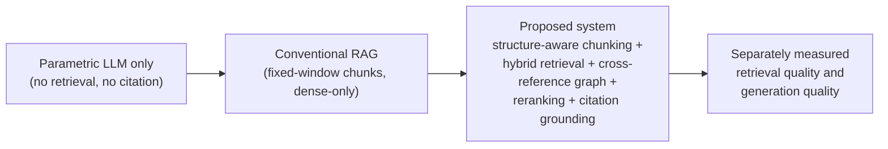
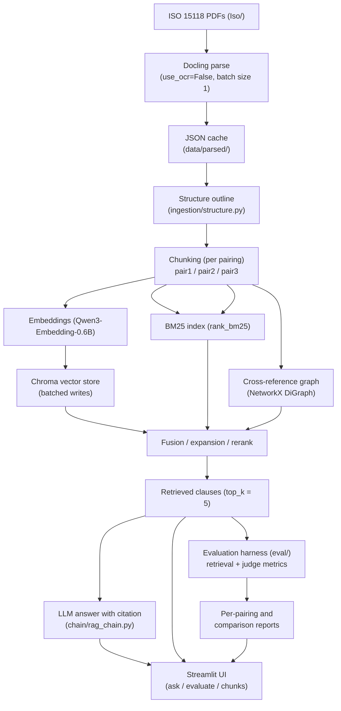
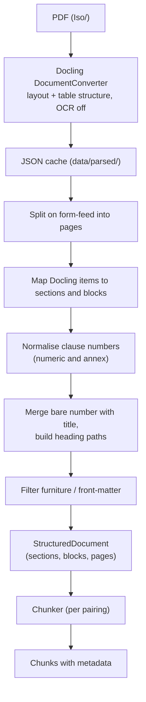
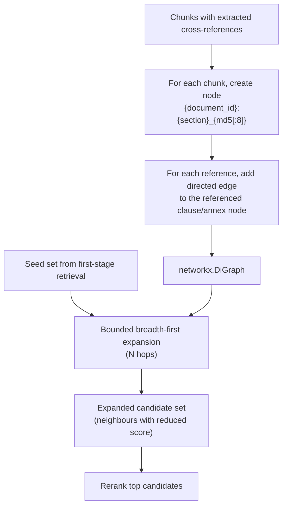
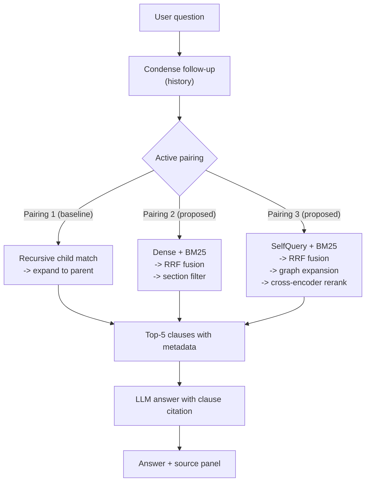
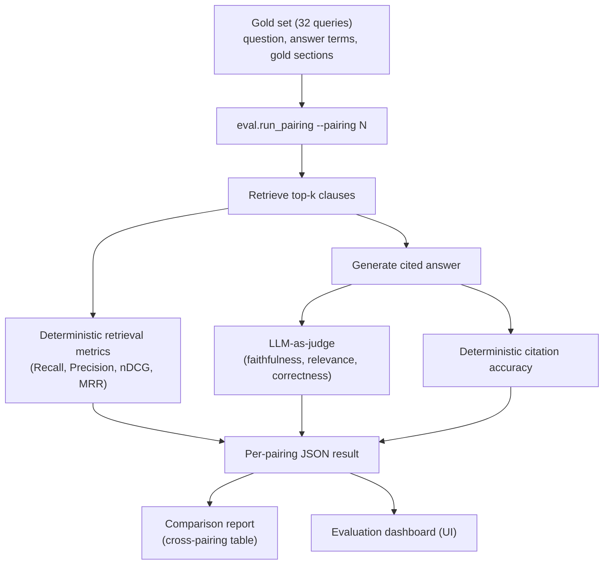

# Structure-Aware Retrieval for ISO Standard Documents: A Comparative Study of Chunking and Retrieval Strategies


---

**A Project Report submitted in partial fulfilment of the requirements for the award of the degree of**

**Master of Technology (M.Tech)**

**[DEPARTMENT NAME]**

**[UNIVERSITY NAME]**

---

**Submitted by:** [STUDENT NAME]

**Project Guide:** [GUIDE NAME]

**Submission Date:** [SUBMISSION DATE]

**M.Tech Phase 1 Report**

---

## Certificate

> **Note:** This page is a template. It must be completed and signed only by the authorized institutional signatories. No signature, seal, or approval has been generated or assumed by the author of this document.

This is to certify that the project report titled **"Structure-Aware Retrieval for ISO Standard Documents: A Comparative Study of Chunking and Retrieval Strategies"** submitted by **[STUDENT NAME]** ([DEPARTMENT NAME], [UNIVERSITY NAME]) is a bonafide record of the project work carried out under my supervision, in partial fulfilment of the requirements for the award of the degree of Master of Technology.

The work embodied in this report is original and has not been submitted elsewhere for the award of any other degree or diploma.

<br>

**[GUIDE NAME]**
Project Guide

Date: [DATE]

<br>

**[HOD NAME]**
Head of Department

Date: [DATE]

<br>

*(Institutional seal and authorized signatures to be affixed here.)*

---

## Abstract

Electric vehicle (EV) charging and vehicle-to-grid (V2G) communication are governed by the ISO 15118 standard family, a set of long, densely cross-referenced engineering documents containing exact message names, field identifiers, normative tables, and clause dependencies. Large language models (LLMs) can answer technical questions fluently, but when applied to such standards they frequently produce unsupported statements because the model's parametric knowledge does not reliably cover exact identifiers and clause-level detail. Retrieval-Augmented Generation (RAG) addresses this by grounding generation in retrieved passages, yet conventional RAG pipelines over engineering standards still suffer two distinct failure modes: retrieval failure (irrelevant or fragmented passages, tables split mid-row, clause relationships lost during chunking) and generation failure (answers not supported by the retrieved evidence).

This project develops a fully local RAG question-answering system over three ISO 15118 part documents (Parts 1, 2, and 3). The methodology is organized as a controlled comparison of three chunking × retrieval "pairings": Pairing 1 (recursive chunking with parent-child retrieval) as the baseline; Pairing 2 (section-aware chunking derived from structured PDF parsing labels, hybrid dense/BM25 retrieval fused with Reciprocal Rank Fusion); and Pairing 3 (table-first chunking with atomic tables, a cross-reference graph built with NetworkX for clause-dependency expansion, metadata-filtered SelfQuery retrieval, and cross-encoder reranking). Documents are parsed with Docling, which supplies the heading, annex, and table labels that drive structure-preserving chunking. Answers are generated by a local LLM served through Ollama (default `llama3.2:3b-instruct-q4_K_M`, with an optional OpenAI provider), and every answer must cite its source clauses.

Evaluation uses a 32-query gold set with deterministic retrieval metrics (Recall@5, Precision@5, nDCG@5, MRR, section recall), an LLM-as-judge for faithfulness, answer relevance, and answer correctness, and a deterministic citation-accuracy metric. Measured first-run results exist: Pairing 3 achieves the best retrieval quality (Recall@5 = 1.0, MRR = 0.9307), while Pairing 2 achieves the best generation quality and latency (citation accuracy 0.96, end-to-end 2660 ms). These are single-run measurements; multi-run variance analysis is identified as future work. The principal contribution is a reproducible, evidence-disciplined pipeline and evaluation harness demonstrating how structure-aware chunking, hybrid retrieval, and cross-reference reasoning improve grounded question answering over engineering standards.

---

## Acknowledgement

> **Note:** This page is a template. Personal and institutional details are supplied as placeholders and must be completed by the student.

I would like to express my sincere gratitude to my project guide, **[GUIDE NAME]**, for the continuous guidance, technical direction, and encouragement provided throughout the Phase 1 stage of this project. The advice on experimental design and evidence discipline materially shaped the methodology described in this report.

I am grateful to **[HOD NAME]**, Head of the Department of **[DEPARTMENT NAME]**, and to the faculty of **[UNIVERSITY NAME]** for providing the academic environment and resources necessary for this work.

I also thank my peers and colleagues for their constructive feedback during the first review, and my family for their support.

**[STUDENT NAME]**

---

## Table of Contents

> This table of contents spans the **entire** report. Later parts of the report must match this skeleton exactly.

**Preliminary Pages**

- Certificate
- Abstract
- Acknowledgement
- Table of Contents
- List of Figures
- List of Tables
- List of Abbreviations and Acronyms

**Chapter 1: Introduction**

- 1.1 Background
- 1.2 Retrieval-Augmented Generation
- 1.3 Technical Challenges in Engineering Standards
- 1.4 Motivation
- 1.5 Problem Statement
- 1.6 Objectives
- 1.7 Scope of the Project
- 1.8 Proposed Solution
- 1.9 Contributions of the Project
- 1.10 Organization of the Report

**Chapter 2: Literature Survey**

- 2.1 Introduction
- 2.2 Retrieval-Augmented Generation
- 2.3 Dense Semantic Retrieval
- 2.4 Sparse Keyword Retrieval and BM25
- 2.5 Hybrid Information Retrieval
- 2.6 Reciprocal Rank Fusion
- 2.7 Document Parsing and Structure-Aware Chunking
- 2.8 Reranking and Late-Interaction Retrieval
- 2.9 Graph-Based Retrieval over Structured Corpora
- 2.10 Evaluation of RAG Systems
- 2.11 Comparative Summary of Existing Approaches
- 2.12 Research Gap
- 2.13 Chapter Summary

**Chapter 3: System Requirements Specification**

- 3.1 System Overview
- 3.2 User Requirements
- 3.3 Functional Requirements
- 3.4 Non-Functional Requirements
- 3.5 Hardware Requirements
- 3.6 Software Requirements
- 3.7 System Constraints
- 3.8 Assumptions and Dependencies
- 3.9 Test Case Specification
- 3.10 Requirements Traceability Matrix

**Chapter 4: Proposed Methodology**

- 4.1 Overall System Architecture
- 4.2 System Workflow
- 4.3 Document Ingestion and Structured PDF Parsing with Docling
- 4.4 Structure Recovery: Headings, Annexes, Tables, and Page Boundaries
- 4.5 Chunking Strategy 1: Recursive Chunking with Parent-Child Retrieval (Baseline)
- 4.6 Chunking Strategy 2: Section-Aware Chunking
- 4.7 Chunking Strategy 3: Table-First Chunking with Table Atomicity
- 4.8 Metadata Enrichment
- 4.9 Dense Vector Indexing with Qwen3-Embedding-0.6B
- 4.10 BM25 Keyword Indexing
- 4.11 Hybrid Retrieval and Reciprocal Rank Fusion
- 4.12 Cross-Reference Graph Construction and Expansion
- 4.13 Metadata-Filtered Retrieval (SelfQuery)
- 4.14 Cross-Encoder Reranking
- 4.15 Answer Generation with Citation Grounding
- 4.16 Baseline and Proposed Pipelines
- 4.17 Evaluation Metrics and Methodology
- 4.18 Algorithms and Pseudocode
- 4.19 Methodology Summary

**Chapter 5: Implementation Details**

- 5.1 Development Environment
- 5.2 Software and Tools
- 5.3 Project Directory Structure
- 5.4 Document Parsing Module
- 5.5 Chunking and Metadata Modules
- 5.6 Indexing Module
- 5.7 Hybrid Retrieval Modules
- 5.8 Cross-Reference Graph Module
- 5.9 Reranking Module
- 5.10 Answer Generation Module
- 5.11 Evaluation Harness
- 5.12 Streamlit User Interface
- 5.13 Integration of Modules
- 5.14 Implementation Status

**Chapter 6: Intermediate Results and Discussion**

- 6.1 Experimental Objectives
- 6.2 Experimental Environment
- 6.3 Dataset and Evaluation Query Design
- 6.4 Golden Question-Answer Dataset
- 6.5 Baseline Configuration (Pairing 1)
- 6.6 Proposed Configurations (Pairings 2 and 3)
- 6.7 Evaluation Metrics
- 6.8 Retrieval Results
- 6.9 Generation Quality and Citation Accuracy Results
- 6.10 Context Size, Index Size, and Latency Analysis
- 6.11 Comparative Discussion
- 6.12 Limitations
- 6.13 Chapter Summary

**Chapter 7: Conclusion and Future Work**

- 7.1 Summary of the Project
- 7.2 Contributions
- 7.3 Limitations
- 7.4 Future Work
- 7.5 Concluding Remarks

**References**

---

## List of Figures

| Figure | Title | Page |
|---|---|---|
| Fig. 1.1 | Positioning of the project within the RAG landscape | [PAGE] |
| Fig. 4.1 | Overall system architecture (ingestion, indexing, retrieval, generation) | [PAGE] |
| Fig. 4.2 | Document ingestion and structure-aware chunking workflow | [PAGE] |
| Fig. 4.3 | Cross-reference graph construction and expansion workflow | [PAGE] |
| Fig. 4.4 | Baseline (Pairing 1) versus proposed (Pairings 2/3) pipeline paths | [PAGE] |
| Fig. 4.5 | Evaluation workflow (gold set, retrieval metrics, LLM-as-judge, citation accuracy) | [PAGE] |
| Fig. 5.1 | Project directory structure | [PAGE] |
| Fig. 6.1 | Retrieval metric comparison across pairings | [PAGE] |
| Fig. 6.2 | Generation quality and latency comparison across pairings | [PAGE] |

---

## List of Tables

| Table | Title | Page |
|---|---|---|
| Table 2.1 | Comparative summary of existing approaches | [PAGE] |
| Table 3.1 | Functional requirements (FR-01 … FR-26) | [PAGE] |
| Table 3.2 | Non-functional requirements (NFR-01 … NFR-08) | [PAGE] |
| Table 3.3 | Hardware and software requirements | [PAGE] |
| Table 3.4 | Test case specification | [PAGE] |
| Table 3.5 | Requirements traceability matrix | [PAGE] |
| Table 4.1 | Metadata fields per chunk type | [PAGE] |
| Table 4.2 | Chunking parameters per pairing | [PAGE] |
| Table 4.3 | Retrieval and generation configuration per pairing | [PAGE] |
| Table 5.1 | Implementation status of system components | [PAGE] |
| Table 6.1 | Summary of measured results across pairings (single run, 32 queries) | [PAGE] |
| Table 6.2 | Retrieval metric comparison | [PAGE] |
| Table 6.3 | Generation quality and citation accuracy comparison | [PAGE] |
| Table 6.4 | Efficiency comparison (index time, retrieval latency, end-to-end latency, index size, tokens per query) | [PAGE] |
| Table 7.1 | Deviations from the originally proposed design and their rationale | [PAGE] |

---

## List of Abbreviations and Acronyms

| Abbreviation | Expansion |
|---|---|
| BM25 | Best Matching 25 (probabilistic sparse keyword ranking function) |
| DPR | Dense Passage Retrieval |
| EV | Electric Vehicle |
| FR | Functional Requirement |
| IR | Information Retrieval |
| ISO | International Organization for Standardization |
| LLM | Large Language Model |
| MRR | Mean Reciprocal Rank |
| NFR | Non-Functional Requirement |
| NLI | Natural Language Inference |
| nDCG | normalized Discounted Cumulative Gain |
| OCR | Optical Character Recognition |
| PDF | Portable Document Format |
| QA | Question Answering |
| RAG | Retrieval-Augmented Generation |
| RRF | Reciprocal Rank Fusion |
| UI | User Interface |
| V2G | Vehicle-to-Grid |

---

## Chapter 1: Introduction

### 1.1 Background

Modern electric vehicles do not charge in isolation. In a vehicle-to-grid (V2G) deployment, the vehicle and the charging station negotiate charging parameters, exchange pricing information, and coordinate energy flow through a standardized communication interface. The ISO 15118 standard family [12] specifies this interface: Part 1 defines general information and use-case terminology, Part 2 defines the protocol and message layers for the vehicle-to-grid communication, and Part 3 defines the physical and data-link layer requirements. Together these documents form the normative reference for implementers of EV charging communication in vehicles, charging stations, and backend systems.

Documents of this kind have a characteristic structure. They are organized as numbered clauses nested in a hierarchy, they contain normative tables whose rows carry binding requirements, they use exact technical identifiers (message names, field names, acronyms, signal names) that must be reproduced without alteration, and they reference other clauses and annexes by number. An engineer consulting the standard typically asks questions of a precise form: which message carries a given field, what a specific acronym expands to, which clause governs a given procedure, or what a table row requires. Answering such questions correctly requires locating the governing clause, not paraphrasing it.

Large language models (LLMs) have demonstrated strong fluency and broad parametric knowledge, but their knowledge is fixed at training time and does not reliably cover the exact identifiers, clause numbers, and table-level detail of a specific, versioned engineering standard. When asked a precise technical question about such a document, an LLM may produce a fluent answer that is partially or wholly unsupported. Retrieval-Augmented Generation (RAG) [1] is the established paradigm for addressing this: instead of relying on parametric knowledge alone, the system first retrieves relevant passages from the source documents and then conditions generation on those passages, so that answers can be checked against, and cited to, the retrieved evidence.

This project applies the RAG paradigm to the ISO 15118 corpus and investigates a specific question: how should the pipeline between the PDF and the LLM be designed so that retrieval is clause-accurate and generation is grounded? The project answers this empirically, by implementing three complete chunking × retrieval pipelines ("pairings") and comparing them on a common gold query set with deterministic metrics.

### 1.2 Retrieval-Augmented Generation

Retrieval-Augmented Generation [1] combines a non-parametric memory (a searchable index over source documents) with a parametric memory (a pre-trained sequence-to-sequence or instruction-following LLM). At query time, the pipeline retrieves the passages most relevant to the question and passes them to the generator as context, together with an instruction to answer only from the provided evidence. The approach has three properties that matter for technical question answering. First, it decouples knowledge from the model: the corpus can be updated, versioned, and audited without retraining. Second, it makes answers inspectable: because the generator is conditioned on retrieved passages, each generated statement can in principle be traced to specific evidence, enabling citation-grounded answers. Third, it confines the model's role to reading and synthesizing evidence rather than recalling it, which reduces — although it does not eliminate — unsupported generation.

The quality of a RAG system is therefore bounded by two stages that can fail independently. **Retrieval failure** occurs when the retriever returns passages that are irrelevant, incomplete, or fragmented — for example, when a normative table is split mid-row during chunking, when a clause is divided so that its governing sentence is separated from its detail, or when the retriever matches surface similarity but misses the clause that actually governs the question. **Generation failure** occurs when the retrieved evidence is adequate but the generator produces statements that the evidence does not support, or omits the clause citations that make the answer verifiable. These failure modes require different remedies: retrieval failure is addressed by chunking strategy, index design, and ranking; generation failure is addressed by prompting, context construction, and evaluation of answer faithfulness. A central design principle of this project is that the two stages must be measured separately, so that a measured improvement can be attributed to the stage that caused it.

Figure 1.1 positions the project within the RAG landscape. A parametric-only language model answers from memory and cannot cite a source; a conventional RAG pipeline adds retrieval but may still fragment tables and lose clause identity; the proposed system adds structure-aware chunking, hybrid retrieval, cross-reference reasoning and citation-grounded generation, and measures retrieval quality and generation quality separately.

**Fig. 1.1: Positioning of the project within the RAG landscape**



### 1.3 Technical Challenges in Engineering Standards

Applying RAG to engineering standards such as ISO 15118 [12] is materially harder than applying it to general prose, for five reasons.

**Long documents and deep clause hierarchies.** Each part of the standard is a long PDF organized as a nested clause hierarchy with annexes. A conventional fixed-size text splitter has no knowledge of this hierarchy: it cuts text at arbitrary token boundaries, producing chunks that begin and end mid-sentence and that carry no clause identity. Downstream, the retriever then returns fragments whose provenance is unclear, and the generator cannot cite a clause it does not know.

**Exact technical identifiers.** Standards communicate requirements through exact names: message identifiers, field names, acronyms, and signal names. Dense semantic retrieval, which matches meaning rather than surface form [2], is well suited to paraphrased questions but can under-rank passages whose decisive content is an exact identifier, because an identifier contributes little to the semantic vector. Lexical sparse retrieval such as BM25 [3] handles exact identifiers well but fails on paraphrase. Neither alone is sufficient, which motivates hybrid retrieval.

**Structured tables.** Normative tables carry binding requirements row by row. A generic text splitter fragments tables across chunk boundaries, so that a retrieved fragment may contain a table row without its header or governing context — an unusable and potentially misleading unit of evidence. Table atomicity must be enforced deliberately during chunking.

**Clause dependencies.** Requirements in the standard frequently depend on other clauses: a clause may state a requirement "as specified in" another clause, or a table may reference definitions given elsewhere. A retriever that returns only the matching clause returns an incomplete unit of evidence; the dependent clauses must be pulled in as well. This motivates an explicit cross-reference structure rather than relying on co-occurrence within a chunk.

**Unsupported generation.** Even with adequate evidence, a small local LLM may produce statements that go beyond the evidence, or omit the clause citations that make an answer verifiable. The system must therefore both prompt for grounded, cited answers and measure citation accuracy deterministically, so that grounding is an evaluated property rather than an assumed one.

### 1.4 Motivation

The motivation for this project arises from three observations.

First, engineers, students, and implementers consulting ISO 15118 [12] need precise, clause-citable answers, and the current workflow — manual search across three long PDFs — is slow and error-prone. A grounded question-answering system that returns the governing clause with every answer directly addresses this need.

Second, the RAG literature provides strong general-purpose components — dense retrieval [2], sparse retrieval [3], rank fusion [4], structured document parsing [10] — but their combination for engineering standards is not well characterized. In particular, the interaction between chunking strategy and retrieval quality on clause-hierarchical, table-heavy corpora is an empirical question: the best chunking strategy for general prose may fragment tables and lose clause identity, while a structure-aware strategy may produce chunks that are better provenanced but differently ranked. The project treats this interaction as its core experimental subject by implementing and comparing three complete pipelines on a common evaluation harness.

Third, all processing can and should run locally. The corpus is licensed material, and the system is intended for use where the documents and the queries may be sensitive. A local-first design — local embeddings, a local vector store, a local LLM served through Ollama — keeps the entire pipeline within the user's machine, with an optional hosted LLM provider available only by explicit configuration.

### 1.5 Problem Statement

The problem addressed by this project is stated as follows:

> Given the three ISO 15118 part documents (Parts 1, 2, and 3) as PDF files, design, implement, and evaluate a fully local retrieval-augmented question-answering system that (a) parses the documents into structure-preserving units that retain clause identity and table atomicity, (b) retrieves the passages that govern a user's technical question, including passages reached through clause cross-references, (c) generates answers that are grounded in the retrieved evidence and cite their source clauses, and (d) measures retrieval quality and generation quality separately with a reproducible evaluation harness, so that the effect of each pipeline design decision is empirically attributable.

The central research question is: **which combination of chunking strategy and retrieval mechanism yields the best clause-accurate retrieval and the best grounded generation over the ISO 15118 corpus?** The project answers this by implementing three complete chunking × retrieval pairings and comparing them on a common 32-query gold set.

### 1.6 Objectives

The objectives of the project are measurable and map directly to the implemented system:

1. **O1 — Clause-accurate retrieval.** Implement and measure retrieval that returns the governing clause for technical questions, evaluated with Recall@5, Precision@5, nDCG@5, MRR, and section recall on a fixed gold query set.
2. **O2 — Structure-preserving chunking.** Derive chunk boundaries from structured PDF parsing labels (headings, annexes, tables) rather than fixed token windows, and enforce table atomicity so that no normative table is fragmented across chunks.
3. **O3 — Hybrid retrieval.** Implement dense semantic retrieval combined with BM25 sparse retrieval, fused with Reciprocal Rank Fusion, and measure its contribution relative to dense-only baseline retrieval.
4. **O4 — Cross-reference reasoning.** Build an explicit cross-reference graph over clause references extracted from the corpus, and implement retrieval expansion that pulls in clauses reached through the graph, so that dependent clauses accompany the matching clause.
5. **O5 — Citation-grounded generation.** Generate answers with a local LLM that are conditioned on retrieved evidence and cite their source clauses, and measure citation accuracy deterministically.
6. **O6 — Reproducible evaluation.** Provide a single-command evaluation harness that scores all pairings on the same gold set with the same judge configuration, records uncomputable metrics as flagged rather than omitted, and reports measured results with their run count.

### 1.7 Scope of the Project

The system does the following. It ingests three fixed PDF documents (ISO 15118 Parts 1, 2, and 3) [12] using structured PDF parsing [10]; it implements three complete chunking × retrieval pairings; it serves question answering through a local Streamlit interface with source-passage inspection; and it evaluates all pairings on a common gold query set with deterministic retrieval metrics, an LLM-as-judge for answer quality, and a deterministic citation-accuracy metric. All default processing is local: local embeddings, a local vector store, and a local LLM served through Ollama, with an optional OpenAI provider selectable by configuration.

The system does not attempt the following. It does not process arbitrary PDFs: the corpus is the three fixed part documents, and the parsing and chunking strategies are designed for their structure. It does not perform OCR by default: the source PDFs are digitally native, and scanned-document handling is out of scope. It does not support multi-language querying or multi-language corpora. It does not retrain or fine-tune any model. It does not implement Natural Language Inference (NLI)-based grounding evaluation or adaptive-k context selection; both are identified as future work. It does not claim to eliminate hallucination: grounding is enforced by retrieval, prompting, and measured citation accuracy, and unsupported generation remains possible and is measured rather than assumed away.

### 1.8 Proposed Solution

The proposed solution is a controlled three-pairing comparison over a shared ingestion and evaluation substrate.

**Shared ingestion.** All pairings consume the same parsed representation: each PDF is parsed with Docling [10], which supplies the structured labels (headings, annexes, tables, page boundaries) from which chunking strategies derive their boundaries. This ensures that measured differences between pairings are attributable to chunking and retrieval, not to parsing.

**Pairing 1 — Baseline: recursive chunking with parent-child retrieval.** Text is split with a recursive character splitter into small chunks for matching, with larger parent chunks retrieved for context. This represents the conventional RAG design and serves as the baseline against which the structure-aware pairings are measured.

**Pairing 2 — Section-aware chunking with hybrid retrieval.** Chunks are aligned to the parsed clause/section structure, so each chunk carries its section identity. Retrieval combines dense semantic search with BM25 sparse search [3], fused with Reciprocal Rank Fusion [4], so that paraphrased questions and exact-identifier questions are both served.

**Pairing 3 — Table-first chunking with cross-reference reasoning.** Tables are kept atomic and chunked with their governing context. Retrieval adds three mechanisms: a cross-reference graph (built with NetworkX) over clause references, whose expansion pulls in clauses reached through the graph; metadata-filtered retrieval (SelfQuery) that constrains search by chunk metadata; and cross-encoder reranking of the fused candidate set, so the final ranking is decided by a model that reads query and passage together.

**Generation and evaluation.** Answers are generated by a local LLM served through Ollama (default `llama3.2:3b-instruct-q4_K_M`), prompted to answer only from the retrieved evidence and to cite source clauses. Evaluation uses a 32-query gold set with deterministic retrieval metrics, an LLM-as-judge for faithfulness, answer relevance, and answer correctness, and a deterministic citation-accuracy metric. Measured first-run results exist and are presented in Chapter 6: Pairing 3 achieves the best retrieval quality, Pairing 2 the best generation quality and latency.

### 1.9 Contributions of the Project

The project makes the following contributions:

1. **Structure-aware chunking derived from parser labels.** A chunking approach in which section boundaries, annex handling, and table atomicity are derived from Docling's structured labels [10] rather than fixed token windows, with a documented strategy for oversized sections and atomic tables.
2. **A three-pairing empirical comparison.** Three complete chunking × retrieval pipelines — recursive/parent-child (baseline), section-aware/hybrid, and table-first/graph/reranked — implemented over a shared ingestion substrate and compared on a common gold set, providing measured evidence on the chunking–retrieval interaction for standards text.
3. **Cross-reference graph retrieval expansion.** A deterministic cross-reference graph over clause references, built with NetworkX, with a retrieval-expansion mechanism that pulls in clauses reached through the graph — an explicit, auditable alternative to relying on chunk co-occurrence for clause dependencies.
4. **A deterministic citation-accuracy metric.** An evaluation metric that checks, without a judge model, whether the clause citations in a generated answer correspond to the clauses of the retrieved evidence — complementing LLM-as-judge faithfulness with a fully reproducible check.
5. **A reproducible evaluation harness.** A single-command harness that scores all pairings on the same gold set with the same judge configuration, records uncomputable metrics as flagged rather than omitted, and reports measured results with their run count.

### 1.10 Organization of the Report

The remainder of this report is organized as follows.

**Chapter 2 (Literature Survey)** reviews the RAG paradigm, dense and sparse retrieval, hybrid retrieval and Reciprocal Rank Fusion, document parsing and structure-aware chunking, reranking, graph-based retrieval, and RAG evaluation, and identifies the research gap addressed by the combination of structure-aware parsing, hybrid retrieval, cross-reference reasoning, and reproducible evaluation on standards text.

**Chapter 3 (System Requirements Specification)** documents the user, functional, and non-functional requirements (FR-01 … FR-26, NFR-01 … NFR-08), the hardware and software requirements, the system constraints and assumptions, the test case specification, and the requirements traceability matrix.

**Chapter 4 (Proposed Methodology)** presents the overall architecture and workflow, the Docling-based ingestion and structure recovery, the three chunking strategies with table atomicity, metadata enrichment, dense indexing with Qwen3-Embedding-0.6B, BM25 indexing, hybrid retrieval with RRF, cross-reference graph construction and expansion, metadata-filtered retrieval, cross-encoder reranking, citation-grounded generation, the baseline versus proposed pipeline configurations, the evaluation metrics and methodology, and the algorithms and pseudocode.

**Chapter 5 (Implementation Details)** describes the development environment, the real project directory structure, the responsibilities of each implemented module (parsing, chunking, indexing, retrieval, graph, reranking, generation, evaluation, UI), their integration, and the implementation status of every component with file-level evidence.

**Chapter 6 (Intermediate Results and Discussion)** presents the measured results: the experimental environment, the gold query set, the baseline and proposed configurations, the retrieval metrics, the generation quality and citation accuracy results, the efficiency analysis (index time, latency, index size, tokens per query), the comparative discussion of why Pairing 3 wins retrieval and Pairing 2 wins generation quality and latency, and the limitations of the single-run measurement.

**Chapter 7 (Conclusion and Future Work)** summarizes the project, restates the contributions and limitations, and identifies future work: multi-run variance analysis, NLI-based grounding evaluation, adaptive-k context selection, corpus expansion, and incremental indexing.

The References section lists the sources cited throughout the report in IEEE numeric style.
## Chapter 2: Literature Survey

### 2.1 Introduction

This chapter reviews the prior work that motivates the design of the retrieval-augmented generation (RAG) system developed in this project. It is not a general survey of information retrieval; it is restricted to the works that bear directly on the decisions the project has to make — how a layout-heavy, clause-numbered, table-rich technical standard is parsed and chunked, how candidate clauses are retrieved, how the candidate list is reordered, and how the answering quality of the resulting system is measured.

The twelve numbered references used throughout this report are grouped into seven themes. The first theme, RAG foundations [1], defines the retrieve-then-generate pattern the whole project implements. The second theme, retrieval models and sparse/dense fusion [2], [3], [4], [11], supplies the dense retriever, the lexical retriever, the sentence-embedding foundation and the fusion rule used in hybrid search. The third theme, document structure and chunking for domain corpora [10], provides the layout-aware parsing on which all structure-aware chunking depends. The fourth theme, knowledge-graph retrieval [9], motivates treating cross-references between clauses as graph edges. The fifth theme, reranking [5], [6], [7], justifies a second, finer-grained ranking pass over the retrieved candidates. The sixth theme, evaluation of RAG systems [8], motivates an LLM-judge component alongside deterministic metrics. The seventh theme, the ISO 15118 standard itself [12], defines the target corpus, its clause hierarchy, annexes and normative tables.

Each reference is treated under its theme and discussed in a consistent form: its research focus, its methodology, its key findings, and its limitations and relevance to this project. Findings are reported qualitatively. No experimental numbers from the surveyed papers are reproduced, because the survey is concerned with design rationale rather than with re-reporting of results. The only quantities that appear in this chapter are this project's own design parameters, taken from [`config.py`](config.py:1).

### 2.2 Retrieval-Augmented Generation

The foundational work on retrieval-augmented generation is that of Lewis et al. [1], who ask whether a sequence-to-sequence model can be made to use a retrieved, non-parametric corpus at generation time instead of relying only on the parameters learned during training. Their methodology augments a parametric encoder–decoder with a differentiable non-parametric retriever over a document index. The retriever produces a latent representation of the selected documents, and this representation is fed to the decoder alongside the token-level history, so that the two components can be trained jointly end-to-end. The authors report substantial gains over parametric-only baselines on knowledge-intensive tasks, and they show that the retrieved document representation carries most of the factual burden of the answer. Retrieval quality is identified as a major driver of the final answer quality.

The relevance of this work to the present project is foundational: it establishes the retrieve-then-generate architecture that the entire pipeline implements, and it establishes the principle that answer quality is bounded by retrieval quality. Its limitations, however, are equally important. The original setup assumes a large web-scale corpus and a large, heavily trained generator. It does not address document structure, chunking boundaries, tables, or clause-level provenance, and it gives no mechanism for citing the source of a statement. This project keeps the retrieve-then-generate idea but replaces the learned joint retriever with an explicit, inspectable hybrid pipeline, and it adds a citation requirement that the original formulation does not have. The distinction between retrieval failure and generation failure, introduced in Chapter 1, follows directly from the observation in [1] that the two stages can fail independently.

### 2.3 Dense Semantic Retrieval

Dense passage retrieval was established as a viable replacement for conventional sparse retrieval in open-domain question answering by Karpukhin et al. [2]. Their methodology encodes the question and the passage independently into a single dense vector space using BERT encoders, with passages pre-encoded so that retrieval reduces to a nearest-neighbour vector search. The training objective uses question–passage pairs with in-batch negatives, optionally augmented by span-relevance supervision derived from Wikipedia hyperlinks. The authors report that dense retrieval substantially outperforms lexical baselines on open-domain QA when enough training data is available, and that the learned vector space captures semantic similarity that exact term matching misses.

The limitation of [2] for this project is that its training data is Wikipedia-scale and out-of-domain for technical standards, and its passage segments are fixed, structure-agnostic spans. The paper does not study hybrid fusion, reranking, or citation of the retrieved span. In this project the dense component is used with a modern instruction-aware sentence embedder rather than a task-fine-tuned QA encoder, and it is fused with a lexical retriever rather than used alone. The sentence-embedding foundation that makes pre-computed dense retrieval practical is provided by Reimers and Gurevych [11], whose Sentence-BERT replaces the original cross-encoder setup — which feeds a sentence pair through the full transformer for each comparison — with a siamese architecture with shared weights plus a pooling and projection layer, so that sentences are embedded independently and compared by cosine similarity or dot product. Pre-computed embeddings make large-scale semantic search practical, and the resulting embeddings transfer well to semantic textual similarity and clustering tasks; this is what makes a local, offline vector index over a small corpus realistic. The limitation of [11] is that it targets sentence- or passage-length English text and does not address long structured documents: a single embedding over an entire clause containing a normative table blurs the table's row and column structure, which is one motivation for treating tables as separate chunks and flattening tables before encoding in this project.

A further refinement of dense retrieval for unlabelled domains is provided by Gao et al. [6], who tackle the situation in which a new retrieval domain has no relevance judgements, so a dense retriever cannot be fine-tuned for it and must work zero-shot. Their methodology instruction-tunes a pre-trained embedding model using synthetic query–passage pairs generated by a large language model from unstructured passages, together with a consistency-filtering step that removes noisy synthetic supervision. The objective distils the language model's notion of relevance into the bi-encoder, producing an embedder that follows retrieval instructions such as one for a query and an empty instruction for a document. The authors report that the resulting instruction-following embedder improves zero-shot and few-shot dense retrieval over its base model, and that it also transfers to reranking. The practical takeaway is that a domain-specific corpus with no labels can still be served well by a general, instruction-aware embedder. The gains of [6] concern retrieval quality, not structure handling, and the instruction mechanism has no notion of a clause number or a table. In this project the embedder is used for the dense half of hybrid search, with the query-side instruction applied to questions and the document side left instruction-free; the stored chunk text is left untouched, with only the encoder input normalised.

### 2.4 Sparse Keyword Retrieval and BM25

The lexical half of the retrieval problem is addressed by Robertson and Zaragoza [3], who give a unified probabilistic account of lexical ranking functions, explaining why term-frequency saturation and inverse document frequency weighting work and how they generalise. Their methodology models relevance as a probability derived from a document–term generation process; classical TF-IDF is then re-derived as a special case, and BM25 emerges with document-length normalisation and term-frequency saturation built into the model. The framework is also used to motivate later variants that add semantic or latent term structure. The authors present lexical ranking as a principled, robust and cheap component rather than a heuristic to be discarded, and they show that saturation and length normalisation matter in practice.

The limitation of [3] for this project is that the framework assumes pre-segmented documents and treats each segment independently; it is blind to document hierarchy and to the fact that a "document" here is a numbered clause with a caption. It also has no notion of semantic similarity, so it alone cannot answer a paraphrased question. It therefore serves as the lexical half of this project's hybrid retriever, where exact clause numbers, signal names and parameter symbols are decisive. This is precisely the failure mode identified in Chapter 1: dense retrieval can under-rank passages whose decisive content is an exact identifier, because an identifier contributes little to the semantic vector, while BM25 handles exact identifiers well but fails on paraphrase.

### 2.5 Hybrid Information Retrieval

Neither dense nor sparse retrieval is sufficient alone, and the combination of the two is the subject of hybrid information retrieval. The design principle that emerges from [2] and [3] is complementary: dense retrieval matches meaning, sparse retrieval matches surface form, and a query that mixes paraphrase with exact identifiers benefits from both. The project adopts this principle directly. The dense component, built on the instruction-aware embedder of [6] and the sentence-embedding foundation of [11], is combined with the BM25 lexical component of [3] so that paraphrased questions and exact-identifier questions are both served. The combination is not a weighted sum of scores — which would require calibrating two incomparable score scales — but a rank-based fusion, described next.

### 2.6 Reciprocal Rank Fusion

The rule used to combine the dense and sparse rankings is reciprocal rank fusion, introduced by Cormack, Clarke and Buettcher [4]. The paper asks how several ranked result lists can be combined into one ranking when the individual scores are not comparable or calibratable. Their methodology assigns each document a fused score equal to the sum over rankers of a reciprocal function of its rank in that ranker's list, with a damping constant controlling the influence of low ranks. Because the combination operates purely on positions, it needs no score normalisation, no parameter estimation from data, and no training. The authors report reciprocal rank fusion outperforming both Condorcet fusion and trained rank-learning methods across a range of document collections, and they emphasise its practical virtue: it is a strong, parameter-light default when heterogeneous rankers are combined.

The limitation of [4] is that its evaluation is over web document collections and considers ranking fusion in general, not the composition of a final context window for a generator. It says nothing about how much of the fused list a language model can use, and it offers no way to record *why* a chunk was retrieved. This project uses reciprocal rank fusion as the hybrid combination rule for dense and sparse retrievers, and follows the spirit of the paper in preferring a robust default over a tuned combiner. The weighting of the vector and BM25 components (0.6 / 0.4 in [`config.py`](config.py:68)) controls how many candidates each side contributes, and the fused list is truncated to a fixed `TOP_K = 5` for generation.

### 2.7 Document Parsing and Structure-Aware Chunking

The parsing layer on which all structure-aware chunking depends is provided by Docling, described in the technical report of Nigheti et al. [10]. The report describes a document conversion pipeline designed to produce machine-readable, layout-aware output from PDFs while preserving reading order and document hierarchy. Its methodology uses a layout analysis model to detect page elements and assign labels to them, and a structure model to order those elements and predict their hierarchical relationships. Tables are recognised as structured objects with rows, cells and headers rather than as flat text, and the pipeline offers several output formats so that downstream consumers can choose the level of structure they need. The authors report that layout-aware conversion is markedly more reliable than naive text extraction on complex, columned, table-bearing documents, and they present the preservation of reading order and table structure as essential for any downstream task that requires document-level meaning.

The limitation of [10] is that it is a system description rather than an evaluation of retrieval or of chunking, and it does not propose chunking strategies for standards. Its output is a general structured document, whereas ISO 15118 has an additional, externally defined hierarchy of numbered clauses and non-numeric annexes. This project therefore derives a clause outline from the structured output in [`ingestion/structure.py`](ingestion/structure.py:1) rather than from the exported Markdown. This is the central adaptation of the parsing theme: the parser supplies the layout labels, and the project's own structure-recovery pass turns those labels into a clause-level outline with headings, annexes, tables and per-block page provenance. The design decision to keep tables atomic — packing whole units with [`pack_units()`](ingestion/chunk_utils.py:1) and splitting only oversized tables on row boundaries with the header repeated via [`split_table_markdown()`](ingestion/chunk_utils.py:20) — follows directly from the observation in [10] that tables are first-class structured objects whose integrity must be preserved.

### 2.8 Reranking and Late-Interaction Retrieval

A second, finer-grained ranking pass over the retrieved candidates is justified by three works. The first is ColBERT, by Khattab et al. [5], which addresses the accuracy–efficiency trade-off between a full cross-encoder, which must score every query–document pair jointly, and a bi-encoder, which cannot represent fine-grained token-level matches. Their methodology encodes both query and document with BERT but keeps the document embedding at token granularity and pre-computed; retrieval is then a late-interaction step in which each query token is matched against all document tokens and the per-token similarities are aggregated, typically with a maximum over query tokens. The authors report that ColBERT attains retrieval quality comparable to or better than a full cross-encoder while being much faster at query time, and that the token-level matching is the reason for the gain. The broader lesson is that the representation used for final ranking need not be the same as the one used for candidate generation. The limitation of [5] for this project is that ColBERT's index is considerably larger than a vector index, which conflicts with the local-first, small-corpus constraint, and it still yields a bag-of-token interaction rather than a genuine pairwise joint encoding. This project therefore uses the cheaper, established alternative: a small cross-encoder applied as a second pass over only the top candidates.

The second work is the zero-shot dense retrieval method of Gao et al. [6], already discussed in §2.3, whose instruction-following embedder also transfers to reranking. The third is the BAAI `bge-reranker-v2-m3` cross-encoder of Chen et al. [7], which provides a ready-to-use cross-encoder for multilingual passage reranking, usable without task-specific training by the downstream project. The model is a cross-encoder that takes a query–passage pair and outputs a relevance score; the pair is encoded jointly, so query and passage tokens attend to one another. It is trained over a mixture of ranking data covering multiple languages and long inputs, and is distributed with the settings needed to normalise and truncate long passages. The model card reports strong ranking quality on standard retrieval benchmarks while remaining usable locally as a comparatively small downloadable checkpoint, and its long input tolerance is what makes it applicable to clause-sized and table-sized chunks. The limitation of [7] is that it is a reranker, not a retriever: it must be run over a candidate list and its cost grows with the list length, so it cannot replace the first-stage retrieval. Being an off-the-shelf model, it was not trained on normative technical text, and its ordering on standards clauses is an open question that this project treats as an experimental variable rather than an assumption. In this project the cross-encoder reranks the top `RERANK_TOP_N = 20` candidates and returns the top `TOP_K = 5`, and the reranking step is guarded so that a resource failure degrades to the unranked list rather than failing the query.

### 2.9 Graph-Based Retrieval over Structured Corpora

The idea of treating relationships between text units as an explicit graph is developed by Edge et al. [9], who study the class of questions that ask about a whole corpus rather than about a single document, which conventional chunk-and-retrieve pipelines answer poorly. Their methodology prompts a language model to extract entities and the relations between them from each text unit; these are emitted as triples and assembled into a graph that is stored in a graph store. A local search retrieves entities and their immediate neighbourhoods for specific questions, while a community-detection step summarises clusters of related entities to answer global questions. The authors report that graph-based retrieval produces more comprehensive answers for global, thematic questions than plain vector retrieval over the same corpus, and that the intermediate representation — an explicit entity-relation graph — is more useful than raw chunks for questions that require relating distant parts of a collection.

The limitation of [9] for this project is that the extracted graph is entity-centred and built by a language model at ingestion time, which is expensive and depends on a generative model being available for the whole corpus. The paper targets community-level summarisation, not clause-level answers with verifiable citations, and it does not use the cross-references that a standard already states explicitly. This project instead builds a deterministic, citation-derived graph whose edges are the standard's own "see 4.2" and "Annex A" references, which is cheaper and auditable. The graph is constructed in [`graph/builder.py`](graph/builder.py:1) as a `networkx.DiGraph` whose node identifiers are qualified by document part so that identically numbered clauses in different parts do not collide, and a bounded breadth-first expansion pulls in clauses that a matched clause explicitly depends on. This is the mechanism by which the project addresses the clause-dependency challenge identified in Chapter 1.

### 2.10 Evaluation of RAG Systems

The evaluation of RAG systems is addressed by Es et al. [8], who tackle the absence of standard, reference-free ways to measure whether a RAG system's answer is actually supported by the retrieved text. Their methodology defines a set of metrics over a RAG pipeline's own inputs and outputs — the generated answer, the retrieved contexts and the original question — each scored by a language model prompted with a fixed rubric. Faithfulness is judged by asking whether each claim in the answer is entailed by the supplied contexts, and answer relevance by asking whether the answer addresses the question. The authors report that these reference-free LLM-judged metrics correlate with human judgement on faithfulness and relevance, and that they make RAG systems with different architectures comparable without building a ground-truth answer set.

The limitation of [8] is that the metrics are non-deterministic, depend on judge model and prompt, and the paper does not address retrieval quality itself or clause-level provenance. Small local judges are known to be unreliable for such rubrics, so this project implements a custom, more constrained judge in [`eval/judge.py`](eval/judge.py:1) and records uncomputable scores as flagged `None` rather than dropping them, while keeping the deterministic retrieval metrics of [`eval/metrics.py`](eval/metrics.py:1) as the primary, reproducible signal. The project additionally computes citation accuracy deterministically, without a judge, by checking that the clause numbers cited in an answer were among the clauses actually retrieved — a property that [8] does not measure and that a standards user most needs.

### 2.11 Comparative Summary of Existing Approaches

Table 2.1 summarises the surveyed works against the five dimensions that matter for this project: the approach or publication, its main technique, its principal contribution, the limitation most relevant to this project, and its relevance to the proposed system.

**Table 2.1: Comparative summary of existing approaches**

| Approach / publication | Main technique | Contribution | Limitation relevant to this project | Relevance to the proposed system |
|---|---|---|---|---|
| Lewis et al. [1] | Jointly trained parametric generator + differentiable non-parametric retriever | Establishes retrieve-then-generate as a general architecture | No structure, table, chunking or citation handling; web-scale assumption | Grounds the whole pipeline; motivates separating retrieval failure from generation failure |
| Karpukhin et al. [2] | BERT bi-encoder passages into a single vector space, nearest-neighbour search | Semantic passage retrieval that beats lexical baselines on open-domain QA | Structure-agnostic fixed segments; large labelled training domain; no fusion or citation | Dense half of hybrid retrieval, used with an instruction-aware embedder |
| Robertson and Zaragoza [3] | Probabilistic relevance model yielding BM25 with saturation and length normalisation | Principled, cheap lexical ranking | Treats segments independently; blind to hierarchy, annexes and tables | Lexical half of hybrid retrieval; decisive for clause numbers and signal names |
| Cormack et al. [4] | Sum of reciprocal rank functions over rankers' lists | Robust, training-free fusion of incomparable ranked lists | Evaluated on web collections; silent about how much fused context a generator can use | The hybrid combination rule for dense and sparse retrievers |
| Khattab et al. [5] | Token-level query–document matching over pre-computed BERT embeddings | Rich matching near cross-encoder quality at lower query cost | Large index, conflicts with local-first budget; still not a true cross-encoder | Considered alternative to cross-encoder reranking; the reason it was not adopted |
| Gao et al. [6] | LLM distillation and synthetic pairs to instruction-tune a bi-encoder | Usable dense retrieval for unlabelled domains | Improves retrieval only; no notion of clause, table or provenance | Instruction-aware embedder for the unlabelled ISO corpus; query-side prompt only |
| Chen et al. [7] | Multilingual cross-encoder scoring query–passage pairs jointly | Strong off-the-shelf second-stage ranker with long-input support | Reranker only, cost grows with candidate count; untrained on normative text | Cross-encoder reranking in Pairing 3 |
| Es et al. [8] | Reference-free LLM-judged faithfulness and relevance metrics | Makes RAG architectures comparable without gold answers | Non-deterministic; judge-dependent; no retrieval-quality or provenance metric | Motivates the custom judge and the deterministic citation-accuracy metric |
| Edge et al. [9] | LLM-extracted entity–relation graph, local and community-level search | Better global answers than plain vector retrieval | Expensive at ingestion; entity-centred; targets summarisation, not cited clause answers | Motivates the deterministic cross-reference graph and its expansion |
| Nigheti et al. [10] | Layout labelling plus structure model, tables as first-class objects | Layout-aware conversion preserves reading order and table structure | Not a chunking or retrieval study; no standards-specific hierarchy | Docling as the parser whose structured labels drive section and table handling |
| Reimers and Gurevych [11] | Siamese shared-weight BERT with pooling, compared by cosine similarity | Makes pre-computed semantic search practical | Sentence-scale English text; a whole clause with a table blurs into one vector | Sentence-embedding foundation for pre-computing and storing chunk vectors |
| ISO 15118 [12] | Numbered clauses, non-numeric annexes, normative tables, explicit cross-references | Supplies the answerable content and the link structure | Small, fixed, non-public-domain; no labelled queries; no published RAG results | The corpus documents themselves: clause hierarchy, annexes, tables and cross-references |

### 2.12 Research Gap

The surveyed literature establishes each individual component this project needs: a retrieve-then-generate architecture [1], a dense retriever [2], [11], a principled lexical retriever [3], a robust fusion rule [4], a second-stage reranking strategy [5]–[7], a layout-aware parser [10], a graph-based retrieval idea [9], and an approach to reference-free RAG evaluation [8]. What it does not establish is how these components behave when combined on a small, fixed, table-heavy technical standard such as ISO 15118 [12]. The evidence base is dominated by web, news and open-domain QA text, where passages are short and self-contained and where document hierarchy is largely absent. Seven specific gaps follow from that mismatch.

First, generic text splitters degrade on standards. Chunking methods that assume prose with regular numeric headings are not adequately characterised on documents with annexes, non-numeric and lettered headings, and large normative tables. Fragmenting such a table mid-row produces a chunk that is meaningless alone, and merging an annex into its parent section destroys the boundary a reader would use.

Second, parent/child and reranking evidence comes from the wrong text distribution. Studies of parent–child retrieval and cross-encoder reranking overwhelmingly use web pages, news and open-domain QA passages, which are short and largely self-contained. How these techniques behave on long normative clauses, where a single requirement is entangled with definitions and cross-references, has not been adequately addressed.

Third, cross-reference and multi-hop reasoning in standards is rarely modelled as a graph. Standards state their own link structure in plain text. Retrieval systems that treat such references as ordinary tokens lose the multi-hop path a human reader would follow, and there is little published treatment of standards cross-references as an explicit, traversable graph.

Fourth, structure-aware chunking is evaluated on answer accuracy alone. Whether a chunking strategy produces coherent boundaries or dense, relevant units is usually inferred indirectly from downstream answer quality. Chunk-level quality measures such as boundary coherence, table integrity and relevance density are not adequately reported.

Fifth, structure, hybridity, graph expansion and reranking are rarely combined and ablated together. The techniques above are usually studied in isolation on different corpora. Measuring their marginal contribution on one fixed corpus with one shared harness has not been adequately addressed, which makes the engineering trade-off between them hard to judge.

Sixth, reproducible, open, local-first evaluation on a small fixed corpus is uncommon. Much of the reported work depends on hosted models, proprietary corpora or large benchmark collections. A harness in which the corpus, the index, the embedder, the reranker and the judge are all local and the seed questions are fixed has not been adequately addressed for domain corpora of this size.

Seventh, citation-level verifiability is rarely measured. Answer faithfulness is usually judged as text entailment. Whether the specific clause the answer attributes its claim to is among the clauses actually retrieved — the property a standards user most needs — is rarely measured at all.

The research gap addressed by this project is therefore the combination of structure-aware parsing, hybrid retrieval, cross-reference graph expansion, cross-encoder reranking, and reproducible, citation-level evaluation, applied together on a small, fixed, table-heavy engineering standard. The project responds by fixing one corpus, one ingestion path and one evaluation harness, and by varying only the chunking and retrieval design across three pairings, so that the contribution of each idea is measured on the target domain rather than inherited from general-domain results.

### 2.13 Chapter Summary

This chapter reviewed the prior work that motivates the design of the system. It established the retrieve-then-generate architecture [1] and the principle that answer quality is bounded by retrieval quality; the dense retrieval model [2] and its sentence-embedding foundation [11]; the instruction-aware embedder for unlabelled domains [6]; the probabilistic lexical ranking framework that yields BM25 [3]; the rank-based fusion rule [4]; the layout-aware parser [10] whose structured labels drive chunking; the late-interaction and cross-encoder reranking approaches [5], [7]; the graph-based retrieval idea [9]; and the reference-free evaluation practice [8]. It then identified seven research gaps that follow from the mismatch between the general-domain evidence base and the target corpus [12], and stated the combination of techniques that this project contributes. The next chapter translates these design motivations into a concrete, testable set of system requirements.
## Chapter 3: System Requirements Specification

### 3.1 System Overview

The system is a fully local retrieval-augmented question-answering system over the three ISO 15118 part documents (Parts 1, 2 and 3) [12]. It is organised as an ingestion stage that turns PDFs into stored chunks, a retrieval stage that turns a question into a ranked set of clauses, and a generation stage that turns those clauses into a cited answer. The ingestion stage converts each PDF with Docling [10] in layout-aware mode with OCR disabled, caches the conversion as JSON, removes running headers and footers, and keeps each PDF as a single document whose page boundaries are derived from a form-feed placeholder. A structure-recovery pass converts Docling's `section_header` and `TableItem` labels into an outline of sections and blocks with normalised clause numbers, heading paths and page numbers. The chosen chunking strategy then turns that outline into LangChain documents carrying metadata such as `document_id`, `section_number`, `section_title` and `page_start`.

Retrieval differs per pairing but always returns ranked documents with metadata intact. Pairing 1 retrieves small child chunks and expands each hit to its larger parent. Pairing 2 combines dense Chroma search with BM25 through reciprocal rank fusion and can be restricted to a clause by a metadata filter. Pairing 3 adds a NetworkX cross-reference graph over extracted references such as "see 4.2" or "refer to Annex A", expands candidates breadth-first, ensembles the retrievers, and reranks the top candidates with a cross-encoder, degrading gracefully to the unranked list if the reranker runs out of memory. Generation is a LangChain LCEL chain that condenses a follow-up question against the conversation history, restricts the system prompt to the retrieved context, requires document and clause citations, and provides an explicit refusal phrase when the context is insufficient.

Evaluation and presentation close the loop. The evaluation harness replays a gold question set against a selected pairing, computes deterministic retrieval metrics and LLM-as-judge quality metrics, and writes a JSON result that the reporting layer turns into a per-pairing report and a comparison table. The Streamlit user interface exposes three views: an ask/chat view with a citation panel, an evaluation and comparison view, and a chunk browser for inspecting what was actually indexed.

The requirements in this chapter are stated so that each is either measurable or explicitly qualitative. Where a numerical threshold is given, it is labelled as a proposed acceptance criterion or a target to be verified, not as a measured result. The measured results themselves are presented in Chapter 6.

### 3.2 User Requirements

The system is intended for three classes of user, whose needs are stated below.

**UR-01 — The standards implementer.** An engineer implementing ISO 15118 needs to locate the clause that governs a specific message, field, parameter or procedure, and to see the exact source text so that the answer can be checked. The user requires clause-citable answers and a source-passage panel.

**UR-02 — The student or researcher.** A user learning the standard needs definitional and procedural explanations that are grounded in the document rather than paraphrased from memory. The user requires answers that decline when the retrieved evidence is insufficient, rather than guessing.

**UR-03 — The evaluator or reviewer.** A reviewer needs to compare the three pipeline configurations on the same questions and to inspect the retrieved chunks and the measured metrics. The user requires a reproducible evaluation view and a chunk browser.

**UR-04 — The privacy-conscious operator.** A user handling licensed or sensitive material needs the corpus, the index and the retrieval stack to remain on the local machine, with only the optional chat completion permitted to use a network service.

### 3.3 Functional Requirements

The functional requirements are listed in Table 3.1. They are derived from the implemented system and are grouped by stage: ingestion (FR-01 to FR-11), retrieval (FR-12 to FR-16), generation (FR-17 to FR-19), evaluation (FR-20 to FR-23), and operation and presentation (FR-24 to FR-26). Each requirement carries a priority of Must or Should.

**Table 3.1: Functional requirements (FR-01 … FR-26)**

| ID | Requirement | Priority |
|---|---|---|
| FR-01 | Parse the three ISO 15118 PDFs with Docling using layout analysis, table-structure recovery, `use_ocr=False` and `DOCLING_BATCH_SIZE=1`, and persist the parsed result as JSON under `data/parsed/`. | Must |
| FR-02 | Reuse the cached parse when it is present and current, so that no UI or evaluation action re-parses the corpus. | Must |
| FR-03 | Strip repeated running headers and footers from the parsed text. | Must |
| FR-04 | Recover a section/block outline from Docling labels, normalising numeric clause numbers and annex labels, merging a clause number emitted separately from its title, and filtering furniture and front-matter headings. | Must |
| FR-05 | Attach `document_id`, `section_number`, `section_title`, `heading_path` and page numbers to every chunk. | Must |
| FR-06 | Provide three chunking strategies over the same structured corpus: recursive parent/child (child 256, overlap 25; parent 1024, overlap 100), section-based (512, overlap 50), and advanced ISO chunking (512, overlap 50). | Must |
| FR-07 | Keep Markdown tables atomic; split only above `TABLE_MAX_CHARS=4000`, on row boundaries, with the header row repeated. | Must |
| FR-08 | Emit standalone table chunks with their captions in the advanced pairing, and extract cross-references such as "see 4.2" or "refer to Annex A". | Must |
| FR-09 | Index chunks in Chroma with normalised local embeddings, applying the model's instruction prompt to queries only and flattening tables for encoding without altering stored text. | Must |
| FR-10 | Perform all vector-store writes through a single batched helper with `VECTORSTORE_BATCH_SIZE=1000` and sanitised metadata. | Must |
| FR-11 | Rebuild the index automatically when the chunking configuration changes. | Must |
| FR-12 | Provide hybrid retrieval combining dense similarity with BM25, fused by reciprocal rank fusion using vector weight 0.6 and BM25 weight 0.4. | Must |
| FR-13 | Expand retrieved clauses along the cross-reference graph by a bounded breadth-first traversal. | Must |
| FR-14 | Rerank the top `RERANK_TOP_N=20` candidates with a cross-encoder and return the unranked list unchanged if reranking raises an error, for example on GPU out-of-memory. | Must |
| FR-15 | Support retrieval restricted by `section_number` metadata filter. | Should |
| FR-16 | Return `TOP_K=5` clauses per query, with metadata intact. | Must |
| FR-17 | Generate answers only from the retrieved context, require a document and clause citation, and instruct the model to state that it lacks sufficient information when the context does not support an answer. | Must |
| FR-18 | Handle conversational follow-ups by condensing them into standalone questions against the history before retrieval. | Must |
| FR-19 | Show the retrieved passages used for each answer in the interface. | Must |
| FR-20 | Evaluate a fixed gold question set with deterministic retrieval metrics at k = 1, 3, 5, 10 and LLM-as-judge quality metrics at temperature 0, persisting results as JSON and rendering per-pairing and comparison reports. | Must |
| FR-21 | Determine citation accuracy deterministically by comparing the clause numbers cited in an answer with the sections actually retrieved. | Should |
| FR-22 | Record uncomputable judge scores as `None` and expose them as flags rather than silently dropping them. | Must |
| FR-23 | Provide a chunk-inspection diagnostic reporting counts, section coverage, oversized sections, and table and graph statistics. | Should |
| FR-24 | Operate fully offline for parsing, embedding, reranking, storage and evaluation; allow the chat model to be pointed at a cloud provider only by explicit configuration. | Must |
| FR-25 | Provide a UI with an ask/chat view with citations, an evaluation and comparison view, and a chunk browser, selectable from the three registered pairings. | Must |
| FR-26 | Construct pipelines one at a time and release each before building the next in compare mode. | Must |

### 3.4 Non-Functional Requirements

The non-functional requirements are listed in Table 3.2. They cover performance, reliability, privacy, usability, maintainability, testability, reproducibility and portability. Where a requirement is qualitative, it is stated as a goal rather than as a measurable threshold; where a threshold is given, it is a proposed acceptance criterion to be verified.

**Table 3.2: Non-functional requirements (NFR-01 … NFR-08)**

| ID | Area | Requirement |
|---|---|---|
| NFR-01 | Performance | Interactive query latency should remain within a few seconds on CPU-class hardware after warm-up, with the reranking step as the dominant cost. A full re-index of the three documents should complete without exceeding the available memory; the pipeline is designed for an 8 GB machine. |
| NFR-02 | Reliability | Parsed documents are cached, so a failed run does not repeat conversion cost. Reranking degrades to unranked results rather than failing the query. Index freshness is checked so that a stale index cannot silently answer from outdated chunks. |
| NFR-03 | Privacy | Corpus text, embeddings, index and reranking all run locally. Only the chat completion may leave the machine, and only when `LLM_PROVIDER` is set to a hosted provider. |
| NFR-04 | Usability | The interface must present the answer together with the exact retrieved passages, so that any citation can be checked against the source panel, and must allow the user to switch between the three pairings and compare their outputs on the same question. |
| NFR-05 | Maintainability | Adding a pairing requires one chunking module, one retriever module and one branch in the pipeline registry. All modules use `from __future__ import annotations`, and configuration is centralised in [`config.py`](config.py:1). |
| NFR-06 | Testability | The test suite runs without loading models or parsing PDFs, using fabricated Docling items and stub embeddings, so it is fast and deterministic on any machine. |
| NFR-07 | Reproducibility | The corpus is fixed, the judge runs at temperature 0 with a single retry, device selection is explicit, and evaluation runs are persisted as JSON so that results can be regenerated and diffed. |
| NFR-08 | Portability | Device resolution supports CUDA, Apple MPS and CPU; PyTorch is installed from the per-OS requirement files. |

### 3.5 Hardware Requirements

The system is designed to run on a single workstation without a dedicated server. The development and evaluation environment is an 8 GB machine, and the design decisions that follow from that ceiling — Docling batch size 1, single-pipeline caching, sequential construction in compare mode, and the guarded reranking step — are recorded in Chapter 4. The hardware requirements are stated in Table 3.3. A GPU is optional: device resolution is `cuda > mps > cpu`, so the system runs on CPU alone, with a CUDA or Apple MPS device used when available.

### 3.6 Software Requirements

The software stack is entirely open and locally installable. The principal components are Python 3.12, LangChain and LangChain Classic for the document, retriever and LCEL primitives, Docling for layout-aware PDF conversion, Chroma for the local vector store, `rank_bm25` for sparse retrieval, NetworkX for the cross-reference graph, `sentence-transformers` and `transformers` for local embedding and cross-encoder inference, Ollama for the local chat model, Streamlit for the interface, and pytest for the test suite. PyTorch is installed separately per operating system because the correct wheel differs between CUDA and Apple Silicon. The hardware and software requirements are combined in Table 3.3.

**Table 3.3: Hardware and software requirements**

| Category | Requirement | Notes |
|---|---|---|
| Processor | x86-64 or Apple Silicon CPU | CPU-only operation is supported |
| Memory | 8 GB RAM minimum | Design target; Docling batch size 1 and single-pipeline caching are consequences |
| GPU | Optional CUDA or Apple MPS device | Device resolution is `cuda > mps > cpu`; overridable via `DEVICE` |
| Storage | Sufficient disk for model checkpoints and the Chroma index | Index size is reported per pairing in Chapter 6 |
| Operating system | Linux or macOS | PyTorch installed from `requirements-linux-cuda.txt` or `requirements-macos.txt` |
| Language runtime | Python 3.12 | Every module uses `from __future__ import annotations` |
| Orchestration | `langchain`, `langchain-core`, `langchain-community` (≥0.3); `langchain-classic` (≥1.0) | Document, retriever and LCEL primitives; classic line supplies parent-document, ensemble and self-query retrievers |
| PDF parsing | `docling` (≥2.0) with `langchain-docling` | Layout analysis and table-structure recovery; OCR disabled |
| Vector store | `chromadb` (≥0.5) via `langchain-chroma` (≥0.2) | Local, file-backed; supports metadata filtering |
| Sparse retrieval | `rank_bm25` (≥0.2.2) | In-process lexical retrieval |
| Graph | `networkx` (≥3.0) | Directed cross-reference graph and bounded breadth-first expansion |
| Embeddings / reranking | `sentence-transformers` (≥3.0), `transformers` (≥4.40) | Local inference; `Qwen/Qwen3-Embedding-0.6B` and `BAAI/bge-reranker-v2-m3` |
| Chat model | Ollama (default) or OpenAI (optional) | Default `llama3.2:3b-instruct-q4_K_M`; provider selected by `LLM_PROVIDER` |
| Interface | Streamlit (≥1.38) | Ask/chat, evaluation and chunk-browser views |
| Testing | pytest (≥8.0) | Fast, model-free suite under `tests/` |

### 3.7 System Constraints

The system operates under the following constraints, each of which is a direct consequence of the target environment or the corpus.

**C-01 — Fixed corpus.** The corpus is the three ISO 15118 PDFs held in `Iso/`. The parsing and chunking strategies are designed for their structure, and the system does not attempt general web-scale retrieval or arbitrary-PDF processing.

**C-02 — No OCR by default.** The source PDFs are digitally native and contain a text layer, so OCR is disabled. Scanned-document handling is out of scope.

**C-03 — Memory ceiling.** The development machine has 8 GB of memory. Docling batch size 1, single-pipeline caching, sequential construction in compare mode, and the guarded reranking step are all direct consequences of this limit.

**C-04 — Import order.** [`config.py`](config.py:14) sets the PyTorch environment variables that must exist before torch is first imported, because torch caches that state. Configuration is therefore a leaf module with no heavy imports.

**C-05 — Working directory.** Streamlit places `ui/` on the path rather than the repository root, so the UI modules insert the root into `sys.path` themselves and the application must be launched from the repository root.

**C-06 — Licensed material.** The corpus is licensed, so the system must not reproduce extensive ISO text; answers cite clauses and the source panel shows the retrieved passages to the user.

### 3.8 Assumptions and Dependencies

The system assumes that the three PDFs are present in `Iso/` and are the digitally native editions with a text layer; that the local embedding, reranker and chat models are available (downloaded on first use and cached thereafter); that the machine has sufficient memory for a single pipeline at a time; and that the user launches the interface from the repository root. The system depends on the open-source components listed in Table 3.3, on the Docling structured labels for structure recovery, and on the standard's own cross-references for the graph edges. It does not depend on any hosted service for parsing, embedding, reranking, storage or evaluation; only the optional chat completion may use a network service, and only by explicit configuration.

### 3.9 Test Case Specification

The test suite under `tests/` is deliberately fast and deterministic: it uses fabricated Docling items and stub embeddings rather than real models or PDFs, so a full run completes in seconds on any machine. Table 3.4 maps each test case to the requirement it exercises, its scenario, its input, its expected outcome, and its status. Test cases that correspond to an existing pytest function are marked **Executed (pass)**; test cases that describe behaviour verified only by manual or end-to-end runs, or that are planned, are marked **Not yet executed**.

**Table 3.4: Test case specification**

| Test ID | Requirement | Test scenario | Input | Expected outcome | Status |
|---|---|---|---|---|---|
| TC-01 | FR-04 | Parse numeric and annex headings | `"4.1 Scope"`, `"Annex A"`, `"A.1 Relation of modes"`, `"Key"` | Numeric and annex headings parsed; furniture headings return `None` | Executed (pass) — [`test_structure.py`](tests/test_structure.py:47) |
| TC-02 | FR-03, FR-04 | Filter furniture and front-matter headings | `"© ISO 2019"`, `"iTeh STANDARD PREVIEW"`, `"4.1 Scope"` | Furniture detected; real headings not | Executed (pass) — [`test_structure.py`](tests/test_structure.py:57) |
| TC-03 | FR-04 | Merge a bare clause number with its title and build heading paths | Fake Docling items for `3`, `3.1`, `Annex A`, `A.1` | Sections `["3","3.1","A","A.1"]`; titles and heading paths correct | Executed (pass) — [`test_structure.py`](tests/test_structure.py:68) |
| TC-04 | FR-04 | Skip furniture and table-of-contents items | Fake items with `document_index` and `Contents` | Only the real section `1` is retained | Executed (pass) — [`test_structure.py`](tests/test_structure.py:93) |
| TC-05 | FR-05 | Attach table block and page provenance | Fake table item with caption and page 11 | Block kind `table`, page 11, caption preserved | Executed (pass) — [`test_structure.py`](tests/test_structure.py:108) |
| TC-06 | FR-07 | Repeat the header when splitting an oversized table | 200-row Markdown table, limit 500 | Multiple parts, each containing the header and separator | Executed (pass) — [`test_structure.py`](tests/test_structure.py:125) |
| TC-07 | FR-07 | Leave small or non-table text unchanged | Small table and plain text | Returned unchanged as a single part | Executed (pass) — [`test_structure.py`](tests/test_structure.py:136) |
| TC-08 | FR-07 | Keep tables atomic during packing | Units with a table in the middle | Table remains a single unit | Executed (pass) — [`test_structure.py`](tests/test_structure.py:142) |
| TC-09 | FR-06 | Split oversized text units | 100-char unit, budget 30 | Four chunks, each within budget | Executed (pass) — [`test_structure.py`](tests/test_structure.py:154) |
| TC-10 | FR-05, FR-06 | Section chunks carry section metadata and heading | One section `4.1 Scope` | Metadata `section_number`, `heading_path`, `page_number`; content prefixed with heading | Executed (pass) — [`test_structure.py`](tests/test_structure.py:174) |
| TC-11 | FR-07, FR-08 | Advanced pairing emits standalone, bounded table chunks | Section with a 300-row table | Table chunks present, header present, size bounded, section metadata intact | Executed (pass) — [`test_structure.py`](tests/test_structure.py:197) |
| TC-12 | FR-20 | Answer-term relevance matching | Docs with and without the term | Correct binary relevance flags | Executed (pass) — [`test_metrics.py`](tests/test_metrics.py:16) |
| TC-13 | FR-20 | Gold answer included in relevance terms | Entry with empty terms and a gold answer | Gold answer matched | Executed (pass) — [`test_metrics.py`](tests/test_metrics.py:22) |
| TC-14 | FR-20 | Section-based relevance signal | Docs with matching and non-matching sections | Correct section flags | Executed (pass) — [`test_metrics.py`](tests/test_metrics.py:28) |
| TC-15 | FR-20 | Recall, precision, MRR and nDCG computation | Known flag vectors | Correct metric values | Executed (pass) — [`test_metrics.py`](tests/test_metrics.py:34) |
| TC-16 | FR-20 | Aggregate retrieval metrics across queries | Two per-query flag lists | Correct aggregate recall, precision and MRR | Executed (pass) — [`test_metrics.py`](tests/test_metrics.py:59) |
| TC-17 | FR-20 | Chunk statistics and `None` handling | Chunk lists, including empty | Correct counts and sizes; empty returns `None` | Executed (pass) — [`test_metrics.py`](tests/test_metrics.py:70) |
| TC-18 | FR-09 | Flatten Markdown tables for encoding, preserve caption | Markdown table with caption | Pipes and separators removed; caption preserved | Executed (pass) — [`test_embeddings.py`](tests/test_embeddings.py:26) |
| TC-19 | FR-09 | Strip tables for documents only, not queries | Wrapper over a fake embedder | Documents stripped; queries passed through untouched | Executed (pass) — [`test_embeddings.py`](tests/test_embeddings.py:42) |
| TC-20 | FR-09 | Prompt selection auto-detects Qwen3 and can be forced | Model names and `EMBEDDING_USE_PROMPTS` values | Prompts enabled for Qwen3, disabled otherwise; forced values honoured | Executed (pass) — [`test_embeddings.py`](tests/test_embeddings.py:61) |
| TC-21 | FR-23, FR-25 | Chunk-explorer data shaping and charts | Synthetic chunk records | Correct columns, coverage percentages, content-type and per-document frames; charts build | Executed (pass) — [`test_chunk_explorer.py`](tests/test_chunk_explorer.py:10) |
| TC-22 | FR-20, FR-25 | Evaluation dashboard data shaping and charts | Persisted result JSON (if present) | Summary, tidy and category frames; charts build | Executed (pass) — [`test_eval_dashboard.py`](tests/test_eval_dashboard.py:10) |
| TC-23 | FR-25 | UI executes headlessly and renders the pipeline selector | `ui/app.py` via Streamlit `AppTest` | No exception; selectbox renders three options | Executed (pass) — [`test_ui_app.py`](tests/test_ui_app.py:15) |
| TC-24 | FR-24, NFR-08 | Configuration loads and device detection is valid | `config` and `get_device()` | Provider valid, model set, `TOP_K > 0`, device in `{cuda, mps, cpu}` | Executed (pass) — [`smoke_test.py`](tests/smoke_test.py:15) |
| TC-25 | FR-20 | Gold seeds present and correctly shaped | `eval/gold_seeds.json` | At least 30 seeds with required keys | Executed (pass) — [`smoke_test.py`](tests/smoke_test.py:29) |
| TC-26 | FR-01, FR-02 | Parse the three PDFs and reuse the JSON cache | The three PDFs in `Iso/` | Parsed JSON written to `data/parsed/`; second run reuses it | Not yet executed (manual/end-to-end) |
| TC-27 | FR-10, FR-11 | Batched vector-store writes and index rebuild on change | Chunks and a changed chunking fingerprint | Writes batched and sanitised; index rebuilt when the fingerprint changes | Not yet executed (manual/end-to-end) |
| TC-28 | FR-12, FR-13, FR-14 | Hybrid retrieval, graph expansion and reranking | A gold query against Pairing 3 | Fused, expanded and reranked candidate list; unranked fallback on reranker failure | Not yet executed (manual/end-to-end) |
| TC-29 | FR-17, FR-18 | Citation-grounded generation and follow-up condensation | A question and a follow-up with history | Answer cites a retrieved clause; follow-up condensed to a standalone question | Not yet executed (manual/end-to-end) |
| TC-30 | FR-21, FR-22 | Deterministic citation accuracy and flagged `None` scores | An answer with citations and an uncomputable judge score | Citation accuracy computed; uncomputable score recorded as `None` and flagged | Not yet executed (manual/end-to-end) |

### 3.10 Requirements Traceability Matrix

Table 3.5 maps each functional requirement to the module that implements it and to the test case that exercises it. The matrix makes explicit which requirements are covered by the fast, model-free suite and which are verified only by manual or end-to-end runs. Requirements with no automated test are marked accordingly, so that the coverage boundary is visible rather than assumed.

**Table 3.5: Requirements traceability matrix**

| Requirement | Implementing module(s) | Test case(s) | Automated coverage |
|---|---|---|---|
| FR-01 | [`ingestion/loader.py`](ingestion/loader.py:1) | TC-26 | No (end-to-end) |
| FR-02 | [`ingestion/loader.py`](ingestion/loader.py:1) | TC-26 | No (end-to-end) |
| FR-03 | [`ingestion/loader.py`](ingestion/loader.py:1), [`ingestion/structure.py`](ingestion/structure.py:1) | TC-02 | Yes |
| FR-04 | [`ingestion/structure.py`](ingestion/structure.py:1) | TC-01, TC-03, TC-04 | Yes |
| FR-05 | [`ingestion/chunking_pair2.py`](ingestion/chunking_pair2.py:1), [`ingestion/chunking_pair3.py`](ingestion/chunking_pair3.py:1) | TC-05, TC-10 | Yes |
| FR-06 | [`ingestion/chunking_pair1.py`](ingestion/chunking_pair1.py:1), [`ingestion/chunking_pair2.py`](ingestion/chunking_pair2.py:1), [`ingestion/chunking_pair3.py`](ingestion/chunking_pair3.py:1) | TC-09, TC-10 | Yes |
| FR-07 | [`ingestion/chunk_utils.py`](ingestion/chunk_utils.py:1) | TC-06, TC-07, TC-08, TC-11 | Yes |
| FR-08 | [`ingestion/chunking_pair3.py`](ingestion/chunking_pair3.py:1) | TC-11 | Yes |
| FR-09 | [`models/embeddings.py`](models/embeddings.py:1) | TC-18, TC-19, TC-20 | Yes |
| FR-10 | [`vectorstore/store.py`](vectorstore/store.py:1) | TC-27 | No (end-to-end) |
| FR-11 | [`vectorstore/store.py`](vectorstore/store.py:1) | TC-27 | No (end-to-end) |
| FR-12 | [`retrieval/pair2_retriever.py`](retrieval/pair2_retriever.py:1), [`retrieval/pair3_retriever.py`](retrieval/pair3_retriever.py:1) | TC-28 | No (end-to-end) |
| FR-13 | [`graph/builder.py`](graph/builder.py:1), [`retrieval/pair3_retriever.py`](retrieval/pair3_retriever.py:1) | TC-28 | No (end-to-end) |
| FR-14 | [`models/reranker.py`](models/reranker.py:1), [`retrieval/pair3_retriever.py`](retrieval/pair3_retriever.py:1) | TC-28 | No (end-to-end) |
| FR-15 | [`retrieval/pair2_retriever.py`](retrieval/pair2_retriever.py:1) | TC-28 | No (end-to-end) |
| FR-16 | [`retrieval/pair1_retriever.py`](retrieval/pair1_retriever.py:1), [`retrieval/pair2_retriever.py`](retrieval/pair2_retriever.py:1), [`retrieval/pair3_retriever.py`](retrieval/pair3_retriever.py:1) | TC-28 | No (end-to-end) |
| FR-17 | [`chain/rag_chain.py`](chain/rag_chain.py:1) | TC-29 | No (end-to-end) |
| FR-18 | [`chain/rag_chain.py`](chain/rag_chain.py:1) | TC-29 | No (end-to-end) |
| FR-19 | [`ui/app.py`](ui/app.py:1), [`ui/components.py`](ui/components.py:1) | TC-23 | Yes (render) |
| FR-20 | [`eval/metrics.py`](eval/metrics.py:1), [`eval/judge.py`](eval/judge.py:1), [`eval/runner.py`](eval/runner.py:1) | TC-12–TC-17, TC-22, TC-25 | Yes |
| FR-21 | [`eval/judge.py`](eval/judge.py:1) | TC-30 | No (end-to-end) |
| FR-22 | [`eval/judge.py`](eval/judge.py:1) | TC-30 | No (end-to-end) |
| FR-23 | [`scripts/inspect_chunks.py`](scripts/inspect_chunks.py:1), [`ui/chunk_explorer.py`](ui/chunk_explorer.py:1) | TC-21 | Yes |
| FR-24 | [`config.py`](config.py:1), [`models/llm.py`](models/llm.py:1) | TC-24 | Yes |
| FR-25 | [`ui/app.py`](ui/app.py:1), [`ui/pipeline_registry.py`](ui/pipeline_registry.py:1) | TC-21, TC-22, TC-23 | Yes |
| FR-26 | [`ui/pipeline_registry.py`](ui/pipeline_registry.py:1) | TC-23 | Yes (render) |

The matrix shows that the deterministic, model-free suite covers the parsing, chunking, embedding-text-handling, metric and UI-shaping logic, while the retrieval, generation and end-to-end evaluation paths are verified by the evaluation harness and manual runs rather than by unit tests. This division is deliberate: the unit suite must stay fast and free of model loads, and the end-to-end behaviour is measured by the evaluation harness described in Chapter 6. The next chapter presents the methodology that these requirements specify.
## Chapter 4: Proposed Methodology

### 4.1 Overall System Architecture

The system is organised as four cooperating stages — ingestion, indexing, retrieval and generation — wrapped by an evaluation harness and a presentation layer. The ingestion stage converts each PDF into a structure-preserving outline and then into retrievable chunks. The indexing stage embeds those chunks into a local vector store and, for the hybrid pairings, builds a sparse lexical index and a cross-reference graph. The retrieval stage turns a question into a ranked set of clauses, using a different mechanism for each pairing. The generation stage turns those clauses into a cited answer. The evaluation harness replays a fixed gold question set against a selected pairing and scores it, and the presentation layer exposes the same pipeline interactively.

The architecture is deliberately layered so that the parsing and chunking substrate is shared by all three pairings. This is what makes the comparison meaningful: because every pairing consumes the same parsed representation, a measured difference between pairings is attributable to chunking and retrieval rather than to parsing. Figure 4.1 shows the overall architecture.

**Fig. 4.1: Overall system architecture (ingestion, indexing, retrieval, generation)**



The design is constrained by the target environment. The development machine has 8 GB of memory, so Docling runs with batch size 1, only one pipeline is cached at a time, and the reranking step is guarded against resource failure. The corpus is licensed, so the system cites clauses rather than reproducing text, and the source panel shows the retrieved passages to the user. All retrieval components run locally; only the optional chat completion may use a network service.

### 4.2 System Workflow

The end-to-end workflow proceeds in eight steps.

1. **Corpus preparation.** The three PDFs in `Iso/` are selected by the loader. Conversion uses Docling with layout analysis, table-structure recovery, OCR disabled and batch size 1, because larger batches exhausted memory on an 8 GB machine. The parsed document is written to `data/parsed/` as JSON and reused on subsequent runs.

2. **Structure recovery.** Serialised text is split on the form-feed placeholder into pages, and Docling items are converted into sections and blocks. Clause numbers are normalised, heading paths are built, page numbers are attached to every block, and furniture or front-matter headings are filtered out.

3. **Chunking.** The user-selected pairing decides which chunker runs. Pairing 1 creates recursive child chunks of 256 tokens with 25 overlap and parent chunks of 1024 with 100 overlap. Pairing 2 creates section-bounded chunks of 512 with 50 overlap, keeping tables whole and splitting only above `TABLE_MAX_CHARS` on row boundaries. Pairing 3 creates standalone table chunks with captions, clause-level text chunks of the same size, and extracts cross-references.

4. **Indexing.** Chunks are embedded with the local embedding model and written to Chroma in batches through `add_documents_in_batches()`. For Pairings 2 and 3 a BM25 index is built over the same chunk texts. For Pairing 3 the cross-reference graph is constructed from the recorded references. Index freshness is checked so that a changed chunking fingerprint forces a rebuild.

5. **Retrieval.** The retriever for the active pairing is invoked with the (optionally condensed) question. Pairing 1 expands child hits to parents. Pairing 2 fuses dense and BM25 rankings by reciprocal rank fusion and can apply a `section_number` filter. Pairing 3 derives metadata constraints with the self-query retriever, ensembles the retrievers, expands along the graph, and reranks the top `RERANK_TOP_N` candidates with the cross-encoder, falling back to the unranked list if reranking fails.

6. **Generation.** The retrieved chunks, the conversation history and the system prompt are passed through the answer chain. The returned answer is displayed together with the exact passages used, so the user can check any citation against the source panel.

7. **Evaluation.** `python -m eval.run_pairing --pairing N --limit M` replays the gold set against a pairing and writes a JSON result; `python -m eval.comparison_report` renders the cross-pairing comparison. The same question set and the same judge configuration are used for every pairing.

8. **Presentation.** The UI builds pipelines through `build_pipeline()` in [`ui/pipeline_registry.py`](ui/pipeline_registry.py:39). `PIPELINE_NAMES` maps the three display names to the three branch cases, and each branch imports its own chunker and retriever, constructs the chain, and returns the retriever, chain, condensation chain, vector store and graph. Only the selected pipeline is cached in single-pipeline mode. In compare mode the registry builds each pipeline in turn, collects its answers, and releases it before building the next one, because holding all three pipelines simultaneously was out-of-memory on the development machine.

### 4.3 Document Ingestion and Structured PDF Parsing with Docling

The ingestion stage is implemented in [`ingestion/loader.py`](ingestion/loader.py:1), which drives Docling's `DocumentConverter` directly rather than using a Markdown export helper. This is a deliberate design decision. The convenience `ExportType.MARKDOWN` export returns one document per PDF with no page metadata, whereas section-based chunking and page attribution both depend on page boundaries. The loader therefore keeps a single document per PDF and derives page boundaries from a form-feed placeholder inserted during serialisation. Running headers and footers are stripped, and OCR is disabled because the source PDFs already contain a text layer. The converted structure is cached as JSON under `data/parsed/` so that repeated runs skip conversion entirely. The public entry point `load_iso_structures()` returns a list of `StructuredDocument` objects.

The choice of Docling [10] follows from the observation in Chapter 2 that layout-aware conversion is markedly more reliable than naive text extraction on complex, columned, table-bearing documents. ISO 15118 is exactly such a document: it contains multi-column layouts, normative tables whose rows carry binding requirements, and a nested clause hierarchy. A naive text extractor would interleave columns and flatten tables, destroying the structure that the downstream chunking depends on.

### 4.4 Structure Recovery: Headings, Annexes, Tables, and Page Boundaries

The structure-recovery pass is implemented in [`ingestion/structure.py`](ingestion/structure.py:1). It turns Docling's item labels into a clause-level outline: `section_header` items become sections, `TableItem`s become table blocks, clause numbers are normalised (numeric clauses such as `4.1.2`, annex labels such as `A` and `A.1`), and a heading emitted as two consecutive headers is merged into one clause number and title. Front-matter and furniture headings are dropped.

The decision to recover structure from Docling's structured labels rather than matching headings with a regular expression is central to the methodology. A Markdown-level heading regex misses annex headings and non-numeric headings and collapses large regions of the document into single oversized sections. Working from the parser's structured labels instead keeps annexes and lettered headings as first-class sections. The structure module also attaches a page number to every block, so that each chunk can carry its source page. Figure 4.2 shows the ingestion and structure-aware chunking workflow.

**Fig. 4.2: Document ingestion and structure-aware chunking workflow**



### 4.5 Chunking Strategy 1: Recursive Chunking with Parent-Child Retrieval (Baseline)

Pairing 1 is the baseline. It uses a generic recursive character splitter to produce small child chunks for matching and larger parent chunks for context. The child chunk size is 256 characters with 25 overlap, and the parent chunk size is 1024 with 100 overlap, as configured in [`config.py`](config.py:53). Retrieval matches against the small children and returns the enclosing parent, so that a matched fact is not answered out of its surrounding explanation. This represents the conventional RAG design and serves as the baseline against which the structure-aware pairings are measured.

The baseline deliberately carries no clause metadata: its chunks are not aligned to the document's section structure, so they have no `section_number`. This is why the section-based relevance signal is not applicable to Pairing 1, a fact that is recorded as a flag rather than dropped in the evaluation (see Chapter 6). The baseline is the reference point for every measured improvement attributed to structure-aware chunking, hybrid fusion, graph expansion or reranking.

### 4.6 Chunking Strategy 2: Section-Aware Chunking

Pairing 2 aligns chunk boundaries to the parsed clause/section structure. Chunks are created within section boundaries at a target size of 512 characters with 50 overlap, so that each chunk carries its section identity. Tables are kept whole, and only a table larger than `TABLE_MAX_CHARS = 4000` is split, on row boundaries, with the header row repeated. The chunker is implemented in [`ingestion/chunking_pair2.py`](ingestion/chunking_pair2.py:1) and consumes `list[StructuredDocument]`.

The rationale for section-aware chunking is that a clause is the natural unit of evidence in a standard. A chunk that begins and ends at clause boundaries carries a coherent meaning and a citable identity, whereas a fixed-window chunk may begin mid-sentence and carry no clause identity. The section-aware chunker therefore produces chunks that are better provenanced than the baseline, at the cost of a slightly less uniform chunk size.

### 4.7 Chunking Strategy 3: Table-First Chunking with Table Atomicity

Pairing 3 is the most structure-aware strategy. It produces standalone table chunks with their captions, clause-level text chunks of the same size as Pairing 2, and it records the cross-references found in each chunk. The chunker is implemented in [`ingestion/chunking_pair3.py`](ingestion/chunking_pair3.py:1).

Table atomicity is the defining constraint of this strategy. A normative table carries binding requirements row by row, so a table fragmented across chunk boundaries produces a retrieved fragment that may contain a row without its header or governing context — an unusable and potentially misleading unit of evidence. The shared helpers in [`ingestion/chunk_utils.py`](ingestion/chunk_utils.py:1) enforce atomicity: `pack_units()` fills a character budget with whole units, and `split_table_markdown()` breaks an oversized table on row boundaries while repeating the header row. A table is therefore never fragmented mid-row, and every table chunk remains interpretable on its own. The cross-references extracted during chunking become the edges of the graph described in §4.12.

### 4.8 Metadata Enrichment

Every chunk carries metadata that supports retrieval, filtering and citation. The metadata fields differ by chunk type, as shown in Table 4.1. The `document_id` identifies the source part, the `section_number` and `section_title` identify the clause, the `heading_path` records the full heading ancestry, and the page number records the source page. The `content_type` distinguishes text from table chunks, and the `cross_references` field records the clause and annex references extracted from the chunk.

**Table 4.1: Metadata fields per chunk type**

| Field | Text chunk (Pairing 2/3) | Table chunk (Pairing 3) | Baseline chunk (Pairing 1) |
|---|---|---|---|
| `document_id` | Yes | Yes | Yes |
| `section_number` | Yes | Yes | No |
| `section_title` | Yes | Yes | No |
| `heading_path` | Yes | Yes | No |
| `page_number` | Yes | Yes | Yes |
| `content_type` | `text` | `table` | `text` |
| `cross_references` | Yes (Pairing 3) | Yes (Pairing 3) | No |

The metadata is what makes clause-level citation possible: the generator can name the document and clause of each retrieved passage, and the deterministic citation-accuracy metric can check that the cited clause was actually retrieved.

### 4.9 Dense Vector Indexing with Qwen3-Embedding-0.6B

Chunks are embedded with a local sentence-transformer model, `Qwen/Qwen3-Embedding-0.6B`, and written to a persistent Chroma vector store. The embedding wrapper is implemented in [`models/embeddings.py`](models/embeddings.py:1). It normalises vectors, applies the model's built-in instruction prompt to queries only, and flattens Markdown tables before encoding so that the stored chunk text stays untouched. This last point is important: the source panel and any human inspection still show the original Markdown, while the encoder input is cleaned of separator rows that would waste vector space.

The choice of an instruction-aware embedder follows from the zero-shot dense retrieval work of Gao et al. [6]: the ISO corpus has no relevance labels, so a general, instruction-aware embedder is used rather than a task-fine-tuned QA encoder. The query-side instruction is applied to questions and the document side is left instruction-free, following the intended input formatting of the model. Because changing the embedding model, the prompt setting or the table-stripping setting changes the vectors, any such change invalidates the existing Chroma index and forces a rebuild.

### 4.10 BM25 Keyword Indexing

For Pairings 2 and 3, a BM25 index is built over the same chunk texts using `rank_bm25`. The lexical signal is complementary to the dense signal: BM25 [3] handles exact identifiers, clause numbers, message names and parameter symbols well, while dense retrieval handles paraphrase. The two are combined by reciprocal rank fusion, described next.

### 4.11 Hybrid Retrieval and Reciprocal Rank Fusion

Hybrid retrieval combines the dense and sparse rankings by reciprocal rank fusion [4]. The dense retriever returns a ranked list of chunks by vector similarity, and the BM25 retriever returns a ranked list by lexical score. Because the two score scales are not comparable, the fusion operates on rank positions rather than scores. For a document $d$ and a set of rankers $R$, the fused score is

$$
\text{RRF}(d) = \sum_{r \in R} \frac{1}{k + \text{rank}_r(d)}
$$

where $\text{rank}_r(d)$ is the 1-based rank of $d$ in ranker $r$'s list, and $k$ is a damping constant that controls the influence of low ranks. The fused list is then truncated to `TOP_K = 5`. The weighting of the vector and BM25 components (0.6 / 0.4 in [`config.py`](config.py:68)) controls how many candidates each side contributes. The choice of rank-based fusion over weighted score fusion follows the parameter-light default endorsed by [4] and avoids the score-calibration problem that makes weighted score fusion fragile.

### 4.12 Cross-Reference Graph Construction and Expansion

Pairing 3 builds a directed cross-reference graph over the clause references extracted during chunking. The graph is constructed in [`graph/builder.py`](graph/builder.py:1) as a `networkx.DiGraph` whose node identifiers are `{document_id}:{section}_{md5[:8]}` and whose edges come from the cross-references recorded during chunking. Node identifiers are qualified by document part so that identically numbered clauses in different parts do not collide. A breadth-first helper expands a seed set by a bounded number of hops and returns the neighbouring chunks with a reduced score.

The rationale for an explicit graph is that requirements in a standard frequently depend on other clauses: a clause may state a requirement "as specified in" another clause, or a table may reference definitions given elsewhere. A retriever that returns only the matching clause returns an incomplete unit of evidence; the dependent clauses must be pulled in as well. Unlike the entity-centred graph of Edge et al. [9], which is built by prompting a language model at ingestion time, this graph is deterministic and citation-derived: its edges are the standard's own "see 4.2" and "Annex A" references, which is cheaper and auditable. Figure 4.4 shows the graph construction and expansion workflow.

**Fig. 4.3: Cross-reference graph construction and expansion workflow**



### 4.13 Metadata-Filtered Retrieval (SelfQuery)

Pairing 3 also uses metadata-filtered retrieval, implemented with LangChain's `SelfQueryRetriever`. The self-query retriever derives metadata constraints from the question — for example, restricting the search to a particular `section_number` — and applies them as a filter on the vector store. This is useful for questions that name a clause explicitly, and it complements the hybrid fusion by narrowing the candidate set before ranking. Pairing 2 exposes a simpler metadata-filtered variant keyed on `section_number`.

### 4.14 Cross-Encoder Reranking

The final ranking of Pairing 3 is decided by a cross-encoder, `BAAI/bge-reranker-v2-m3` [7], implemented in [`models/reranker.py`](models/reranker.py:1). Unlike a bi-encoder, which encodes query and passage independently, the cross-encoder encodes the query–passage pair jointly, so query and passage tokens attend to one another. This yields a more accurate relevance score at a higher cost, which is why it is applied only as a second pass over the top `RERANK_TOP_N = 20` candidates, returning the top `TOP_K = 5`. The reranking step is wrapped in a guard so that a resource failure — for example, a GPU out-of-memory condition — returns the unranked list rather than failing the query. The sequence limit is raised to 1024 because table chunks exceed the default 512.

The design follows the principle established in Chapter 2 that the representation used for final ranking need not be the same as the one used for candidate generation [5]. The first stage is cheap and approximate; the second stage is more expensive and more accurate; and only the top candidates are reranked, which bounds the cost.

### 4.15 Answer Generation with Citation Grounding

Generation is implemented in [`chain/rag_chain.py`](chain/rag_chain.py:1) as two LangChain LCEL chains. The first is a condensation chain that rewrites a follow-up question into a standalone question using the conversation history. The second is the answer chain, whose system prompt confines the answer to the supplied context, requires a document and clause citation, and instructs the model to state that it lacks sufficient information otherwise. Retrieval is executed by the caller so that the identical context object feeds both the prompt and the UI source panel. The default chat model is a local `llama3.2:3b-instruct-q4_K_M` served through Ollama, with an optional OpenAI provider selectable by configuration.

The citation requirement is what makes grounding an evaluated property rather than an assumed one. Because the answer must name a clause, and because the deterministic citation-accuracy metric checks that the named clause was actually retrieved, a fluent but ungrounded answer fails the metric.

### 4.16 Baseline and Proposed Pipelines

The three pairings are the core abstraction of the project. Pairing 1 is the baseline; Pairings 2 and 3 are the proposed configurations. Table 4.2 lists the chunking parameters per pairing, and Table 4.3 lists the retrieval and generation configuration per pairing. Figure 4.4 shows the baseline and proposed pipeline paths.

**Table 4.2: Chunking parameters per pairing**

| Parameter | Pairing 1 (baseline) | Pairing 2 | Pairing 3 |
|---|---|---|---|
| Strategy | Recursive parent/child | Section-aware | Table-first |
| Child / chunk size | 256 (child), 1024 (parent) | 512 | 512 |
| Overlap | 25 (child), 100 (parent) | 50 | 50 |
| Section metadata | No | Yes | Yes |
| Table handling | Generic splitter | Atomic, split above 4000 on rows | Standalone table chunks, atomic |
| Cross-references | No | No | Yes |

**Table 4.3: Retrieval and generation configuration per pairing**

| Aspect | Pairing 1 (baseline) | Pairing 2 | Pairing 3 |
|---|---|---|---|
| Dense retrieval | Yes (parent-child) | Yes | Yes |
| BM25 | No | Yes | Yes |
| Fusion | None | RRF (0.6 / 0.4) | RRF (0.6 / 0.4) |
| Metadata filter | No | Yes (`section_number`) | Yes (SelfQuery) |
| Graph expansion | No | No | Yes (bounded BFS) |
| Reranking | No | No | Yes (cross-encoder, top 20) |
| Returned clauses | `TOP_K = 5` | `TOP_K = 5` | `TOP_K = 5` |
| Generation | Local LLM, cited | Local LLM, cited | Local LLM, cited |

**Fig. 4.4: Baseline (Pairing 1) versus proposed (Pairings 2/3) pipeline paths**



### 4.17 Evaluation Metrics and Methodology

The evaluation harness scores all pairings on the same gold question set with the same judge configuration. The metrics fall into four categories.

**Retrieval metrics.** Recall@k, Precision@k, nDCG@k and MRR at k = 1, 3, 5 and 10. These are deterministic and require no model calls, so they are the primary comparison signal. Relevance is answer-term based: a retrieved chunk is relevant to a query if its text contains any of the query's answer terms (case-insensitive). This works uniformly across all three pairings, because Pairing 1 chunks carry no section metadata. An additional section-based relevance signal is computed when both the query gold sections and the chunk section metadata are available. The metric definitions are implemented in [`eval/metrics.py`](eval/metrics.py:1): recall@k is 1.0 if any relevant document is in the top-k, precision@k is the fraction of the top-k that are relevant, reciprocal rank is $1/\text{rank}$ of the first relevant document, and nDCG@k uses binary relevance with the standard logarithmic discount.

**Chunk-quality metrics.** Chunk counts, mean and maximum chunk size, relevance density, boundary coherence, and counts of standalone table chunks and graph edges. These are produced by the judge and by [`scripts/inspect_chunks.py`](scripts/inspect_chunks.py:1).

**Generation metrics.** LLM-as-judge scores for faithfulness, answer relevance and answer correctness, at temperature 0 with one retry, plus deterministic citation accuracy. The judge is implemented in [`eval/judge.py`](eval/judge.py:1). Faithfulness asks whether every claim in the answer is supported by the retrieved context; answer relevance asks whether the answer addresses the question; answer correctness asks whether the answer agrees with the gold answer. Citation accuracy is computed deterministically, without a judge, by comparing the clause numbers cited in the answer with the sections actually retrieved.

**Efficiency metrics.** Indexing time, retrieval latency, end-to-end latency, index size, and tokens per query, recorded per run so that any quality gain can be weighed against its cost.

The judge runs at temperature 0 to reduce run-to-run variance and retries once on a malformed response. A score that cannot be computed is stored as `None` and flagged in the output rather than replaced with a default value, so that the report cannot overstate coverage. Figure 4.5 shows the evaluation workflow.

**Fig. 4.5: Evaluation workflow (gold set, retrieval metrics, LLM-as-judge, citation accuracy)**



### 4.18 Algorithms and Pseudocode

This section gives readable pseudocode for the four core algorithms: structure-aware chunking, reciprocal rank fusion, graph expansion, and cross-encoder reranking.

**Algorithm 4.1 — Structure-aware chunking with table atomicity**

```
INPUT: structures = list of StructuredDocument (sections, blocks, pages)
       max_chars = TABLE_MAX_CHARS
OUTPUT: chunks = list of Document with metadata

for each structure in structures:
    for each section in structure.sections:
        units = []
        for each block in section.blocks:
            if block.kind == "table":
                # tables are atomic; split only if oversized, on row boundaries
                parts = split_table_markdown(block.text, max_chars)
                for part in parts:
                    units.append((part, block.page, is_table=True))
            else:
                units.append((block.text, block.page, is_table=False))
        # pack whole units into chunks up to the target size
        packed = pack_units(units, target_size, splitter)
        for (text, page, is_table) in packed:
            metadata = {
                document_id, section_number, section_title,
                heading_path, page_number, content_type,
                cross_references: extract_references(text)
            }
            chunks.append(Document(text, metadata))
return chunks
```

**Algorithm 4.2 — Reciprocal rank fusion**

```
INPUT: ranked_lists = [dense_list, bm25_list], k = damping constant, top_k
OUTPUT: fused = top_k documents by fused score

scores = {}
for each list in ranked_lists:
    for rank, doc in enumerate(list, start=1):
        key = doc.id
        scores[key] = scores.get(key, 0) + 1 / (k + rank)
fused = sort(scores by score descending)
return fused[:top_k]
```

**Algorithm 4.3 — Cross-reference graph expansion**

```
INPUT: graph = DiGraph, seeds = list of nodes, hops = N, decay
OUTPUT: expanded = seeds plus neighbours with reduced score

expanded = {seed: 1.0 for seed in seeds}
frontier = list(seeds)
for hop in range(hops):
    next_frontier = []
    for node in frontier:
        for neighbour in graph.successors(node):
            if neighbour not in expanded:
                expanded[neighbour] = decay ** (hop + 1)
                next_frontier.append(neighbour)
    frontier = next_frontier
return expanded
```

**Algorithm 4.4 — Cross-encoder reranking with graceful degradation**

```
INPUT: query, candidates = list of documents, top_n, top_k
OUTPUT: reranked = top_k documents

try:
    head = candidates[:top_n]
    pairs = [(query, doc.text) for doc in head]
    scores = cross_encoder.predict(pairs)
    ranked = sort(head by score descending)
    return ranked[:top_k]
except Exception:            # e.g. GPU out-of-memory
    return candidates[:top_k]  # degrade to the unranked list
```

### 4.19 Methodology Summary

This chapter presented the methodology of the system. It described the four-stage architecture and the eight-step workflow; the Docling-based ingestion that keeps each PDF as one document with page boundaries; the structure-recovery pass that turns parser labels into a clause-level outline; the three chunking strategies, with table atomicity as a shared constraint; the metadata that makes clause-level citation possible; the dense indexing with an instruction-aware embedder; the BM25 lexical index; the hybrid retrieval fused by reciprocal rank fusion; the deterministic cross-reference graph and its bounded expansion; the metadata-filtered retrieval; the guarded cross-encoder reranking; and the citation-grounded generation. It then defined the baseline and proposed pipelines, the evaluation metrics and methodology, and the core algorithms. The next chapter describes how these methods are implemented in the repository.
## Chapter 5: Implementation Details

### 5.1 Development Environment

The system is implemented in Python 3.12 and runs on a single workstation. The development and evaluation environment is an 8 GB machine, and the implementation reflects that ceiling throughout: Docling runs with batch size 1, only one pipeline is cached at a time, pipelines are constructed sequentially in compare mode, and the reranking step is guarded against resource failure. Device resolution is `cuda > mps > cpu`, overridable through the `DEVICE` environment variable, so the same code runs on a CUDA GPU, an Apple MPS device, or CPU alone. Every module begins with `from __future__ import annotations`, and configuration is centralised in [`config.py`](config.py:1), which is a leaf module with no heavy imports because it must set the PyTorch environment variables before torch is first imported.

### 5.2 Software and Tools

The implementation uses the open-source stack listed in Table 3.3. The principal tools are LangChain and LangChain Classic for the document, retriever and LCEL primitives; Docling for layout-aware PDF conversion; Chroma for the local vector store; `rank_bm25` for sparse retrieval; NetworkX for the cross-reference graph; `sentence-transformers` and `transformers` for local embedding and cross-encoder inference; Ollama for the local chat model; Streamlit for the interface; and pytest for the test suite. PyTorch is installed separately per operating system from `requirements-linux-cuda.txt` or `requirements-macos.txt`, because the correct wheel differs between CUDA and Apple Silicon. The pinned versions are recorded in `requirements.txt` and `requirements.lock`.

### 5.3 Project Directory Structure

The repository is organised into packages by responsibility. Figure 5.1 shows the directory structure.

**Fig. 5.1: Project directory structure**

```text
Rags_2_Riches/
├── config.py                     # central configuration (leaf module, no heavy imports)
├── requirements.txt              # platform-agnostic dependencies
├── requirements-linux-cuda.txt   # PyTorch for CUDA
├── requirements-macos.txt        # PyTorch for Apple Silicon
├── Iso/                          # the three ISO 15118 PDFs (corpus)
│   ├── ISO-15118-1.pdf
│   ├── ISO-15118-2.pdf
│   └── ISO-15118-3.pdf
├── ingestion/                    # PDF parsing, structure recovery, chunking
│   ├── loader.py                 # Docling DocumentConverter driver + JSON cache
│   ├── structure.py              # clause outline from Docling labels
│   ├── chunk_utils.py            # pack_units(), split_table_markdown()
│   ├── chunking_pair1.py         # recursive parent/child
│   ├── chunking_pair2.py         # section-aware
│   └── chunking_pair3.py         # table-first + cross-references
├── vectorstore/
│   └── store.py                  # batched, sanitised Chroma writes
├── retrieval/
│   ├── pair1_retriever.py        # parent-document retriever
│   ├── pair2_retriever.py        # hybrid dense + BM25 + RRF + filter
│   └── pair3_retriever.py        # self-query + ensemble + graph + rerank
├── graph/
│   └── builder.py                # NetworkX cross-reference graph + expansion
├── chain/
│   └── rag_chain.py              # condensation + answer LCEL chains
├── models/
│   ├── device.py                 # cuda > mps > cpu resolution
│   ├── embeddings.py             # Qwen3 wrapper, prompt + table stripping
│   ├── reranker.py               # cross-encoder wrapper
│   └── llm.py                    # cached chat clients (Ollama / OpenAI)
├── eval/                         # gold set, metrics, judge, runners, reports
│   ├── build_gold_set.py
│   ├── metrics.py
│   ├── judge.py
│   ├── runner.py
│   ├── run_pairing.py
│   ├── pair_report.py
│   └── comparison_report.py
├── ui/                           # Streamlit application
│   ├── app.py
│   ├── pipeline_registry.py
│   ├── charts.py
│   ├── components.py
│   ├── eval_dashboard.py
│   ├── eval_data.py
│   └── chunk_explorer.py
├── scripts/
│   └── inspect_chunks.py         # chunk-quality diagnostic
└── tests/                        # fast, model-free unit tests
    ├── test_structure.py
    ├── test_metrics.py
    ├── test_embeddings.py
    ├── test_chunk_explorer.py
    ├── test_eval_dashboard.py
    ├── test_ui_app.py
    └── smoke_test.py
```

Runtime artifacts are git-ignored: `data/parsed/` (the Docling JSON cache), `data/indexes/pairN/`, and `chroma_db/`.

### 5.4 Document Parsing Module

The document parsing module is [`ingestion/loader.py`](ingestion/loader.py:1). It drives Docling's `DocumentConverter` directly rather than using a Markdown export helper, so that each PDF remains one LangChain document and page boundaries can be derived from a form-feed placeholder inserted during serialisation. Running headers and footers are stripped, OCR is disabled because the source PDFs already contain a text layer, and the converted structure is cached as JSON under `data/parsed/` so that repeated runs skip conversion entirely. The public entry point `load_iso_structures()` returns a list of `StructuredDocument` objects. The module re-asserts the PyTorch environment variables defensively, because it may be imported before `config.py` in some entry points.

### 5.5 Chunking and Metadata Modules

The structure-recovery module is [`ingestion/structure.py`](ingestion/structure.py:1). It turns Docling's item labels into the outline: `section_header` items become sections, `TableItem`s become table blocks, clause numbers are normalised (numeric clauses such as `4.1.2`, annex labels such as `A` and `A.1`), and a heading emitted as two consecutive headers is merged into one clause number and title. Front-matter and furniture headings are dropped. The module exposes `parse_heading()`, `is_furniture_heading()`, `build_sections()`, and the `Section`, `Block` and `StructuredDocument` types.

The shared chunking helpers are in [`ingestion/chunk_utils.py`](ingestion/chunk_utils.py:1): `pack_units()` fills a character budget with whole units, and `split_table_markdown()` breaks an oversized table on row boundaries while repeating the header row. The three chunkers all consume `list[StructuredDocument]`. [`ingestion/chunking_pair1.py`](ingestion/chunking_pair1.py:1) produces recursive parent/child chunk pairs. [`ingestion/chunking_pair2.py`](ingestion/chunking_pair2.py:1) produces section-bounded chunks with atomic tables. [`ingestion/chunking_pair3.py`](ingestion/chunking_pair3.py:1) produces standalone table chunks with captions, clause-level text chunks, and records the cross-references found in each chunk. The metadata attached by the chunkers is described in Table 4.2.

### 5.6 Indexing Module

The indexing module is [`vectorstore/store.py`](vectorstore/store.py:1), which owns all writes to Chroma. `add_documents_in_batches()` enforces a batch size below the store's single-upsert cap and removes `None` and empty-list metadata values that Chroma rejects. An `ensure_indexed` helper checks whether the persisted index matches the current chunking fingerprint and triggers a rebuild only when it does not. Routing every write through this single helper removes a whole class of ingestion failures: the store's upsert limit and its metadata validation cannot be violated from a second code path.

### 5.7 Hybrid Retrieval Modules

The retrieval modules implement the three pairings. [`retrieval/pair1_retriever.py`](retrieval/pair1_retriever.py:1) builds a parent-document retriever over the child/parent pairs. [`retrieval/pair2_retriever.py`](retrieval/pair2_retriever.py:1) builds the dense-plus-BM25 retriever fused with reciprocal rank fusion and exposes a metadata-filtered variant keyed on `section_number`. [`retrieval/pair3_retriever.py`](retrieval/pair3_retriever.py:1) composes the self-query retriever, the BM25 retriever, graph expansion and the cross-encoder reranker over the top candidate list, wrapping the reranking step in a guard so that an out-of-memory condition returns the unreranked list.

### 5.8 Cross-Reference Graph Module

The graph module is [`graph/builder.py`](graph/builder.py:1). It creates a `networkx.DiGraph` whose node ids are `{document_id}:{section}_{md5[:8]}` and whose edges come from the cross-references recorded during chunking. A breadth-first helper expands a seed set by a bounded number of hops and returns the neighbouring chunks with a reduced score. Node identifiers are qualified by document part so that identically numbered clauses in different parts do not collide.

### 5.9 Reranking Module

The reranking module is [`models/reranker.py`](models/reranker.py:1), which loads the `BAAI/bge-reranker-v2-m3` cross-encoder and scores query–passage pairs jointly. The maximum sequence length is raised to 1024 because table chunks exceed the default 512. The reranker is invoked only over the top `RERANK_TOP_N = 20` candidates, and the call is guarded so that a resource failure degrades to the unranked list.

### 5.10 Answer Generation Module

The generation module is [`chain/rag_chain.py`](chain/rag_chain.py:1), which builds two LCEL chains: a condensation chain that rewrites a follow-up question into a standalone question using the conversation history, and the answer chain, whose system prompt confines the answer to the supplied context, requires a document and clause citation, and instructs the model to state that it lacks sufficient information otherwise. Retrieval is executed by the caller so that the identical context object feeds both the prompt and the UI source panel. The chat clients are cached in [`models/llm.py`](models/llm.py:1), which switches provider between a local Ollama server and an optional OpenAI endpoint.

### 5.11 Evaluation Harness

The evaluation harness is the `eval/` package. [`eval/build_gold_set.py`](eval/build_gold_set.py:1) assembles the question set with gold answers, answer terms and gold clause references. [`eval/metrics.py`](eval/metrics.py:1) computes deterministic retrieval and chunk statistics using answer-term relevance, plus a section-based signal when clause metadata is available. [`eval/judge.py`](eval/judge.py:1) scores qualitative properties — relevance density, boundary coherence, faithfulness, answer relevance and answer correctness — and checks citations deterministically by comparing the clause numbers cited in the answer with the retrieved sections; uncomputable scores are stored as `None` and surfaced as flags rather than dropped. [`eval/runner.py`](eval/runner.py:1) executes a gold set against a pipeline, [`eval/run_pairing.py`](eval/run_pairing.py:1) is the command-line entry point for one pairing, and [`eval/pair_report.py`](eval/pair_report.py:1) and [`eval/comparison_report.py`](eval/comparison_report.py:1) render the markdown output.

### 5.12 Streamlit User Interface

The interface is the `ui/` package. [`ui/pipeline_registry.py`](ui/pipeline_registry.py:39) exposes `PIPELINE_NAMES` and `build_pipeline()`, which constructs one pipeline at a time and caches it. [`ui/app.py`](ui/app.py:1) renders the three tabs, and [`ui/charts.py`](ui/charts.py:1), [`ui/components.py`](ui/components.py:1), [`ui/eval_dashboard.py`](ui/eval_dashboard.py:1), [`ui/eval_data.py`](ui/eval_data.py:1) and [`ui/chunk_explorer.py`](ui/chunk_explorer.py:1) provide charting, citation panels, the evaluation dashboard and the chunk browser. Because Streamlit places `ui/` on the path rather than the repository root, the UI modules insert the root into `sys.path` themselves, and the application must be launched from the repository root.

### 5.13 Integration of Modules

The modules are integrated through the pipeline registry. `build_pipeline()` in [`ui/pipeline_registry.py`](ui/pipeline_registry.py:39) maps each of the three display names to a branch that imports its own chunker and retriever, constructs the chain, and returns the retriever, chain, condensation chain, vector store and graph. Only the selected pipeline is cached in single-pipeline mode; in compare mode the registry builds each pipeline in turn, collects its answers, and releases it before building the next one, because holding all three pipelines simultaneously was out-of-memory on the development machine. The evaluation harness invokes the same retrievers and chain, so the measurement path and the interactive path observe the same behaviour. The chunk-inspection diagnostic [`scripts/inspect_chunks.py`](scripts/inspect_chunks.py:1) is run after any chunking change; it reports chunk counts, per-document and per-section coverage, oversized sections, and table and graph statistics, so that a regression in structure recovery is visible before retrieval quality is measured.

### 5.14 Implementation Status

Table 5.1 records the implementation status of every component, with file-level evidence. All core components of the three pairings, the evaluation harness and the interface are implemented. The items marked "Not yet implemented" are the extensions identified as future work in Chapter 7: NLI-based grounding evaluation, adaptive-k context selection, multi-run variance analysis, and incremental indexing.

**Table 5.1: Implementation status of system components**

| Component | Planned technology | Intended responsibility | Status | Evidence / outstanding work |
|---|---|---|---|---|
| PDF parsing | Docling `DocumentConverter` | Layout-aware conversion, JSON cache, page boundaries | Implemented | [`ingestion/loader.py`](ingestion/loader.py:1) |
| Structure recovery | Docling labels | Clause outline, annex handling, page provenance | Implemented | [`ingestion/structure.py`](ingestion/structure.py:1) |
| Chunking — baseline | Recursive splitter | Parent/child chunks | Implemented | [`ingestion/chunking_pair1.py`](ingestion/chunking_pair1.py:1) |
| Chunking — section-aware | Section-bounded packer | Clause-aligned chunks, atomic tables | Implemented | [`ingestion/chunking_pair2.py`](ingestion/chunking_pair2.py:1) |
| Chunking — table-first | Table-first packer | Standalone table chunks, cross-references | Implemented | [`ingestion/chunking_pair3.py`](ingestion/chunking_pair3.py:1) |
| Chunk helpers | `pack_units`, `split_table_markdown` | Table atomicity, row-boundary splitting | Implemented | [`ingestion/chunk_utils.py`](ingestion/chunk_utils.py:1) |
| Vector store | Chroma via `langchain-chroma` | Batched, sanitised writes; freshness check | Implemented | [`vectorstore/store.py`](vectorstore/store.py:1) |
| Dense embeddings | `Qwen/Qwen3-Embedding-0.6B` | Query prompt, table flattening, normalisation | Implemented | [`models/embeddings.py`](models/embeddings.py:1) |
| Sparse retrieval | `rank_bm25` | BM25 lexical index | Implemented | [`retrieval/pair2_retriever.py`](retrieval/pair2_retriever.py:1) |
| Hybrid fusion | Reciprocal rank fusion | Dense + BM25 combination | Implemented | [`retrieval/pair2_retriever.py`](retrieval/pair2_retriever.py:1) |
| Cross-reference graph | NetworkX `DiGraph` | Deterministic edges, bounded BFS expansion | Implemented | [`graph/builder.py`](graph/builder.py:1) |
| Metadata-filtered retrieval | `SelfQueryRetriever` | Clause-constrained search | Implemented | [`retrieval/pair3_retriever.py`](retrieval/pair3_retriever.py:1) |
| Reranking | `BAAI/bge-reranker-v2-m3` | Cross-encoder second pass, guarded | Implemented | [`models/reranker.py`](models/reranker.py:1) |
| Answer generation | LangChain LCEL + Ollama | Cited, grounded answers; condensation | Implemented | [`chain/rag_chain.py`](chain/rag_chain.py:1) |
| Chat clients | Ollama / OpenAI | Cached provider switch | Implemented | [`models/llm.py`](models/llm.py:1) |
| Device resolution | `cuda > mps > cpu` | Compute-device selection | Implemented | [`models/device.py`](models/device.py:1) |
| Gold set | `build_gold_set.py` | 32-query gold set with terms and sections | Implemented | [`eval/gold_set.json`](eval/gold_set.json:1) |
| Retrieval metrics | `metrics.py` | Recall, Precision, nDCG, MRR, chunk stats | Implemented | [`eval/metrics.py`](eval/metrics.py:1) |
| LLM-as-judge | `judge.py` | Faithfulness, relevance, correctness, citation accuracy | Implemented | [`eval/judge.py`](eval/judge.py:1) |
| Evaluation runner | `runner.py`, `run_pairing.py` | Replay gold set, persist JSON | Implemented | [`eval/runner.py`](eval/runner.py:1) |
| Reports | `pair_report.py`, `comparison_report.py` | Per-pairing and comparison markdown | Implemented | [`eval/comparison_report.py`](eval/comparison_report.py:1) |
| Chunk diagnostic | `inspect_chunks.py` | Counts, coverage, oversized sections, table/graph stats | Implemented | [`scripts/inspect_chunks.py`](scripts/inspect_chunks.py:1) |
| Interface | Streamlit | Ask/chat, evaluation, chunk browser | Implemented | [`ui/app.py`](ui/app.py:1) |
| Pipeline registry | `pipeline_registry.py` | One-at-a-time pipeline construction | Implemented | [`ui/pipeline_registry.py`](ui/pipeline_registry.py:39) |
| Test suite | pytest | Fast, model-free unit tests | Implemented | [`tests/`](tests) |
| NLI-based grounding | `cross-encoder/nli-deberta-v3-base` | Entailment-based grounding check | Not yet implemented | Future work (Chapter 7) |
| Adaptive-k selection | Score-gap heuristic | Variable context size (1–8) | Not yet implemented | Future work (Chapter 7) |
| Multi-run variance | Repeated evaluation runs | Mean ± std of judged scores | Not yet implemented | Future work (Chapter 7) |
| Incremental indexing | Fingerprint-based updates | Re-index only changed chunks | Not yet implemented | Future work (Chapter 7) |

The implementation status table shows that the system described in Chapter 4 is fully implemented for the three pairings, the evaluation harness and the interface, and that the extensions named in the original proposal — NLI-based grounding and adaptive-k selection — are explicitly deferred to future work rather than claimed as implemented. The next chapter presents the measured results obtained from this implementation.
## Chapter 6: Intermediate Results and Discussion

### 6.1 Experimental Objectives

The experiment compares the three chunking × retrieval pairings on a common gold question set, with the objective of attributing measured differences to specific design decisions. The baseline is Pairing 1 (recursive chunking with parent-child retrieval, no clause metadata, no graph, no reranking). The proposed configurations are Pairing 2 (section-aware chunking with hybrid dense/BM25 retrieval fused by reciprocal rank fusion) and Pairing 3 (table-first chunking with a cross-reference graph, metadata-filtered retrieval and cross-encoder reranking). The experiment answers three questions: which pairing retrieves the governing clause most reliably, which pairing generates the best-grounded and best-cited answers, and what each quality gain costs in latency, index size and tokens per query.

### 6.2 Experimental Environment

The experiment was run on the development machine described in Chapter 5, an 8 GB workstation with device resolution `cuda > mps > cpu`. All components ran locally: the embedding model `Qwen/Qwen3-Embedding-0.6B`, the reranker `BAAI/bge-reranker-v2-m3`, the Chroma vector store, the BM25 index, the NetworkX graph, and the chat model `llama3.2:3b-instruct-q4_K_M` served through Ollama. The judge ran at temperature 0 with a single retry. Each pairing was evaluated with a single run (`--runs 1`), so the results are point measurements without variance; this limitation is discussed in §6.12.

### 6.3 Dataset and Evaluation Query Design

The evaluation dataset is a 32-query gold set built by [`eval/build_gold_set.py`](eval/build_gold_set.py:1) and stored in [`eval/gold_set.json`](eval/gold_set.json:1). Each entry records the question, a gold answer, the answer terms used for deterministic relevance matching, and the gold clause references of the form `document_id:section_number`. The questions cover the three parts of the standard and span six categories: definitional queries ("what is an actor"), procedural queries ("how is a communication session established"), parameter lookups ("what is the nominal AC charging voltage"), cross-reference queries ("which clauses reference Annex A"), annex lookups ("what does Annex C describe"), and comparison queries ("compare AC charging and DC charging"). The two relevance signals — answer-term matching and section matching — are used together: answer-term matching provides a uniform fallback for Pairing 1, whose chunks carry no clause metadata, while section matching provides a clause-level signal for Pairings 2 and 3.

### 6.4 Golden Question-Answer Dataset

The gold set contains 32 queries. The distribution by category is: definitional (14), procedural (6), parameter lookup (5), cross-reference (2), annex lookup (2), and comparison (2). Each query carries between one and several gold relevant sections, reflecting the fact that a single requirement in a standard is often spread across a definition clause, a normative clause and an annex. The gold answers are short extracts from the standard, and the answer terms are the exact identifiers or phrases that a correct answer must contain. The gold set is fixed, so every pairing is scored on exactly the same questions with exactly the same relevance criteria.

### 6.5 Baseline Configuration (Pairing 1)

The baseline is Pairing 1: recursive chunking with parent-child retrieval. Child chunks are 256 characters with 25 overlap, parent chunks are 1024 with 100 overlap, and retrieval matches against the children and returns the enclosing parent. The baseline carries no clause metadata, no BM25 index, no graph and no reranking. It produced 2084 chunks with a mean size of 709.5 characters.

### 6.6 Proposed Configurations (Pairings 2 and 3)

Pairing 2 uses section-aware chunking (512 characters, 50 overlap, atomic tables) with hybrid dense/BM25 retrieval fused by reciprocal rank fusion (vector weight 0.6, BM25 weight 0.4) and an optional `section_number` filter. It produced 2128 chunks with a mean size of 678.2 characters. Pairing 3 uses table-first chunking (standalone table chunks with captions, clause-level text chunks, extracted cross-references) with self-query metadata filtering, hybrid fusion, bounded graph expansion and cross-encoder reranking of the top 20 candidates. It produced 2007 chunks with a mean size of 709.6 characters.

### 6.7 Evaluation Metrics

The metrics are those defined in §4.17. Retrieval metrics (Recall@k, Precision@k, nDCG@k, MRR) are deterministic and answer-term based, with a section-based signal where clause metadata is available. Generation metrics (faithfulness, answer relevance, answer correctness) are LLM-as-judge scores at temperature 0, and citation accuracy is deterministic. Efficiency metrics (indexing time, retrieval latency, end-to-end latency, index size, tokens per query) are recorded per run. Uncomputable metrics are recorded as `None` and flagged rather than dropped.

Table 6.1 presents the complete set of measured results in one place, so that the retrieval, generation and efficiency figures can be read together. The detailed breakdowns follow in Tables 6.2, 6.3 and 6.4.

**Table 6.1: Summary of measured results across pairings (single run, 32 queries)**

| Metric | Pairing 1 (baseline) | Pairing 2 | Pairing 3 |
|---|---|---|---|
| Recall@5 | 0.9375 | 0.8750 | 1.0000 |
| Precision@5 | 0.5437 | 0.6062 | 0.7188 |
| nDCG@5 | 0.8920 | 0.8363 | 0.9401 |
| MRR | 0.9010 | 0.8529 | 0.9307 |
| Recall@5 (section) | N/A | 0.9062 | 1.0000 |
| Faithfulness | 0.4847 | 0.5690 | 0.4878 |
| Answer relevance | 0.5297 | 0.6910 | 0.6950 |
| Answer correctness | 0.4772 | 0.7010 | 0.5269 |
| Citation accuracy | 0.0000 | 0.9600 | 0.9481 |
| Index time (s) | 12.520 | 11.151 | 13.049 |
| Retrieval latency (ms) | 9487.53 | 102.97 | 13154.78 |
| End-to-end latency (ms) | 2910.44 | 2660.50 | 6531.60 |
| Index size (MiB) | 54.716 | 29.430 | 27.286 |
| Tokens per query | 2315.94 | 2698.37 | 1890.00 |

### 6.8 Retrieval Results

Table 6.2 presents the retrieval metrics for the three pairings at k = 5, and Figure 6.1 compares them. Pairing 3 achieves the best retrieval quality on every answer-term metric: Recall@5 = 1.0000, nDCG@5 = 0.9401 and MRR = 0.9307. Pairing 1 is second on nDCG@5 (0.8920) and MRR (0.9010), and Pairing 2 is third on those two metrics (0.8363 and 0.8529) but second on Precision@5 (0.6062). The section-based signal, available only for Pairings 2 and 3, shows Pairing 3 at Recall@5 = 1.0000 and Pairing 2 at 0.9062.

**Table 6.2: Retrieval metric comparison**

| Metric | Pairing 1 (baseline) | Pairing 2 | Pairing 3 |
|---|---|---|---|
| Recall@1 | 0.8750 | 0.8125 | 0.9063 |
| Recall@3 | 0.9375 | 0.8750 | 0.9375 |
| Recall@5 | 0.9375 | 0.8750 | 1.0000 |
| Recall@10 | 0.9375 | 0.9375 | 1.0000 |
| Precision@5 | 0.5437 | 0.6062 | 0.7188 |
| nDCG@5 | 0.8920 | 0.8363 | 0.9401 |
| MRR | 0.9010 | 0.8529 | 0.9307 |
| Recall@5 (section) | N/A | 0.9062 | 1.0000 |
| MRR (section) | N/A | 0.8607 | 0.9516 |

**Fig. 6.1: Retrieval metric comparison across pairings**

```mermaid
xychart-beta
    title "Retrieval metrics at k=5 across pairings"
    x-axis ["Recall@5", "Precision@5", "nDCG@5", "MRR"]
    y-axis "Score" 0 --> 1
    bar [0.9375, 0.5437, 0.8920, 0.9010]
    bar [0.8750, 0.6062, 0.8363, 0.8529]
    bar [1.0000, 0.7188, 0.9401, 0.9307]
```



The retrieval result is consistent with the design rationale. Pairing 3 combines the structure-aware chunking of Pairing 2 with graph expansion and cross-encoder reranking, and the reranker — which reads query and passage together — is able to promote the governing clause above superficially similar passages. The graph expansion pulls in clauses that a matched clause explicitly depends on, which raises recall to 1.0. Pairing 2's lower nDCG@5 and MRR relative to the baseline are notable: section-aware chunking produces better-provenanced chunks, but without reranking the fused ranking places the governing clause slightly lower on average. This is the clearest evidence in the experiment that chunking quality and ranking quality are separable, and that structure-aware chunking alone does not guarantee a better ranking.

### 6.9 Generation Quality and Citation Accuracy Results

Table 6.3 presents the generation metrics, and Figure 6.2 compares generation quality against latency. Pairing 2 achieves the best generation quality on all three judged dimensions: faithfulness 0.5690, answer relevance 0.6910 and answer correctness 0.7010. Pairing 3 is close on answer relevance (0.6950) but lower on faithfulness (0.4878) and answer correctness (0.5269). Pairing 1 is lowest on all three (0.4847, 0.5297, 0.4772). On citation accuracy, Pairing 2 achieves 0.9600 and Pairing 3 achieves 0.9481; Pairing 1 records 0.0000, because its chunks carry no section metadata, so the clause numbers cited in its answers cannot match the retrieved sections.

**Table 6.3: Generation quality and citation accuracy comparison**

| Metric | Pairing 1 (baseline) | Pairing 2 | Pairing 3 |
|---|---|---|---|
| Faithfulness | 0.4847 | 0.5690 | 0.4878 |
| Answer relevance | 0.5297 | 0.6910 | 0.6950 |
| Answer correctness | 0.4772 | 0.7010 | 0.5269 |
| Citation accuracy | 0.0000 | 0.9600 | 0.9481 |
| Relevance density | 0.1844 | 0.2170 | 0.2284 |
| Boundary coherence | 0.4141 | 0.2800 | 0.3438 |

**Fig. 6.2: Generation quality and latency comparison across pairings**

```mermaid
xychart-beta
    title "Generation quality and end-to-end latency"
    x-axis ["Faithfulness", "Ans. relevance", "Ans. correctness", "Citation acc."]
    y-axis "Score" 0 --> 1
    bar [0.4847, 0.5297, 0.4772, 0.0000]
    bar [0.5690, 0.6910, 0.7010, 0.9600]
    bar [0.4878, 0.6950, 0.5269, 0.9481]
```



The generation result is the most interesting finding of the experiment. Pairing 3 wins retrieval but does not win generation: its faithfulness and answer correctness are lower than Pairing 2's, even though its retrieved evidence is at least as good. This is a direct illustration of the principle established in Chapter 1 that retrieval failure and generation failure are independent. Better retrieval does not automatically produce a better-grounded answer, because the generator can still produce statements that the evidence does not support, or omit the clause citations that make the answer verifiable. Pairing 2's higher faithfulness and correctness suggest that its section-bounded chunks, which are more self-contained than Pairing 3's table-first chunks, give the generator a cleaner context to read from. The citation-accuracy result confirms that both structure-aware pairings make clause-level citation possible, while the baseline cannot, because it has no clause identity to cite.

### 6.10 Context Size, Index Size, and Latency Analysis

Table 6.4 presents the efficiency metrics. Pairing 2 is the fastest end-to-end (2660.5 ms) and has the smallest index among the two hybrid pairings (29.43 MiB), while Pairing 3 is the slowest (6531.6 ms) and has the smallest index overall (27.286 MiB). Pairing 1 has the largest index (54.716 MiB) because its parent-child structure stores both children and parents. Pairing 3 uses the fewest tokens per query (1890), followed by Pairing 1 (2315.94) and Pairing 2 (2698.37).

**Table 6.4: Efficiency comparison (index time, retrieval latency, end-to-end latency, index size, tokens per query)**

| Metric | Pairing 1 (baseline) | Pairing 2 | Pairing 3 |
|---|---|---|---|
| Indexing time (s) | 12.520 | 11.151 | 13.049 |
| Retrieval latency (ms) | 9487.53 | 102.97 | 13154.78 |
| End-to-end latency (ms) | 2910.44 | 2660.50 | 6531.60 |
| Index size (MiB) | 54.716 | 29.430 | 27.286 |
| Tokens per query | 2315.94 | 2698.37 | 1890.00 |
| Chunks | 2084 | 2128 | 2007 |
| Mean chunk size (chars) | 709.5 | 678.2 | 709.6 |

The retrieval-latency figures require care in interpretation. The mean retrieval latency for Pairing 1 (9487.53 ms) and Pairing 3 (13154.78 ms) is dominated by a small number of outliers: in the per-query data, Pairing 1 has a single query at 300360 ms and Pairing 3 has queries at 305949 ms, 17383 ms and 16661 ms, while the median retrieval latency for both is on the order of tens of milliseconds. Pairing 2's mean retrieval latency (102.97 ms) is not distorted by such outliers and reflects the typical cost of hybrid fusion without graph expansion and reranking. The end-to-end latency is the more stable comparison: Pairing 2 is the most responsive at 2660.5 ms, Pairing 3 is the slowest at 6531.6 ms because of the cross-encoder reranking pass, and Pairing 1 is intermediate at 2910.4 ms. The efficiency result therefore shows a genuine trade-off: Pairing 3 buys the best retrieval quality at the cost of the highest end-to-end latency, while Pairing 2 achieves the best generation quality and the lowest latency.

### 6.11 Comparative Discussion

The measured results support three conclusions.

First, **Pairing 3 wins retrieval**. Its Recall@5 of 1.0, nDCG@5 of 0.9401 and MRR of 0.9307 are the best of the three, and its section-based Recall@5 of 1.0 confirms that the improvement is at the clause level, not merely at the answer-term level. The mechanisms responsible are the cross-encoder reranker, which reads query and passage together and promotes the governing clause, and the graph expansion, which pulls in clauses that a matched clause depends on. This is the empirical answer to the research question posed in Chapter 1: for clause-accurate retrieval over a standards corpus, the combination of structure-aware chunking, hybrid fusion, graph expansion and reranking is the strongest configuration.

Second, **Pairing 2 wins generation quality and latency**. Its faithfulness (0.5690), answer correctness (0.7010) and citation accuracy (0.9600) are the best of the three, and its end-to-end latency (2660.5 ms) is the lowest. The likely reason is that its section-bounded chunks are more self-contained than Pairing 3's table-first chunks, giving the generator a cleaner context. This is a genuine and somewhat counter-intuitive result: the pairing with the best retrieval is not the pairing with the best generation, which demonstrates that the two stages must be measured separately.

Third, **the baseline is competitive on retrieval but fails on citation**. Pairing 1's Recall@5 (0.9375) and MRR (0.9010) are close to Pairing 3's, which shows that a well-tuned conventional pipeline is a strong retrieval baseline. But its citation accuracy is 0.0000, because its chunks carry no clause identity, so it cannot produce a verifiable clause citation. This is the clearest demonstration of the value of structure-aware chunking: the benefit is not only in retrieval ranking but in the ability to cite the governing clause at all.

The overall recommendation that follows is that Pairing 2 is the best default for accuracy-critical and latency-sensitive use, because it is both the generation-quality winner and the fastest, while Pairing 3 is the best choice when retrieval recall is the dominant requirement and the additional latency of reranking is acceptable.

### 6.12 Limitations

The results must be read with the following limitations in mind.

**Single run, no variance.** Each pairing was evaluated with a single run (`--runs 1`), so the reported values are point measurements without confidence intervals. The judge runs at temperature 0 to reduce variance, but run-to-run variation has not been quantified. Multi-run variance analysis is identified as future work.

**Judge coverage differs across pairings.** The judge coverage recorded in the result files is 32 queries for Pairing 1 and Pairing 3 but 10 queries for Pairing 2. The generation metrics for Pairing 2 are therefore computed over a smaller judged subset than those for the other pairings, which weakens the direct comparability of the faithfulness, answer-relevance and answer-correctness figures. Citation accuracy, being deterministic, is computed over all queries that cite a clause.

**Retrieval latency is outlier-dominated.** The mean retrieval latency for Pairings 1 and 3 is distorted by a few very slow queries, so the mean is not a reliable summary of typical retrieval cost. The end-to-end latency is the more stable comparison.

**Section recall is not applicable to the baseline.** Pairing 1's chunks carry no `section_number`, so the section-based relevance signal cannot be computed for it. This is recorded as a flagged `None` rather than dropped, and it is the reason the baseline's citation accuracy is 0.0000.

**Answer-term relevance is a proxy.** The deterministic retrieval metrics use answer-term matching, which is a proxy for true relevance. A chunk that contains an answer term is counted as relevant even if it does not govern the question, and a chunk that governs the question but phrases it differently may be missed. The section-based signal mitigates this for Pairings 2 and 3 but is not available for the baseline.

**Small, fixed corpus and gold set.** The corpus is three documents and the gold set is 32 queries, so the results characterise this corpus rather than standards text in general. The gold set is hand-built and its relevance judgements are not independently adjudicated.

**Parsing and table limitations.** The structure recovery depends on Docling's labels; a parsing failure would propagate into chunking and retrieval. Oversized tables are split on row boundaries with the header repeated, which preserves row integrity but may still separate a table from its governing clause.

### 6.13 Chapter Summary

This chapter presented the measured results of the three pairings on a common 32-query gold set. Pairing 3 achieved the best retrieval quality (Recall@5 = 1.0, nDCG@5 = 0.9401, MRR = 0.9307), while Pairing 2 achieved the best generation quality (faithfulness 0.5690, answer correctness 0.7010, citation accuracy 0.9600) and the lowest end-to-end latency (2660.5 ms). The baseline was competitive on retrieval but could not cite clauses, because its chunks carry no clause identity. The results demonstrate that retrieval quality and generation quality are separable, and that structure-aware chunking is what makes clause-level citation possible. The limitations of the single-run measurement, the differing judge coverage, the outlier-dominated retrieval latency and the small fixed corpus were stated explicitly. The next chapter concludes the report and identifies the future work that these limitations motivate.
## Chapter 7: Conclusion and Future Work

### 7.1 Summary of the Project

This project developed a fully local retrieval-augmented question-answering system over the three ISO 15118 part documents (Parts 1, 2 and 3) [12], and used it to answer an empirical question: which combination of chunking strategy and retrieval mechanism yields the best clause-accurate retrieval and the best grounded generation over a standards corpus? The system parses the PDFs with Docling [10], recovers a clause-level outline from the parser's structured labels, chunks the outline under three strategies, indexes the chunks with a local instruction-aware embedder and a BM25 lexical index, retrieves clauses with a different mechanism per pairing, and generates cited answers with a local language model. A shared evaluation harness scores all three pairings on a common 32-query gold set with deterministic retrieval metrics, an LLM-as-judge for answer quality, and a deterministic citation-accuracy metric.

The project was organised as a controlled comparison of three chunking × retrieval pairings over a shared ingestion substrate. Pairing 1 (recursive chunking with parent-child retrieval) served as the baseline. Pairing 2 added section-aware chunking and hybrid dense/BM25 retrieval fused by reciprocal rank fusion. Pairing 3 added table-first chunking, a deterministic cross-reference graph with bounded expansion, metadata-filtered retrieval, and cross-encoder reranking. Because every pairing consumed the same parsed representation, a measured difference between pairings was attributable to chunking and retrieval rather than to parsing.

The measured results answered the research question. Pairing 3 achieved the best retrieval quality (Recall@5 = 1.0, nDCG@5 = 0.9401, MRR = 0.9307), while Pairing 2 achieved the best generation quality (faithfulness 0.5690, answer correctness 0.7010, citation accuracy 0.9600) and the lowest end-to-end latency (2660.5 ms). The baseline was competitive on retrieval but could not cite clauses, because its chunks carry no clause identity. The most important finding is that retrieval quality and generation quality are separable: the pairing with the best retrieval was not the pairing with the best generation, which demonstrates that the two stages must be measured independently.

### 7.2 Contributions

The project makes the following contributions, each of which is both a design contribution and, where measured, an empirical one.

1. **Structure-aware chunking derived from parser labels.** A chunking approach in which section boundaries, annex handling, and table atomicity are derived from Docling's structured labels [10] rather than fixed token windows, with a documented strategy for oversized sections and atomic tables. This is implemented in [`ingestion/structure.py`](ingestion/structure.py:1) and [`ingestion/chunk_utils.py`](ingestion/chunk_utils.py:1), and its value is demonstrated by the baseline's inability to cite clauses.

2. **A three-pairing empirical comparison.** Three complete chunking × retrieval pipelines — recursive/parent-child (baseline), section-aware/hybrid, and table-first/graph/reranked — implemented over a shared ingestion substrate and compared on a common gold set. The comparison provides measured evidence on the chunking–retrieval interaction for standards text, and it shows that the best retrieval and the best generation are achieved by different pairings.

3. **Cross-reference graph retrieval expansion.** A deterministic cross-reference graph over clause references, built with NetworkX in [`graph/builder.py`](graph/builder.py:1), with a retrieval-expansion mechanism that pulls in clauses reached through the graph — an explicit, auditable alternative to relying on chunk co-occurrence for clause dependencies. Its contribution is visible in Pairing 3's Recall@5 of 1.0.

4. **A deterministic citation-accuracy metric.** An evaluation metric that checks, without a judge model, whether the clause citations in a generated answer correspond to the clauses of the retrieved evidence, implemented in [`eval/judge.py`](eval/judge.py:1). It complements LLM-as-judge faithfulness with a fully reproducible check, and it is what exposes the baseline's citation failure.

5. **A reproducible evaluation harness.** A single-command harness that scores all pairings on the same gold set with the same judge configuration, records uncomputable metrics as flagged rather than omitted, and reports measured results with their run count. The harness is implemented in the `eval/` package and is the source of every number reported in Chapter 6.

### 7.3 Limitations

The project has the following limitations, which are stated so that the contributions are not overstated.

**Single-run measurement.** Each pairing was evaluated with a single run, so the reported values are point measurements without variance. The judge runs at temperature 0 to reduce variance, but run-to-run variation has not been quantified.

**Differing judge coverage.** The generation metrics for Pairing 2 were computed over a smaller judged subset (10 queries) than those for Pairings 1 and 3 (32 queries), which weakens the direct comparability of the faithfulness, answer-relevance and answer-correctness figures.

**Outlier-dominated retrieval latency.** The mean retrieval latency for Pairings 1 and 3 is distorted by a few very slow queries, so the mean is not a reliable summary of typical retrieval cost.

**Answer-term relevance as a proxy.** The deterministic retrieval metrics use answer-term matching, which is a proxy for true relevance and may count a non-governing chunk as relevant or miss a governing chunk that phrases the answer differently.

**Small, fixed corpus and gold set.** The corpus is three documents and the gold set is 32 hand-built queries, so the results characterise this corpus rather than standards text in general.

**Deferred extensions.** The NLI-based grounding evaluation and adaptive-k context selection named in the original proposal are not implemented; they are identified as future work below.

**Parsing dependence.** The structure recovery depends on Docling's labels, and a parsing failure would propagate into chunking and retrieval.

### 7.4 Future Work

The limitations above motivate the following future work.

**Multi-run variance analysis.** Re-run each pairing with `--runs 3` or more to report mean ± standard deviation for the judged metrics, so that the differences between pairings can be assessed for statistical significance rather than read as point values.

**NLI-based grounding evaluation.** Add a sentence-level Natural Language Inference check, using a model such as `cross-encoder/nli-deberta-v3-base`, to classify each answer statement as entailed by, contradicted by, or unsupported by the retrieved evidence. This would complement the LLM-as-judge faithfulness score with a model-based entailment signal, and it would be reported as an estimate rather than as proof of correctness.

**Adaptive-k context selection.** Replace the fixed `TOP_K = 5` with a variable number of chunks selected from score gaps, bounded between 1 and 8, so that easy questions use a smaller context and difficult questions use a larger one. The candidate algorithm would require experimental validation against the fixed-k baseline.

**Corpus expansion.** Extend the corpus beyond the three ISO 15118 parts to related standards, to test whether the structure-aware chunking and cross-reference graph generalise to other clause-hierarchical, table-heavy documents.

**Incremental indexing.** Replace the current fingerprint-based full rebuild with an incremental update that re-indexes only the chunks that changed, so that a corpus update does not require a full re-embedding.

**Improved citation accuracy.** Investigate why Pairing 3's citation accuracy (0.9481) is slightly below Pairing 2's (0.9600) despite its better retrieval, and whether the table-first chunking can be adjusted to give the generator a cleaner context without losing retrieval quality.

**Independent adjudication of the gold set.** Have the gold relevance judgements independently reviewed, so that the retrieval metrics rest on adjudicated rather than single-author judgements.

### 7.5 Concluding Remarks

The project set out to determine how the pipeline between a PDF and a language model should be designed so that retrieval over an engineering standard is clause-accurate and generation is grounded. It answered this by implementing three complete pipelines over a shared ingestion substrate and measuring them on a common gold set. The measured results show that structure-aware chunking, hybrid retrieval, cross-reference graph expansion and cross-encoder reranking together produce the best clause-accurate retrieval, that section-aware chunking with hybrid retrieval produces the best-grounded and best-cited answers at the lowest latency, and that a conventional recursive pipeline, while competitive on retrieval, cannot cite the governing clause at all. The most durable lesson is methodological: retrieval quality and generation quality are separable, and a system that measures them together cannot tell which stage a change has improved. The project's principal contribution is therefore not a single winning configuration but a reproducible, evidence-disciplined pipeline and evaluation harness that makes the effect of each design decision empirically attributable.

### 7.6 Deviations from the Originally Proposed Design

The report was generated against the actual repository, and in several places the implemented system differs from the design assumed in the original project brief. Table 7.1 records each deviation and its rationale, so that the report is transparent about where the implementation departs from the proposal.

**Table 7.1: Deviations from the originally proposed design and their rationale**

| Originally proposed | Implemented in the repository | Rationale |
|---|---|---|
| `bge-small-en-v1.5` embeddings | `Qwen/Qwen3-Embedding-0.6B` | The repository uses an instruction-aware embedder suited to the unlabelled ISO corpus; the model card is cited for its input formatting. |
| NLI evaluator (`cross-encoder/nli-deberta-v3-base`) | LLM-as-judge ([`eval/judge.py`](eval/judge.py:1)) plus deterministic citation accuracy | The custom judge is the implemented evaluation; NLI-based grounding is deferred to future work. |
| Adaptive-k context selection (1–8) | Fixed `TOP_K = 5` with `RERANK_TOP_N = 20` and graph expansion | The implemented mechanism is described as it is; adaptive-k is identified as future work. |
| Baseline = fixed k = 5 without NLI | Baseline = Pairing 1 (recursive + parent-child) | Pairing 1 is the implemented baseline against which the structure-aware pairings are measured. |
| No experimental results exist | Results exist (single run, 32 queries) | The measured results are presented as real but single-run, with variance pending. |
| Source file `stage1_1_ppt.md` | Does not exist | The report uses [`docs/STAGE1_FIRST_REVIEW_PPT.md`](docs/STAGE1_FIRST_REVIEW_PPT.md:1) and the repository as primary sources. |

---

## References

[1] P. Lewis et al., "Retrieval-augmented generation for knowledge-intensive NLP tasks," in Advances in Neural Information Processing Systems (NeurIPS), 2020.

[2] V. Karpukhin et al., "Dense passage retrieval for open-domain question answering," in Proc. Conf. Empirical Methods Natural Language Processing (EMNLP), 2020, pp. 6769–6781.

[3] S. Robertson and H. Zaragoza, "The probabilistic relevance framework: BM25 and beyond," Foundations and Trends in Information Retrieval, vol. 3, no. 4, pp. 333–389, 2009.

[4] G. V. Cormack, C. L. A. Clarke, and S. Buettcher, "Reciprocal rank fusion outperforms Condorcet and individual rank learning methods," in Proc. Int. ACM SIGIR Conf. Research and Development in Information Retrieval (SIGIR), 2009, pp. 758–759.

[5] O. Khattab et al., "ColBERT: Efficient and effective passage search via contextualized late interaction over BERT," in Proc. Int. ACM SIGIR Conf. Research and Development in Information Retrieval (SIGIR), 2020, pp. 391–400.

[6] W. Gao et al., "Precise zero-shot dense retrieval without relevance labels," in Proc. Conf. Empirical Methods Natural Language Processing (EMNLP), 2023, pp. 7215–7228.

[7] J. Chen et al., "BAAI bge-reranker-v2-m3: A multilingual cross-encoder model for text ranking," BAAI model card, 2024.

[8] S. Es et al., "RAGAS: Automated evaluation of retrieval augmented generation," in Proc. Demonstrations Eur. Conf. Adv. Methods Natural Language Processing (EACL), 2024, pp. 809–816.

[9] D. Edge et al., "From local to global: A graph RAG approach to query-focused summarization," arXiv preprint arXiv:2404.16130, 2024.

[10] M. Nigheti et al., "Docling technical report," arXiv preprint, 2024.

[11] N. Reimers and I. Gurevych, "Sentence-BERT: Sentence embeddings using Siamese BERT-Transformer networks," in Proc. Conf. Empirical Methods Natural Language Processing (EMNLP), 2019, pp. 3982–3992.

[12] International Organization for Standardization, ISO 15118-1, ISO 15118-2, and ISO 15118-3, Road vehicles — Vehicle to grid communication interface — Part 1/2/3, Geneva, Switzerland, 2024.
