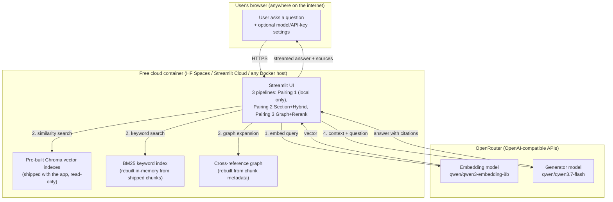
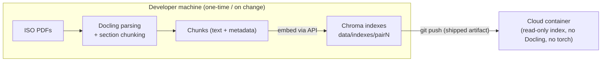

# Cloud Migration Summary — API-Only Models & Hosted Deployment

> **Purpose:** Input document for generating a 5-slide presentation on the
> cloud-readiness work done on the ISO 15118 RAG system. Covers (1) what code
> changed and why, (2) the hosting architecture, (3) how to deploy and use it.

---

## 1. Problem & Goal

The RAG system originally required **local models**: Ollama for the chat LLM and
local sentence-transformers models for embeddings and reranking. That meant any
host needed a GPU/large RAM machine — impossible on free cloud tiers.

**Goal:** make the entire stack runnable on a free cloud container by moving all
model inference to **OpenRouter's OpenAI-compatible APIs**, pre-building the
vector indexes locally, and shipping them with the app.

**Result:** $0/month hosting (Hugging Face Spaces free tier), publicly
accessible from anywhere, with users able to choose their own models and API
keys at runtime.

---

## 2. Code Changes (file by file)

| File | Change |
|---|---|
| `config.py` | New env vars: `EMBEDDING_PROVIDER` (`local`\|`openai`), `EMBEDDING_BASE_URL`, `EMBEDDING_API_KEY_ENV`, `LLM_BASE_URL`, `LLM_API_KEY_ENV`, `CLOUD_MODE` |
| `models/embeddings.py` | New `openai` provider branch for any OpenAI-compatible `/embeddings` endpoint; `_NormalizedEmbeddings` L2-normalizes API vectors so cosine similarity matches the local path; `_RetryEmbeddings` retries HTTP 429 rate limits with exponential backoff (2s→90s); empty chunks substituted with a space for encoder input only (APIs reject empty strings, local models tolerated them); batch size lowered to 64 to fit free-tier token quotas |
| `models/llm.py` | `get_llm()` accepts `base_url`/`api_key` overrides — routes the chat LLM through OpenRouter |
| `models/runtime.py` **(new)** | In-memory runtime override store. Resolution order: explicit args > runtime overrides > config defaults. API keys never touch disk or logs |
| `ui/settings.py` **(new)** | Sidebar section where any user picks model names and enters API keys at runtime (kept in `st.session_state` only) |
| `ui/app.py` | Renders the settings sidebar; pipeline cache is keyed on the settings signature so changed models rebuild the pipeline |
| `ui/pipeline_registry.py` | `CLOUD_MODE=1` skips Docling PDF parsing entirely — chunks are recovered from the shipped Chroma index (`data/indexes/pairN`); Pairing 1 raises a clear "unsupported in cloud" error (it has no persisted vector store) |
| `requirements-cloud.txt` **(new)** | API-only dependency set — no torch, docling, or sentence-transformers; `chromadb` version pinned so locally-built indexes open cleanly in the container |
| `.gitignore` | Ships the pre-built indexes `data/indexes/pair2` + `pair3` (~28 MB each); `pair1` stays local-only (~140 MB, unsupported in cloud) |
| `.env.example` | OpenRouter defaults: generator `qwen/qwen3.7-flash`, embeddings `qwen/qwen3-embedding-8b`, one shared `OPENROUTER_API_KEY` for both |
| `tests/test_embeddings_api.py` **(new)** | Deterministic tests with a fake backend (no network): provider switching, runtime overrides, normalization, table stripping, empty-chunk handling, rate-limit retries — suite total **47 passed** |
| `Dockerfile` **(new)** | Docker-SDK fallback for HF Spaces: Python 3.12-slim, API-only deps, copies app code + pre-built indexes, runs Streamlit on port 7860 |
| `docs/API_MIGRATION_AND_DEPLOYMENT.md` **(new)** | Full setup + deployment guide |

### Key engineering gotchas solved

1. **Cache key vs. embedding model** — vectors from different embedding models
   are incompatible; indexes were rebuilt locally with the new API model before
   deployment.
2. **Empty-string rejection** — OpenRouter's embedding endpoint returns HTTP 400
   for empty input strings that the local model accepted; fixed at the
   encoder-input layer without touching stored chunk text.
3. **Rate limits during bulk indexing** — the free-tier embedding quota (Nebius)
   returns 429s; the OpenAI SDK's 2 quick retries were insufficient, so a
   dedicated backoff wrapper plus smaller batches made bulk indexing reliable.
4. **Index path mismatch** — the eval CLI builds into `data/indexes/pairN`
   while the UI defaulted to `chroma_db/`; cloud mode now reads and reuses the
   eval-built stores with zero re-embedding.

---

## 3. Hosting Architecture (generic)

### Data flow per query

1. **Query embedding** — the user's question is embedded by the API model
   (one small API call; must be the *same model* the index was built with).
2. **Retrieval** — hybrid search (vector similarity against the shipped Chroma
   index + BM25 over chunks recovered from that index); Pairing 3 additionally
   expands results over the cross-reference graph.
3. **Generation** — retrieved chunks (with document/section/page headers) are
   passed as context to the generator model, which answers with citations.

### Build-time vs. run-time split

- **Build time (local):** Docling parses PDFs → chunkers produce sections and
  tables → chunks are embedded through the API → Chroma indexes are written.
  Repeated only when chunking or the embedding model changes.
- **Run time (cloud):** no PDF parsing, no torch, no model weights — the
  container only serves the UI, queries the shipped index, and calls the APIs.

---

## 4. Deployment Steps (summary)

1. Commit code + `data/indexes/pair2`, `pair3` (already done — 28 MB each,
   under GitHub's 100 MB limit).
2. Create an HF Space (Streamlit SDK, or Docker SDK using the provided
   `Dockerfile`) and `git push space cloud-models:main`.
3. Set secrets/variables: `OPENROUTER_API_KEY` (secret), `CLOUD_MODE=1`,
   `LLM_*` and `EMBEDDING_*` model variables.
4. Open `https://<user>-<space>.hf.space` — live on the internet.

**Cost:** hosting $0 (free tier); runtime cost limited to API tokens
(cents/month for light use; the user's own OpenRouter credits are used when
they supply their own key in the sidebar).

---

## 5. Suggested 5-Slide Structure

1. **Slide 1 — From local-only to cloud-ready:** the problem (GPU/RAM-bound
   local models) and the solution (API-only inference + pre-built indexes).
2. **Slide 2 — What changed in the code:** provider switches in
   config/factories, runtime override store, UI settings sidebar, cloud mode
   skipping Docling, cloud requirements set.
3. **Slide 3 — Engineering challenges solved:** embedding-model/vector-space
   coupling, empty-string API rejection, 429 rate-limit backoff, index path
   alignment — each with the fix.
4. **Slide 4 — Architecture:** the mermaid diagrams above (query flow +
   build-time/run-time split); emphasize "ship the index, not the pipeline".
5. **Slide 5 — Deployment & results:** HF Spaces steps, $0 hosting cost,
   public URL, user-supplied keys/models at runtime, 47 passing tests, and
   what remains local (Pairing 1, reranker degradation in cloud).
