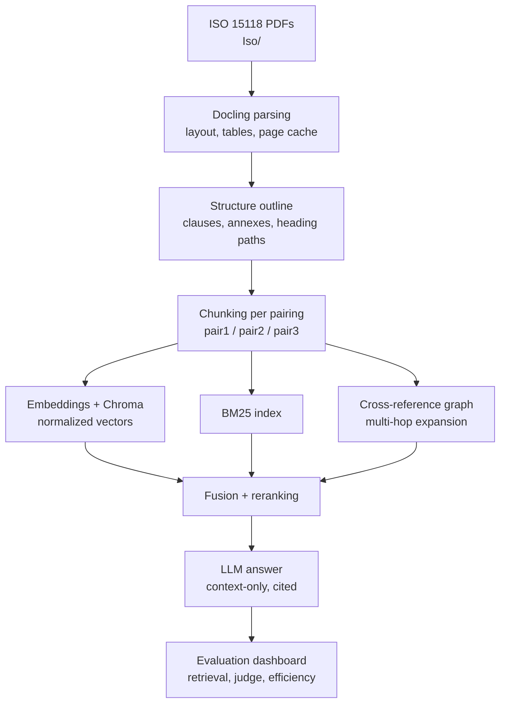
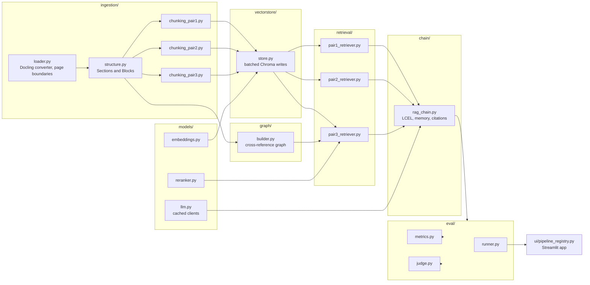

# Stage 1 Review Presentation — ISO 15118 RAG System

## Slide 1 — Title

- **Project title:** Retrieval-Augmented Generation over ISO 15118 EV Charging Communication Standards
- Team: `[Team Name]`
- Guide: `[Guide Name]`
- Department: `[Department Name]`
- Academic year: `[Academic Year]`
- Occasion: **Stage 1 Review** (first review)

**Speaker notes:** Introduce the team, the guide, and the one-line scope: a question-answering assistant that reads the three ISO 15118 parts and answers with clause-level citations.

---

## Slide 2 — Introduction and Problem Context

- ISO 15118 defines the physical and data link communication between an electric vehicle and a charging station (EVSE); it is split into Part 1, Part 2 and Part 3.
- The documents are long, heavily structured (numbered clauses, annexes) and rich in parameter tables — typical pages carry a normative requirement next to a table of limits.
- Engineers and students working on charging integrations need to answer precise, clause-level questions quickly, during lab work and debugging.
- Reading a 300+ page PDF to confirm one numeric limit or one timing requirement is slow and error-prone.
- Large language models can answer such questions, but a general model has no access to the exact standard and may state values that are not in the document.
- Combining a parser, a retriever and a local language model turns the three PDFs into a searchable, citable knowledge base.

**Speaker notes:** Emphasise that the documents are not free text; structure is the main difficulty, and that is what this project exploits.

---

## Slide 3 — Problem Statement

- Manual search of standards PDFs is slow: text is distributed across numbered clauses, annexes and tables, so a keyword hit does not necessarily point to the applicable requirement.
- PDF viewers offer only string matching (Ctrl-F, bookmarks); they cannot answer a natural-language question that spans clauses.
- Generic document assistants built for prose (web pages, news, tickets) split documents into fixed-size text blocks, which breaks tables apart and loses clause boundaries.
- A plain language model answers from its own memory, producing values and requirements that are not present in the standard, with no traceability to a clause.
- The specific need: a system that answers natural-language questions about ISO 15118 using only the retrieved standard text, identifies the exact clause and page, and keeps the corpus and models local.

**Speaker notes:** State the problem in one sentence: accurate, citable, offline answers over a table- and annex-heavy standard.

---

## Slide 4 — Objectives

- Parse the three ISO 15118 PDFs with a layout-aware parser and recover the clause hierarchy, annexes, heading paths and page numbers.
- Implement three chunking × retrieval pairings and compare them on one fixed corpus.
- Implement structure-aware chunking that keeps every table atomic and attaches clause metadata to each chunk.
- Implement hybrid retrieval (dense vectors + BM25 with rank fusion), metadata filtering by clause number, and cross-encoder reranking.
- Build a cross-reference graph from references such as "see 4.2" or "Annex A" and use multi-hop expansion for related clauses.
- Provide a question-answering interface that answers only from retrieved context and cites document, clause and page.
- Build a reproducible evaluation harness: gold question set, deterministic retrieval metrics, judge-based qualitative metrics and efficiency metrics.
- Keep embeddings, reranker, corpus and indexes local; allow only the chat model to be switched to a hosted provider.

**Speaker notes:** All objectives are verifiable — each maps to a pipeline component or an evaluation artefact.

---

## Slide 5 — Existing System / Current Practice

**How the standard is consulted today**

| Practice | Clause-level accuracy | Table handling | Citation | Privacy / offline | Cost |
|---|---|---|---|---|---|
| Manual PDF reading | High, but slow to reach the clause | Read by eye, no structure | Manual | Full | Time only |
| Ctrl-F and bookmarks | Depends on exact wording | Rows often skipped | Page only | Full | Free |
| Generic keyword search across PDFs | Medium; ignores clause context | Tables matched line by line | Weak | Full | Free |
| Ungrounded LLM (general chat) | Unreliable; may invent values | No table awareness | None | Data leaves the machine | Subscription / API |
| Commercial document-search tools | Good keyword search, weak clause semantics | Varies by vendor | Usually clause/paragraph | Often cloud-based | Paid licence |
| **This project** | Structure-aware chunking + hybrid retrieval + reranking | Tables kept whole, indexed as separate chunks | Automatic document + clause + page | Local-first | Open-source stack |

**Speaker notes:** Rows come from how the ISO documents are actually used in practice; the gap is the combination of structure, tables, citation and local execution.

---

## Slide 6 — Literature Survey (Condensed)

| # | Reference | Contribution |
|---|---|---|
| [1] | Lewis et al. (2020) | Introduced retrieval-augmented generation; parametric memory combined with retrieved non-parametric text. |
| [2] | Karpukhin et al. (2020) | Dense passage retrieval over Wikipedia with BERT encoders; foundation for vector-search RAG. |
| [3] | Robertson & Zaragoza (2009) | BM25 probabilistic relevance framework; the lexical baseline for hybrid retrieval. |
| [4] | Cormack et al. (2009) | Reciprocal rank fusion: combines ranked lists without needing score calibration. |
| [5] | Khattab et al. (2020) | ColBERT late interaction; early evidence that ranking quality matters more than raw recall. |
| [6] | Gao et al. (2023) | Instruction-tuned embedders for zero-shot dense retrieval without relevance labels. |
| [7] | Chen et al. (2024) | Multilingual cross-encoder reranker (bge-reranker-v2-m3) for fine-grained passage ordering. |
| [8] | Es et al. (2024) | RAGAS: automated faithfulness and relevance evaluation for RAG systems. |
| [9] | Edge et al. (2024) | GraphRAG: build an entity graph from a corpus and use it for multi-hop, global questions. |
| [10] | Nigheti et al. (2024) | Docling: layout-aware document conversion with table structure recovery. |
| [11] | Reimers & Gurevych (2019) | Sentence-BERT: Siamese BERT encoders producing usable sentence embeddings. |
| [12] | ISO 15118-1/-2/-3 (2024) | The target corpus: vehicle-to-grid communication interface standard. |

**Speaker notes:** Full discussion in `docs/STAGE1_LITERATURE_SURVEY.md`. Group the references into four themes: RAG core, retrieval and ranking, evaluation, and document parsing.

---

## Slide 7 — Research Gap

- Standards documents have a formal layout (numbered clauses, annexes, normative tables); generic recursive splitters cut across these boundaries and produce fragments that are meaningless alone.
- Parent-child retrieval and cross-encoder reranking are well studied on web and news text, where passages are short and self-contained; their behaviour on normative technical clauses is rarely characterised.
- Cross-references inside standards ("see 4.2.1", "see Annex B") encode genuine semantic links between clauses, but most RAG systems treat them as plain text and never follow them.
- Structure-aware chunking, hybrid retrieval, knowledge-graph expansion and LLM-judge evaluation are usually studied separately; combining them and measuring the contribution of each on a single standards corpus is uncommon.
- Consequently there is little published evidence on which combination is worth the engineering cost for clause-level technical QA.

**Speaker notes:** The gap motivates the three-pairing design: it lets us measure the value of structure, hybridity and reranking empirically rather than assuming it.

---

## Slide 8 — Proposed System

**Summary**

- One ingestion path (Docling → structure outline) feeding three interchangeable pairings of chunking and retrieval, all answering through the same LangChain chain and evaluated by the same harness.

**The three pairings**

1. **Pairing 1 — Baseline:** recursive character chunking with a parent-document retriever (small child chunks matched, larger parent returned as context).
2. **Pairing 2 — Structure-aware:** section-level chunks that keep tables atomic and carry `document_id`, `section_number`, `heading_path`, `page_number`, `content_type`; hybrid Chroma + BM25 retrieval with reciprocal rank fusion, plus metadata-filtered lookup by clause number.
3. **Pairing 3 — Advanced:** table-first standalone table chunks and clause-level text chunks, cross-reference extraction, a cross-reference knowledge graph with multi-hop expansion, self-query retrieval, BM25 ensemble and cross-encoder reranking.

**Pipeline flow**

**Speaker notes:** The graph and reranking stages belong to Pairing 3 only; the other pairings stop at fusion. The dashboard reads the same artefacts the CLIs produce.

---

## Slide 9 — System Architecture

**Module map**

**Technology choices**

| Layer | Technology | Role in the system |
|---|---|---|
| Language | Python 3.12 | Typed modules, modern standard library. |
| Orchestration | LangChain (LCEL) | Retrieval abstractions, chain composition, memory. |
| Parsing | Docling | Layout-aware PDF conversion, table structure, JSON cache. |
| Vector store | Chroma | Local persistent index with metadata filtering. |
| Lexical search | rank_bm25 | Sparse retrieval combined with dense results. |
| Graph | NetworkX | Cross-reference nodes/edges and multi-hop expansion. |
| Embeddings / reranker | sentence-transformers (Qwen3-Embedding-0.6B, bge-reranker-v2-m3) | Local vectors and cross-encoder scoring. |
| Interface | Streamlit | Chat view, chunk explorer, evaluation dashboard. |
| Testing | pytest | Fast, deterministic unit tests with fakes. |

**Speaker notes:** Note that only `chain/rag_chain.py` talks to a language model provider, and `models/llm.py` caches clients; everything else is offline.

---

## Slide 10 — Methodology and Implementation Plan

| Phase | Work | Deliverable |
|---|---|---|
| 1. Corpus and parsing | PDF ingestion with Docling, header/footer removal, page boundaries, JSON cache; structure recovery into clauses, annexes and blocks. | Structured document model and cached parse of all three parts. |
| 2. Chunking | Implement the three chunking strategies, table-atomic packing, clause metadata. | Three chunk sets plus a diagnostic script reporting counts, section coverage and table statistics. |
| 3. Retrieval | Chroma index with batched writes, BM25 index, reciprocal rank fusion, metadata filters, cross-reference graph, reranking. | Three retrievers selectable from one interface. |
| 4. Generation and UI | LCEL chain with context-only prompting, citations, memory and question condensation; Streamlit app with chat, chunk explorer and dashboard. | Working end-to-end assistant for each pairing. |
| 5. Evaluation and analysis | Gold question set, retrieval metrics, LLM-judge metrics, efficiency metrics, comparison report. | Reproducible comparison of the three pairings and an analysis of failure cases. |

**Testing approach**

- Unit tests use fake Docling items and fake embeddings, so the suite runs in seconds with no model downloads and no PDF parsing.
- Tests cover structure recovery, chunk counts and table integrity, metric computation, and UI data loading.
- Every chunking change is followed by the chunk diagnostic script to check coverage before re-indexing.

**Speaker notes:** Each phase ends with something that can be demonstrated; the evaluation phase is last so that the comparison reflects the final pipeline.

---

## Slide 11 — Results and Expected Outcomes

> Measured results from the first full evaluation run over the gold set (32 queries, single run per pairing, judge at temperature 0; see `eval/RAG_EVAL_REPORT.md`). Single-run figures, so variance is not yet reported.

**Design parameters (fixed in `config.py`)**

| Parameter | Value |
|---|---|
| Pairing 1 child chunk size / overlap | 256 / 25 |
| Pairing 1 parent chunk size | 1024 |
| Pairing 2 and 3 chunk size / overlap | 512 / 50 |
| `TABLE_MAX_CHARS` | 4000 |
| `TOP_K` | 5 |
| `RERANK_TOP_N` | 20 |
| Hybrid vector / BM25 weights | 0.6 / 0.4 |
| `DOCLING_BATCH_SIZE` | 1 |

**Measured comparison (32 gold queries)**

| Metric | Pairing 1 | Pairing 2 | Pairing 3 |
|---|---|---|---|
| Recall@5 (answer-term) | 0.9375 | 0.875 | **1.0000** |
| nDCG@5 | 0.8920 | 0.8363 | **0.9401** |
| MRR | 0.9010 | 0.8529 | **0.9307** |
| Recall@5 (section) | N/A | 0.9062 | **1.0000** |
| Faithfulness (judge) | 0.4847 | **0.5690** | 0.4878 |
| Answer correctness (judge) | 0.4772 | **0.7010** | 0.5269 |
| Citation accuracy | 0 | **0.9600** | 0.9481 |
| End-to-end latency (ms) | 2910 | **2661** | 6532 |

**Observations**

- Pairing 3 (structure-aware chunking + hybrid retrieval + cross-reference graph + reranking) achieves the best retrieval quality: perfect Recall@5 and the highest nDCG/MRR, confirming the hypothesis that structure and cross-reference reasoning help multi-clause questions.
- Pairing 2 (section + hybrid) wins on generation quality — highest faithfulness, answer correctness and citation accuracy — and is also the fastest pairing, so it is the recommended default for accuracy-critical use.
- Pairing 1 (recursive + parent-child) has no section metadata, so section-level recall is not applicable and citation accuracy is 0; this validates the decision to move to structure-aware chunking.
- Retrieval metrics were computed at k = 1, 3, 5 and 10; latency, token usage, index time and index size were recorded per pairing. Uncomputable metrics are stored as `None` and flagged rather than dropped.

**Speaker notes:** These are first-run measurements; the Stage 2 review will add multi-run variance (mean ± std) via `python -m eval.run_pairing --pairing N --runs 3`.

---

## Slide 12 — Conclusion and Future Scope

**Conclusion**

- The project turns a difficult document type — numbered clauses, annexes, normative tables — into a question-answering system that answers only from retrieved text and cites the source.
- Structure-aware chunking, hybrid dense/lexical retrieval, cross-reference graph expansion and reranking are implemented as three comparable pairings rather than one opaque pipeline.
- A reproducible evaluation harness measures retrieval quality, answer faithfulness and cost, so design choices can be justified with data.
- Everything except the optional chat model runs locally, which suits confidential or offline industrial settings.

**Future scope**

- Extend the corpus to related standards (ISO 15118-4, DIN, IEC 61851) with the same pipeline.
- Add image and figure understanding for diagrams that carry normative information.
- Support question answering in multiple languages by switching the generation model.
- Add incremental re-indexing so a revised clause does not require rebuilding the whole index.
- Package the assistant as a local web service with document-level access control.
- Extend the gold set and publish the comparison as a reproducible case study.

**Speaker notes:** The first full evaluation over the gold set is complete (Slide 11); the next milestone is multi-run variance analysis and extending the gold set.

---

## Slide 13 — References

[1] P. Lewis et al., "Retrieval-augmented generation for knowledge-intensive NLP tasks," in Advances in Neural Information Processing Systems (NeurIPS), 2020.

[2] V. Karpukhin et al., "Dense passage retrieval for open-domain question answering," in Proc. Conf. Empirical Methods Natural Language Processing (EMNLP), 2020, pp. 6769–6781.

[3] S. Robertson and H. Zaragoza, "The probabilistic relevance framework: BM25 and beyond," Foundations and Trends in Information Retrieval, vol. 3, no. 4, pp. 333–389, 2009.

[4] G. V. Cormack, C. L. A. Clarke, and S. Buettcher, "Reciprocal rank fusion outperforms Condorcet and individual rank learning methods," in Proc. Int. ACM SIGIR Conf. Research and Development in Information Retrieval (SIGIR), 2009, pp. 758–759.

[5] O. Khattab et al., "ColBERT: Efficient and effective passage search via contextualized late interaction over BERT," in Proc. Int. ACM SIGIR Conf. Research and Development in Information Retrieval (SIGIR), 2020, pp. 391–400.

[6] W. Gao et al., "Precise zero-shot dense retrieval without relevance labels," in Proc. Conf. Empirical Methods Natural Language Processing (EMNLP), 2023, pp. 7215–7228.

[7] J. Chen et al., "BAAI bge-reranker-v2-m3: A multilingual cross-encoder model for text ranking," BAAI model card, 2024.

[8] S. Es et al., "RAGAS: Automated evaluation of retrieval augmented generation," in Proc. Demonstrations Eur. Conf. Adv. Methods Natural Language Processing (EACL), 2024, pp. 809–816.

[9] D. Edge et al., "From local to global: A graph RAG approach to query-focused summarization," arXiv preprint arXiv:2404.16130, 2024.

[10] M. Nigheti et al., "Docling technical report," arXiv preprint, 2024.

[11] N. Reimers and I. Gurevych, "Sentence-BERT: Sentence embeddings using Siamese BERT-Transformer networks," in Proc. Conf. Empirical Methods Natural Language Processing (EMNLP), 2019, pp. 3982–3992.

[12] International Organization for Standardization, ISO 15118-1, ISO 15118-2, and ISO 15118-3, Road vehicles — Vehicle to grid communication interface — Part 1/2/3, Geneva, Switzerland, 2024.

**Companion documents:** `docs/STAGE1_LITERATURE_SURVEY.md`, `docs/STAGE1_PROPOSED_SYSTEM.md`, `docs/STAGE1_REFERENCES.md` use the same numbering.
