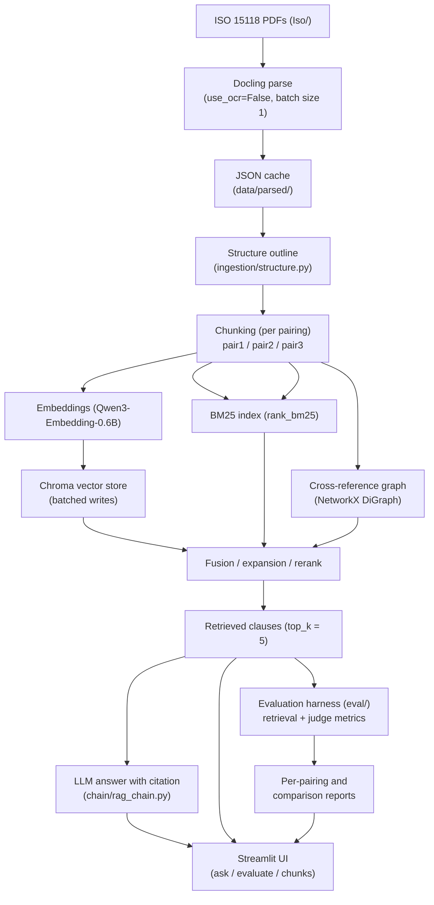
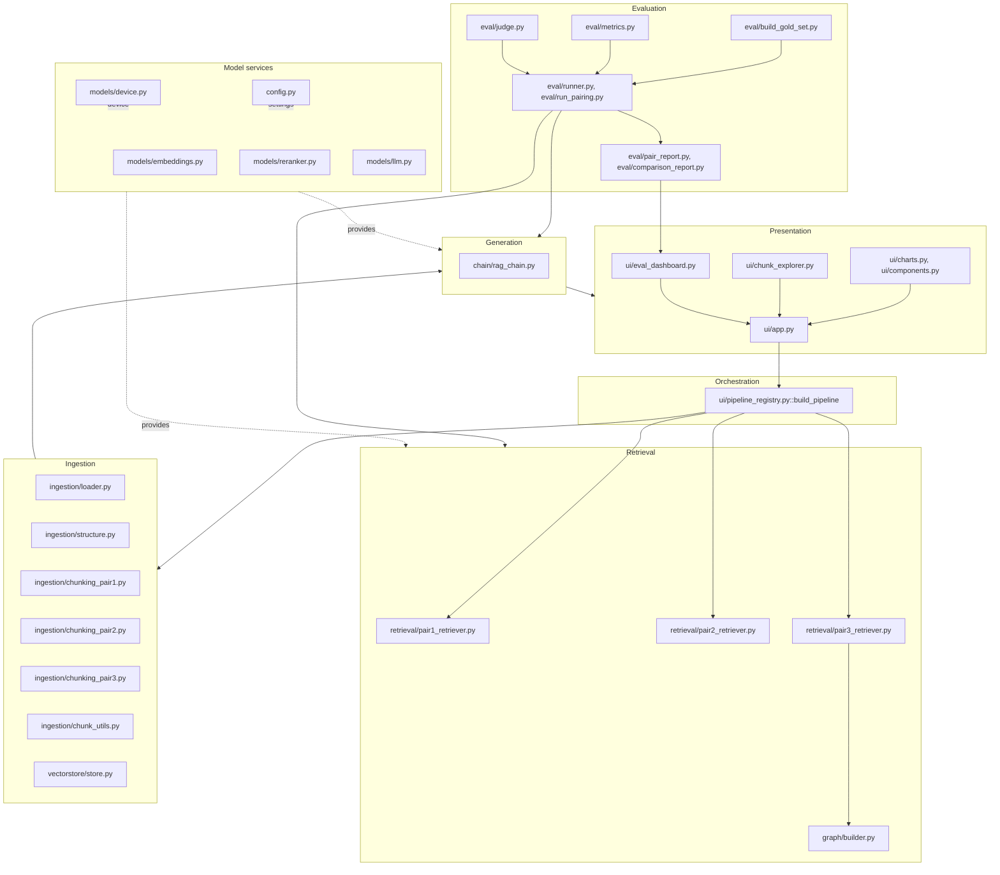

# Stage 1 Deliverable — Proposed RAG System over ISO 15118

**Project:** Retrieval-Augmented Generation for ISO 15118 (EV charging communication) standard documents
**Document type:** Technical design / proposed system description (Stage 1, first review)
**Status:** Proposed design; performance figures quoted below are targets to be verified, not measured results.

Companion documents: `docs/STAGE1_FIRST_REVIEW_PPT.md`, `docs/STAGE1_LITERATURE_SURVEY.md`, `docs/STAGE1_REFERENCES.md`.

---

## Table of contents

1. [Introduction](#1-introduction)
2. [Objectives](#2-objectives)
3. [System overview](#3-system-overview)
4. [Modules](#4-modules)
5. [Workflow](#5-workflow)
6. [Technologies](#6-technologies)
7. [System architecture](#7-system-architecture)
8. [Functional requirements](#8-functional-requirements)
9. [Non-functional requirements](#9-non-functional-requirements)
10. [Design decisions and alternatives considered](#10-design-decisions-and-alternatives-considered)
11. [Evaluation plan](#11-evaluation-plan)
12. [Expected outcomes](#12-expected-outcomes)
13. [Conclusion](#13-conclusion)
14. [References](#14-references)

---

## 1. Introduction

The ISO 15118 series specifies how an electric vehicle and an external charging station exchange
messages over a physical communication link. Its three parts define, respectively, the general
information and communication requirements, the physical and data-link layers, and the
application-layer requirements for AC and DC charging. Because these documents are long,
densely numbered, and written in normative language, engineers who need to answer a specific
question — for instance, which message must a vehicle send after it detects a charge point, or
what timeouts apply to a given sequence — usually have to search the text manually and infer the
answer from several adjacent clauses.

This document describes a proposed retrieval-augmented generation (RAG) system over that corpus.
The system parses the three PDFs into a clause-aware document outline, splits the outline into
retrievable chunks under three alternative chunking strategies, indexes the chunks with a dense
vector index combined with sparse lexical search, optionally expands the candidate set along a
cross-reference graph, and finally prompts a local language model to answer a natural-language
question using only the retrieved passages. Every answer is expected to name the document and
clause it was drawn from, and the model is instructed to decline when the retrieved context does
not contain the answer.

The scope of the proposal is deliberately narrow. The corpus is fixed to the three ISO 15118
PDFs held in `Iso/`; the system does not attempt general web-scale retrieval. The chat model is
local by default, and only the generative step may be pointed at a cloud provider. Everything
else — parsing, embeddings, reranking, storage, evaluation — is local and offline-capable.

The design also treats comparison as a first-class requirement. Rather than committing to a
single chunking and retrieval configuration, the system defines three "pairings", each combining
one chunking strategy with one retrieval strategy. Pairing 1 (recursive parent/child chunks with
parent-document retrieval) serves as the baseline; Pairing 2 adds clause-aware chunking, hybrid
dense/BM25 fusion and metadata filtering; Pairing 3 adds table-first chunking, cross-reference
graph expansion, self-query metadata extraction, ensemble retrieval and cross-encoder
reranking. A common evaluation harness runs the same gold question set against all three and
reports the differences.

This document is the technical design deliverable for the first review. Companion material
covers the literature the design draws on (`docs/STAGE1_LITERATURE_SURVEY.md`), the presentation
narrative (`docs/STAGE1_FIRST_REVIEW_PPT.md`) and the consolidated bibliography
(`docs/STAGE1_REFERENCES.md`).

## 2. Objectives

1. Parse the three ISO 15118 PDFs into a clause-addressable structured corpus in which every
   block carries a normalised clause number, a heading path, and its source page.
2. Produce at least three chunking/retrieval pairings over the same corpus, so that the effect of
   chunk granularity and retrieval strategy can be measured rather than asserted.
3. Achieve answer-term Recall@5 of at least 0.80 and MRR@5 of at least 0.60 on a hand-built gold
   question set of 40 or more queries across the three documents (targets to be verified).
4. Ground every generated answer in retrieved passages, with a measurable citation rate: the
   judged answers should cite a document and clause that overlap with the retrieved set in at
   least 80 % of cases (target to be verified).
5. Make the system answerable interactively through a browser UI that shows the retrieved sources
   alongside the answer, and that can switch between the three pairings and compare their outputs
   on the same question.
6. Provide a reproducible evaluation harness with deterministic retrieval metrics at k = 1, 3, 5,
   10 and LLM-as-judge qualitative metrics at temperature 0, whose results are persisted and
   comparable across runs.
7. Keep the whole retrieval stack offline-capable, so that the corpus never leaves the machine and
   only the optional chat completion may use a network service.
8. Maintain a test suite that runs without loading models or parsing PDFs, so that the pipeline
   logic can be checked in seconds on any machine.

## 3. System overview

The system is organised as an ingestion stage that turns PDFs into stored chunks, a retrieval
stage that turns a question into a ranked set of clauses, and a generation stage that turns those
clauses into a cited answer. The ingestion stage converts each PDF with Docling in layout-aware
mode with OCR disabled, caches the conversion as JSON, removes running headers and footers, and
keeps each PDF as a single document whose page boundaries are derived from a form-feed placeholder.
A structure-recovery pass converts Docling's `section_header` and `TableItem` labels into an
outline of sections and blocks with normalised clause numbers, heading paths and page numbers.
The chosen chunking strategy then turns that outline into LangChain documents carrying metadata
such as `document_id`, `section_number`, `section_title` and `page_start`.

Retrieval differs per pairing but always returns ranked documents with metadata intact. Pairing 1
retrieves small child chunks and expands each hit to its larger parent. Pairing 2 combines dense
Chroma search with BM25 through reciprocal rank fusion and can be restricted to a clause by a
metadata filter. Pairing 3 adds a NetworkX cross-reference graph over extracted references such as
"see 4.2" or "refer to Annex A", expands candidates breadth-first, ensembles the retrievers, and
reranks the top candidates with a cross-encoder, degrading gracefully to the unranked list if the
reranker runs out of memory. Generation is a LangChain LCEL chain that condenses a follow-up
question against the conversation history, restricts the system prompt to the retrieved context,
requires document and clause citations, and provides an explicit refusal phrase when the context
is insufficient.

Evaluation and presentation close the loop. The evaluation harness replays a gold question set
against a selected pairing, computes deterministic retrieval metrics and LLM-as-judge quality
metrics, and writes a JSON result that the reporting layer turns into a per-pairing report and a
comparison table. The Streamlit UI exposes three views: an ask/chat view with a citation panel, an
evaluation and comparison view, and a chunk browser for inspecting what was actually indexed.

## 4. Modules

| Package | Responsibility | Key files | Inputs | Outputs |
|---|---|---|---|---|
| `ingestion/` | Parse PDFs, recover clause structure, produce chunks | `loader.py`, `structure.py`, `chunk_utils.py`, `chunking_pair1.py`, `chunking_pair2.py`, `chunking_pair3.py` | PDF paths / Docling JSON cache | `StructuredDocument`, `Section`, `Block`, `list[Document]` |
| `vectorstore/` | Persist embeddings in Chroma with batched, sanitised writes | `store.py` | chunks + embeddings function | persistent Chroma collection |
| `retrieval/` | Build the three retrievers (parent/child, hybrid+filters, graph+rerank) | `pair1_retriever.py`, `pair2_retriever.py`, `pair3_retriever.py` | chunks (and graph) | callable returning ranked `Document`s |
| `graph/` | Build and expand the clause cross-reference graph | `builder.py` | chunks with extracted references | `networkx.DiGraph`, expansion helper |
| `chain/` | Prompting and LCEL composition for answer and condensation | `rag_chain.py` | retriever output + history | cited answer string, condensed question |
| `models/` | Device resolution, embeddings, reranker, chat LLM clients | `device.py`, `embeddings.py`, `reranker.py`, `llm.py` | text / model names | embedding vectors, scores, chat client |
| `eval/` | Gold set, deterministic metrics, LLM-as-judge, runners, reports | `build_gold_set.py`, `metrics.py`, `judge.py`, `runner.py`, `run_pairing.py`, `pair_report.py`, `comparison_report.py` | pipeline + gold set | per-pairing JSON, markdown reports, comparison table |
| `ui/` | Streamlit application and cached pipeline construction | `app.py`, `pipeline_registry.py`, `charts.py`, `components.py`, `eval_dashboard.py`, `eval_data.py`, `chunk_explorer.py` | user input, evaluation artefacts | interactive pages, charts, source panels |
| `scripts/` | Offline diagnostics for chunk quality | `inspect_chunks.py` | chunked corpus | counts, coverage, size and table statistics |
| `tests/` | Fast deterministic unit tests (no model loads, no PDF parsing) | `test_structure.py`, `test_metrics.py`, `test_embeddings.py`, `test_chunk_explorer.py`, `test_eval_dashboard.py`, `test_ui_app.py`, `smoke_test.py` | synthetic fixtures | pass/fail assertions |

### 4.1 `ingestion/`

`ingestion/loader.py` drives Docling's `DocumentConverter` directly rather than using a Markdown
export helper, so that each PDF remains one LangChain document and page boundaries can be derived
from a form-feed placeholder inserted during serialisation. Running headers and footers are
stripped, OCR is disabled because the source PDFs already contain a text layer, and the converted
structure is cached as JSON under `data/parsed/` so repeated runs skip conversion entirely. The
public entry point `load_iso_structures()` returns a list of `StructuredDocument` objects.
`ingestion/structure.py` turns Docling's item labels into the outline: `section_header` items
become sections, `TableItem`s become table blocks, clause numbers are normalised (numeric clauses
such as `4.1.2`, annex labels such as `A` and `A.1`), and a heading emitted as two consecutive
headers is merged into one clause number and title. Front-matter and furniture headings are
dropped.

`ingestion/chunk_utils.py` holds the shared helpers: `pack_units()` fills a character budget with
whole units, and `split_table_markdown()` breaks an oversized table on row boundaries while
repeating the header row. The three chunkers all consume `list[StructuredDocument]`:
`chunking_pair1.py` produces recursive parent/child chunk pairs; `chunking_pair2.py` produces
section-bounded chunks with atomic tables; `chunking_pair3.py` produces standalone table chunks with
captions, clause-level text chunks, and records the cross-references found in each chunk.

### 4.2 `vectorstore/`

`vectorstore/store.py` owns all writes to Chroma. `add_documents_in_batches()` enforces a batch
size below the store's single-upsert cap and removes `None` and empty-list metadata values that
Chroma rejects. An `ensure_indexed` helper checks whether the persisted index matches the current
chunking fingerprint and triggers a rebuild only when it does not.

### 4.3 `retrieval/`

`pair1_retriever.py` builds a parent-document retriever over the child/parent pairs.
`pair2_retriever.py` builds the dense-plus-BM25 retriever fused with reciprocal rank fusion and
exposes a metadata-filtered variant keyed on `section_number`.
`pair3_retriever.py` composes the self-query retriever, the BM25 retriever, graph expansion and the
cross-encoder reranker over the top candidate list, wrapping the reranking step in a guard so that
an out-of-memory condition returns the unreranked list.

### 4.4 `graph/`

`graph/builder.py` creates a `networkx.DiGraph` whose node ids are
`{document_id}:{section}_{md5[:8]}` and whose edges come from the cross-references recorded during
chunking. A breadth-first helper expands a seed set by a bounded number of hops and returns the
neighbouring chunks with a reduced score.

### 4.5 `chain/`

`chain/rag_chain.py` builds two LCEL chains: a condensation chain that rewrites a follow-up question
into a standalone question using the conversation history, and the answer chain, whose system
prompt confines the answer to the supplied context, requires a document and clause citation, and
instructs the model to state that it lacks sufficient information otherwise. Retrieval is executed
by the caller so that the identical context object feeds both the prompt and the UI source panel.

### 4.6 `models/`

`models/device.py` resolves the compute device as CUDA, then Apple MPS, then CPU, with an
environment override. `models/embeddings.py` wraps a local sentence-transformers model,
normalises vectors, applies the model's built-in instruction prompt to queries only, and flattens
Markdown tables before encoding so that the stored chunk text stays untouched. `models/reranker.py`
loads the cross-encoder, and `models/llm.py` caches chat clients and switches provider between a
local Ollama server and an optional OpenAI endpoint.

### 4.7 `eval/`

`build_gold_set.py` assembles the question set with gold answers, answer terms and gold clause
references. `metrics.py` computes deterministic retrieval and chunk statistics using answer-term
relevance, plus a section-based signal when clause metadata is available. `judge.py` scores
qualitative properties — relevance density, boundary coherence, context precision and recall,
faithfulness, answer relevance — and checks citations deterministically by comparing the clause
numbers cited in the answer with the retrieved sections; uncomputable scores are stored as `None`
and surfaced as flags rather than dropped. `runner.py` executes a gold set against a pipeline,
`run_pairing.py` is the command-line entry point for one pairing, `pair_report.py` and
`comparison_report.py` render the markdown output.

### 4.8 `ui/`

`ui/pipeline_registry.py` exposes `PIPELINE_NAMES` and `build_pipeline()`, which constructs one
pipeline at a time and caches it. `ui/app.py` renders the three tabs, and `ui/charts.py`,
`ui/components.py`, `ui/eval_dashboard.py`, `ui/eval_data.py` and `ui/chunk_explorer.py` provide
charting, citation panels, the evaluation dashboard and the chunk browser.

### 4.9 `scripts/`

`scripts/inspect_chunks.py` is run after any chunking change. It reports chunk counts, per-document
and per-section coverage, oversized sections, and table and graph statistics, so that a regression
in structure recovery is visible before retrieval quality is measured.

### 4.10 `tests/`

The suite uses fabricated Docling items and stub embeddings rather than real models or PDFs, so a
full run stays deterministic and completes quickly. Structure recovery, chunk packing, metric
computation, embedding prompt behaviour and UI helper logic are all covered this way.

## 5. Workflow

1. **Corpus preparation.** The three PDFs in `Iso/` are selected by the loader. Conversion uses
   Docling with layout analysis, table-structure recovery, OCR disabled and batch size 1, because
   larger batches exhausted memory on an 8 GB machine. The parsed document is written to
   `data/parsed/` as JSON and reused on subsequent runs.

2. **Structure recovery.** Serialised text is split on the form-feed placeholder into pages, and
   Docling items are converted into sections and blocks. Clause numbers are normalised, heading
   paths are built, page numbers are attached to every block, and furniture or front-matter
   headings are filtered out.

3. **Chunking.** The user-selected pairing decides which chunker runs. Pairing 1 creates recursive
   child chunks of 256 tokens with 25 overlap and parent chunks of 1024 with 100 overlap. Pairing 2
   creates section-bounded chunks of 512 with 50 overlap, keeping tables whole and splitting only
   above `TABLE_MAX_CHARS` on row boundaries. Pairing 3 creates standalone table chunks with
   captions, clause-level text chunks of the same size, and extracts cross-references.

4. **Indexing.** Chunks are embedded with the local embedding model and written to Chroma in
   batches through `add_documents_in_batches()`. For Pairings 2 and 3 a BM25 index is built over
   the same chunk texts. For Pairing 3 the cross-reference graph is constructed from the recorded
   references. Index freshness is checked so that a changed chunking fingerprint forces a rebuild.

5. **Retrieval.** The retriever for the active pairing is invoked with the (optionally condensed)
   question. Pairing 1 expands child hits to parents. Pairing 2 fuses dense and BM25 rankings by
   reciprocal rank fusion and can apply a `section_number` filter. Pairing 3 derives metadata
   constraints with the self-query retriever, ensembles the retrievers, expands along the graph,
   and reranks the top `RERANK_TOP_N` candidates with the cross-encoder, falling back to the
   unranked list if reranking fails.

6. **Generation.** The retrieved chunks, the conversation history and the system prompt are passed
   through the answer chain. The returned answer is displayed together with the exact passages used,
   so the user can check any citation against the source panel.

7. **Evaluation.** `python -m eval.run_pairing --pairing N --limit M` replays the gold set against a
   pairing and writes a JSON result; `python -m eval.comparison_report` renders the cross-pairing
   comparison. The same question set and the same judge configuration are used for every pairing.

8. **Presentation.** The UI builds pipelines through `build_pipeline()` in
   `ui/pipeline_registry.py`. `PIPELINE_NAMES` maps the three display names to the three branch
   cases, and each branch imports its own chunker and retriever, constructs the chain, and returns
   the retriever, chain, condensation chain, vector store and graph. Only the selected pipeline is
   cached in single-pipeline mode. In compare mode the registry builds each pipeline in turn,
   collects its answers, and releases it before building the next one, because holding all three
   pipelines simultaneously was out-of-memory on the development machine.

## 6. Technologies

| Technology | Version / role | Why chosen |
|---|---|---|
| Python | 3.12 | Baseline language for the whole system; `from __future__ import annotations` used in every module for forward-typed references. |
| LangChain | `langchain`, `langchain-core`, `langchain-community` (≥0.3) | Provides the document, retriever and LCEL primitives the pipeline is composed from. |
| LangChain Classic | `langchain-classic` ≥1.0 | Supplies retrievers and stores that were removed from the main `langchain` line in 1.x — parent-document retrieval, ensemble retrieval, self-query retrieval, and the in-memory parent store. |
| Docling | `docling` ≥2.0 (+ `langchain-docling`) | Layout-aware PDF conversion with table-structure recovery; needed because ISO tables carry normative values that plain text extraction destroys. OCR is disabled since the PDFs have a text layer. |
| Chroma | `chromadb` ≥0.5 via `langchain-chroma` ≥0.2 | Local, file-backed vector store; supports metadata filtering by clause number, which the section-based pairing relies on. |
| rank_bm25 | ≥0.2.2 | Lightweight in-process sparse retrieval; the lexical signal is complementary to dense embeddings on clause-number queries. |
| NetworkX | ≥3.0 | Directed graph for clause cross-references; supports the bounded breadth-first expansion used at query time. |
| sentence-transformers / transformers | ≥3.0 / ≥4.40 | Local embedding and cross-encoder inference without external services. |
| bge-reranker-v2-m3 | `BAAI/bge-reranker-v2-m3`, reranker, max length 1024 | Multilingual cross-encoder that reorders the candidate list; the sequence limit was raised from 512 because table chunks exceed it. |
| Ollama | default chat provider, `llama3.2:3b-instruct-q4_K_M` | Keeps generation local and reproducible on the development machine. |
| OpenAI | optional, `LLM_PROVIDER=openai` | Allows the same pipeline to be run against a hosted model for comparison, without changing any other component. |
| Streamlit | ≥1.38 | Browser interface for chat with citations, evaluation comparison and chunk inspection. |
| pandas / charting helpers | pandas ≥2.0, `ui/charts.py` | Tabular metric display and comparison plots in the evaluation tab. |
| pytest | ≥8.0 | Test runner for the fast, model-free suite in `tests/`. |
| PyTorch | installed per OS from `requirements-linux-cuda.txt` or `requirements-macos.txt` | The correct wheel differs between CUDA and Apple Silicon, so it is excluded from the platform-agnostic `requirements.txt`. |

## 7. System architecture

**Data flow.** A question enters through the UI. The registry has already built the active
retriever and chain from the cached structures, chunks, embeddings index and (for Pairing 3)
graph. If the question is a follow-up, the condensation chain rewrites it into a standalone
question using the history. The retriever returns ranked documents; for Pairing 3 that set has
already been expanded and reranked. The documents, the history and the system prompt are passed to
the answer chain, whose output is displayed with a citation panel built from the same documents.
The identical retrieved set is also what the evaluation runner scores, so the measurement path and
the interactive path observe the same behaviour.

**Design constraints that shaped the architecture.**

- *Import order.* `config.py` sets the PyTorch environment variables that must exist before torch
  is first imported, because torch caches that state. `models/device.py` and `ingestion/loader.py`
  re-assert them defensively. This is why configuration is a leaf module with no heavy imports.
- *Batched writes.* Chroma rejects very large single upserts and rejects `None` or empty-list
  metadata. Routing every write through `add_documents_in_batches()` removes a whole class of
  ingestion failures.
- *One document per PDF.* Keeping a PDF as a single document with page boundaries preserves section
  boundaries that section-based chunking depends on; a per-page export would break them.
- *Memory ceiling.* The development machine has 8 GB. Docling batch size 1, single-pipeline
  caching, sequential construction in compare mode and the guarded reranking step are all direct
  consequences of that limit.
- *Working directory.* Streamlit places `ui/` on the path rather than the repository root, so the
  UI modules insert the root into `sys.path` themselves and the app must be launched from the root.

## 8. Functional requirements

| ID | Requirement | Priority |
|---|---|---|
| FR-01 | Parse the three ISO 15118 PDFs with Docling using layout analysis, table-structure recovery, `use_ocr=False` and `DOCLING_BATCH_SIZE=1`, and persist the parsed result as JSON under `data/parsed/`. | Must |
| FR-02 | Reuse the cached parse when it is present and current, so that no UI or evaluation action re-parses the corpus. | Must |
| FR-03 | Strip repeated running headers and footers from the parsed text. | Must |
| FR-04 | Recover a section/block outline from Docling labels, normalising numeric clause numbers and annex labels, merging a clause number emitted separately from its title, and filtering furniture and front-matter headings. | Must |
| FR-05 | Attach `document_id`, `section_number`, `section_title`, `heading_path` and page numbers to every chunk. | Must |
| FR-06 | Provide three chunking strategies over the same structured corpus: recursive parent/child (child 256, overlap 25; parent 1024, overlap 100), section-based (512, overlap 50), and advanced ISO chunking (512, overlap 50). | Must |
| FR-07 | Keep Markdown tables atomic; split only above `TABLE_MAX_CHARS=4000`, on row boundaries, with the header row repeated. | Must |
| FR-08 | Emit standalone table chunks with their captions in the advanced pairing, and extract cross-references such as "see 4.2" or "refer to Annex A". | Must |
| FR-09 | Index chunks in Chroma with normalised local embeddings, applying the model's instruction prompt to queries only and flattening tables for encoding without altering stored text. | Must |
| FR-10 | Perform all vector-store writes through a single batched helper with `VECTORSTORE_BATCH_SIZE=1000` and sanitised metadata. | Must |
| FR-11 | Rebuild the index automatically when the chunking configuration changes. | Must |
| FR-12 | Provide hybrid retrieval combining dense similarity with BM25, fused by reciprocal rank fusion using vector weight 0.6 and BM25 weight 0.4. | Must |
| FR-13 | Expand retrieved clauses along the cross-reference graph by a bounded breadth-first traversal. | Must |
| FR-14 | Rerank the top `RERANK_TOP_N=20` candidates with a cross-encoder and return the unranked list unchanged if reranking raises an error, for example on GPU out-of-memory. | Must |
| FR-15 | Support retrieval restricted by `section_number` metadata filter. | Should |
| FR-16 | Return `TOP_K=5` clauses per query, with metadata intact. | Must |
| FR-17 | Generate answers only from the retrieved context, require a document and clause citation, and instruct the model to state that it lacks sufficient information when the context does not support an answer. | Must |
| FR-18 | Handle conversational follow-ups by condensing them into standalone questions against the history before retrieval. | Must |
| FR-19 | Show the retrieved passages used for each answer in the interface. | Must |
| FR-20 | Evaluate a fixed gold question set with deterministic retrieval metrics at k = 1, 3, 5, 10 and LLM-as-judge quality metrics at temperature 0, persisting results as JSON and rendering per-pairing and comparison reports. | Must |
| FR-21 | Determine citation accuracy deterministically by comparing the clause numbers cited in an answer with the sections actually retrieved. | Should |
| FR-22 | Record uncomputable judge scores as `None` and expose them as flags rather than silently dropping them. | Must |
| FR-23 | Provide a chunk-inspection diagnostic reporting counts, section coverage, oversized sections, and table and graph statistics. | Should |
| FR-24 | Operate fully offline for parsing, embedding, reranking, storage and evaluation; allow the chat model to be pointed at a cloud provider only by explicit configuration. | Must |
| FR-25 | Provide a UI with an ask/chat view with citations, an evaluation and comparison view, and a chunk browser, selectable from the three registered pairings. | Must |
| FR-26 | Construct pipelines one at a time and release each before building the next in compare mode. | Must |

## 9. Non-functional requirements

| Area | Requirement |
|---|---|
| Performance | Interactive query latency should remain within a few seconds on CPU-class hardware after warm-up, with the reranking step as the dominant cost. A full re-index of the three documents should complete without exceeding the available memory; the pipeline is designed for an 8 GB machine. |
| Reliability | Parsed documents are cached, so a failed run does not repeat conversion cost. Reranking degrades to unranked results rather than failing the query. Index freshness is checked so that a stale index cannot silently answer from outdated chunks. |
| Privacy | Corpus text, embeddings, index and reranking all run locally. Only the chat completion may leave the machine, and only when `LLM_PROVIDER` is set to a hosted provider. |
| Maintainability | Adding a pairing requires one chunking module, one retriever module and one branch in the pipeline registry. All modules use `from __future__ import annotations`, and configuration is centralised in `config.py`. |
| Testability | The test suite runs without loading models or parsing PDFs, using fabricated Docling items and stub embeddings, so it is fast and deterministic on any machine. |
| Reproducibility | The corpus is fixed, the judge runs at temperature 0 with a single retry, device selection is explicit, and evaluation runs are persisted as JSON so that results can be regenerated and diffed. |
| Portability | Device resolution supports CUDA, Apple MPS and CPU; PyTorch is installed from the per-OS requirement files. |

## 10. Design decisions and alternatives considered

**Drive `DocumentConverter` directly rather than using `ExportType.MARKDOWN`.** The convenience
export returns one document per PDF with no page metadata. Since section-based chunking and page
attribution both depend on page boundaries, the loader keeps a single document per PDF and derives
page boundaries from a form-feed placeholder placed during serialisation.

**Recover structure from Docling labels rather than matching headings with a regular expression.**
Regex detection over Markdown misses annexes and non-numeric headings, and collapses a whole
document into a few very large sections. The structure module instead consumes the parser's
`section_header` and `TableItem` labels, which carry the layout information the converter already
computed.

**Keep tables atomic.** A generic text splitter fragments tables in the middle of rows, which
destroys the normative values the tables exist to convey. Packing whole units with `pack_units()`
and splitting only with `split_table_markdown()` preserves row integrity and repeats the header
when a split is unavoidable.

**Adopt three pairings rather than one.** A single configuration would make the design decisions
unverifiable. Three pairings with a shared gold set turn chunk size, metadata filtering, graph
expansion and reranking into measurable variables, with Pairing 1 as the baseline.

**Fuse dense and sparse rankings with reciprocal rank fusion.** Weighted score fusion would require
calibrating two incomparable score scales. Reciprocal rank fusion uses only rank positions, is
parameter-light, and has a literature precedent [4]; the weights in `config.py` control how many
candidates each side contributes.

**Degrade rather than fail on reranking.** Reranking gives the largest quality gain but is also the
most memory-hungry step. Wrapping it in a guard means a memory-constrained machine still returns
correct, merely unranked results.

**Rewrite, then embed.** Embedding the tables as-is wastes vector space on separator rows. The
embedding wrapper flattens tables for encoding while leaving stored text unchanged, so the source
panel and any human inspection still show the original Markdown.

**Keep the judge local and custom.** The off-the-shelf RAGAS judge returns `nan` with a small
local model. A custom judge with explicit scoring dimensions, temperature 0 and one retry is more
predictable, and uncomputable scores are recorded as `None` with a flag instead of being dropped.

**Route all vector-store writes through one helper.** Centralising batch size and metadata
sanitisation means the store's upsert limit and its metadata validation cannot be violated from a
second code path.

## 11. Evaluation plan

**Gold set.** `eval/build_gold_set.py` assembles the question set. Each entry records the question,
a gold answer, the answer terms used for deterministic relevance matching, and the gold clause
references of the form `document_id:section_number`. Questions are written to cover the three
parts of the standard and to include both definitional queries ("what does X mean") and procedural
ones ("what must the EV do before Y"), since the two stress different chunk boundaries. A section
based relevance signal is used where chunk metadata allows it; answer-term matching provides a
uniform fallback for Pairing 1, whose chunks carry no clause metadata.

**Metric categories.**

- *Retrieval.* Recall@k, Precision@k, MRR and nDCG@k at k = 1, 3, 5 and 10. These are deterministic
  and require no model calls, so they are the primary comparison signal.
- *Chunk quality.* Chunk counts, mean and maximum chunk size, proportion of oversized sections,
  section coverage per document, and counts of standalone table chunks and graph edges, produced by
  `scripts/inspect_chunks.py`.
- *Generation.* LLM-as-judge scores for relevance density, boundary coherence, context precision,
  context recall, faithfulness and answer relevance, at temperature 0 with one retry, plus
  deterministic citation accuracy.
- *Efficiency.* Index size, chunk count and wall-clock time per query, recorded per run so that any
  quality gain can be weighed against its cost.

**Judge configuration.** The judge sees the question, the retrieved context and the answer, and
returns a score per dimension together with a short rationale. It runs at temperature 0 to reduce
run-to-run variance and retries once on a malformed response. A score that cannot be computed is
stored as `None` and flagged in the output rather than replaced with a default value, so that the
report cannot overstate coverage.

**Baseline.** Pairing 1 is the baseline: generic recursive chunking with parent-document retrieval,
no clause metadata, no graph and no reranking. Any improvement attributed to structure-aware
chunking, hybrid fusion, graph expansion or reranking is measured relative to it on the same
questions.

**Reporting.** Each pairing is run with `python -m eval.run_pairing --pairing N --limit M`, which
writes a JSON result; `python -m eval.pair_report` renders a per-pairing markdown report and
`python -m eval.comparison_report` renders the cross-pairing table consumed by the evaluation tab
of the UI. The gold set is built with `python -m eval.build_gold_set`.

**Interpretation.** All thresholds named in this document — Recall@5 of 0.80, MRR@5 of 0.60, an 80 %
citation agreement rate — are targets set in advance to be checked against the runs. No result in
this document is a measurement; the reports produced by the harness are the source of numbers.

## 12. Expected outcomes

**Deliverables.**

1. A working local RAG system over the three ISO 15118 documents, runnable through the Streamlit
   UI from the repository root.
2. Three implemented pairings with a common gold-set evaluation harness and per-pairing and
   comparison reports.
3. A chunk-inspection diagnostic and a model-free test suite.
4. This design document together with the first-review presentation, the literature survey and the
   consolidated reference list.

**Expected measurable targets (to be verified).**

| Target | Value | Verified by |
|---|---|---|
| Answer-term Recall@5 | ≥ 0.80 | `python -m eval.run_pairing --pairing N` |
| MRR@5 | ≥ 0.60 | Same |
| Citation agreement between cited and retrieved clauses | ≥ 80 % of judged answers | Judge run in `eval/judge.py` |
| Faithfulness (no unsupported claims) | ≥ 0.70 on the best pairing | Judge run |
| Run-to-run variance of judged scores | Low at temperature 0, with one retry | Repeated evaluation runs |
| Peak memory of the interactive session | Fits an 8 GB machine | Manual observation in compare mode |

**Risks and mitigations.**

| Risk | Mitigation |
|---|---|
| Memory exhaustion when parsing large PDFs or holding several pipelines | Docling batch size 1; build and release pipelines one at a time; reranking guarded against out-of-memory; chunk sizes kept modest. |
| Large model downloads for embeddings and reranking | Models are cached locally after the first run; the system remains fully functional offline afterwards; a smaller embedding model can be configured without code changes. |
| Parsing cost if OCR were enabled | OCR is disabled because the source PDFs contain a text layer, and the parsed JSON cache avoids repeated conversion. |
| Unfaithful or over-confident answers | The system prompt restricts the answer to the retrieved context and mandates an explicit insufficiency statement; faithfulness and citation accuracy are measured by the judge rather than assumed. |
| Stale index after a chunking change | An index freshness check compares a chunking fingerprint and triggers a rebuild. |
| Judge subjectivity | Temperature 0, a single retry, explicit scoring dimensions, deterministic citation checking, and `None`-plus-flag recording for uncomputable scores. |

## 13. Conclusion

This document sets out a proposed retrieval-augmented generation system for the ISO 15118
standard documents. The design is anchored in three ideas: recover the clause structure of the
source before chunking, keep tables intact because they carry normative values, and treat the
choice of chunking and retrieval strategy as something to be measured rather than assumed. The
three-pairing structure and the shared evaluation harness make the comparison reproducible, and
the citation-grounded generation path keeps the user able to verify every answer against the
retrieved passages.

The proposed system also respects the constraints of the target environment: it runs locally,
fits in the available memory, degrades rather than fails when a resource is short, and is
supported by a test suite that needs neither models nor PDF parsing. The targets stated in this
document are expectations to be checked against the evaluation reports; the harness, not this
document, is the source of measured values.

## 14. References

[1] P. Lewis et al., "Retrieval-augmented generation for knowledge-intensive NLP tasks," in Advances in Neural Information Processing Systems (NeurIPS), 2020.

[2] V. Karpukhin et al., "Dense passage retrieval for open-domain question answering," in Proc. Conf. Empirical Methods Natural Language Processing (EMNLP), 2020, pp. 6769–6781.

[3] S. Robertson and H. Zaragoza, "The probabilistic relevance framework: BM25 and beyond," Foundations and Trends in Information Retrieval, vol. 3, no. 4, pp. 333–389, 2009.

[4] G. V. Cormack, C. L. A. Clarke, and S. Buettcher, "Reciprocal rank fusion outperforms Condorcet and individual rank learning methods," in Proc. Int. ACM SIGIR Conf. Research and Development in Information Retrieval (SIGIR), 2009, pp. 758–759.

[5] O. Khattab et al., "ColBERT: Efficient and effective passage search via contextualized late interaction over BERT," in Proc. Int. ACM SIGIR Conf. Research and Development in Information Retrieval (SIGIR), 2020, pp. 391–400.

[6] W. Gao et al., "Precise zero-shot dense retrieval without relevance labels," in Proc. Conf. Empirical Methods Natural Language Processing (EMNLP), 2023, pp. 7215–7228.

[7] J. Chen et al., "BAAI bge-reranker-v2-m3: A multilingual cross-encoder model for text ranking," BAAI model card, 2024.

[8] S. Es et al., "RAGAS: Automated evaluation of retrieval augmented generation," in Proc. Demonstrations Eur. Conf. Adv. Methods Natural Language Processing (EACL), 2024, pp. 809–816.

[9] D. Edge et al., "From local to global: A graph RAG approach to query-focused summarization," arXiv preprint arXiv:2404.16130, 2024.

[10] M. Nigheti et al., "Docling technical report," arXiv preprint, 2024.

[11] N. Reimers and I. Gurevych, "Sentence-BERT: Sentence embeddings using Siamese BERT-Transformer networks," in Proc. Conf. Empirical Methods Natural Language Processing (EMNLP), 2019, pp. 3982–3992.

[12] International Organization for Standardization, ISO 15118-1, ISO 15118-2, and ISO 15118-3, Road vehicles — Vehicle to grid communication interface — Part 1/2/3, Geneva, Switzerland, 2024.
