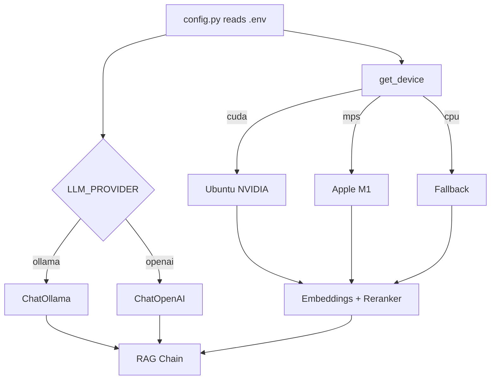

# Implementation Plan: ISO 15118 RAG Pipeline (Hybrid Stack, Cross-Platform)

> **Purpose**: A single, authoritative implementation plan that reconciles the existing
> planning documents ([`RAG_SPECIFICATION.md`](../RAG_SPECIFICATION.md),
> [`PIPELINE_IMPLEMENTATION_GUIDE.md`](../PIPELINE_IMPLEMENTATION_GUIDE.md),
> [`EVALUATION_AND_UI.md`](../EVALUATION_AND_UI.md),
> [`OPEN_SOURCE_MODELS.md`](../OPEN_SOURCE_MODELS.md)) into one buildable specification.
>
> **Target hardware**: Apple Silicon M1 (macOS, MPS) **and** Ubuntu PC with NVIDIA GPU (CUDA).
> **Model stack**: Hybrid — local open-source embeddings + reranker by default, LLM switchable
> between Ollama (local) and OpenAI (API) via `.env`.
> **Input corpus**: Three PDFs in [`Iso/`](../Iso) — ISO 15118-1, ISO 15118-2, ISO 15118-3.

---

## 1. Goals and Scope

### 1.1 Goal
Build a RAG system that ingests the three ISO 15118 PDFs and answers natural-language questions
with high precision by exploiting the documents' structural hierarchy (clauses, tables,
cross-references), running identically on M1 and Ubuntu+NVIDIA.

### 1.2 Scope (full)
| Workstream | Included |
|---|---|
| Multi-PDF ingestion | Yes — all three ISO 15118 parts, with `document_id` metadata |
| Pairing 1 | Recursive chunking + Parent-Child retrieval |
| Pairing 2 | Section-based chunking + metadata-filtered hybrid search |
| Pairing 3 | Advanced ISO chunking + graph-enhanced hybrid retrieval + reranking |
| Evaluation harness | RAGAS + custom metrics + Markdown comparison report |
| Streamlit UI | Single-pipeline and compare-all-three modes |
| Cross-platform | Device auto-detect, per-OS dependency files, Ollama setup for both OSes |

### 1.3 Non-Goals
- Fine-tuning embedding or LLM models.
- Multi-user auth, cloud deployment, or real-time streaming (streaming is a post-MVP option).
- OCR of handwritten content.

---

## 2. Stack Decisions (Reconciled)

The existing docs conflict: the main plans assume OpenAI; [`OPEN_SOURCE_MODELS.md`](../OPEN_SOURCE_MODELS.md) and
[`requirements.txt`](../requirements.txt) assume a local stack. This plan resolves that with a
**hybrid, configurable** design.

| Component | Default (local) | Optional (API) | Notes |
|---|---|---|---|
| Orchestration | LangChain `>=0.3` | — | Core framework |
| PDF parsing | Docling + `langchain-docling` | — | Layout-aware, OCR, Markdown tables |
| Embeddings | `Qwen/Qwen3-Embedding-0.6B` via `HuggingFaceEmbeddings` | `text-embedding-3-small` | Local default; device auto-detected |
| Reranker | `BAAI/bge-reranker-v2-m3` via `sentence-transformers` | — | Pairing 3 Stage 4 |
| LLM | `llama3` via `ChatOllama` | `gpt-4o-mini` via `ChatOpenAI` | Switch via `LLM_PROVIDER` |
| Vector store | Chroma (`langchain-chroma`) | — | Local persistence, metadata filters |
| Keyword search | BM25 (`rank_bm25`) | — | Exact ISO acronym matching |
| Graph | NetworkX | — | Cross-reference graph prototype |
| Eval | RAGAS + pandas | — | Uses the configured LLM/embeddings |
| UI | Streamlit | — | Pure Python |

**Rationale**: Local embeddings/reranker keep the corpus private and avoid per-token cost; the
LLM is the only component where API quality may be preferred, so it is the single switchable knob.

---

## 3. Cross-Platform Strategy

This is the primary new concern relative to the existing plans. Three mechanisms make one
codebase run on both targets.

### 3.1 Device Auto-Detection

A single helper resolves the compute device at runtime. **Never hardcode `device="cuda"`**
(as [`OPEN_SOURCE_MODELS.md`](../OPEN_SOURCE_MODELS.md:34) currently does).

```python
# models/device.py
import os
import torch

def get_device() -> str:
    """Return the best available device: cuda > mps > cpu."""
    if torch.cuda.is_available():
        return "cuda"
    if getattr(torch.backends, "mps", None) and torch.backends.mps.is_available():
        return "mps"
    return "cpu"

# MPS lacks some ops; allow CPU fallback so M1 does not crash.
os.environ.setdefault("PYTORCH_ENABLE_MPS_FALLBACK", "1")
```

### 3.2 Provider Factories

All model construction goes through factories so no module imports a concrete provider directly.

```python
# models/embeddings.py
from langchain_huggingface import HuggingFaceEmbeddings
from models.device import get_device
from config import EMBEDDING_MODEL

def get_embeddings():
    return HuggingFaceEmbeddings(
        model_name=EMBEDDING_MODEL,
        model_kwargs={"device": get_device()},
        encode_kwargs={"normalize_embeddings": True},
    )
```

```python
# models/llm.py
from config import LLM_PROVIDER, LLM_MODEL, OLLAMA_BASE_URL

def get_llm():
    if LLM_PROVIDER == "openai":
        from langchain_openai import ChatOpenAI
        return ChatOpenAI(model=LLM_MODEL, temperature=0)
    from langchain_ollama import ChatOllama
    return ChatOllama(model=LLM_MODEL, temperature=0, base_url=OLLAMA_BASE_URL)
```

```python
# models/reranker.py
from sentence_transformers import CrossEncoder
from models.device import get_device
from config import RERANKER_MODEL

_reranker = None

def get_reranker() -> CrossEncoder:
    global _reranker
    if _reranker is None:
        _reranker = CrossEncoder(RERANKER_MODEL, max_length=512, device=get_device())
    return _reranker
```

### 3.3 Per-OS Dependency Files

`requirements.txt` holds the platform-agnostic base. PyTorch is installed separately because the
correct wheel differs per OS/accelerator.

| File | Purpose |
|---|---|
| `requirements.txt` | Base: LangChain, Docling, Chroma, BM25, NetworkX, Streamlit, RAGAS, utils |
| `requirements-macos.txt` | `torch` (default PyPI wheel includes MPS) |
| `requirements-linux-cuda.txt` | `torch` from the CUDA index URL |

```txt
# requirements.txt (base)
langchain>=0.3.0
langchain-core>=0.3.0
langchain-community>=0.3.0
langchain-chroma>=0.2.0
langchain-text-splitters>=0.3.0
langchain-huggingface>=0.1.0
langchain-ollama>=0.2.0
langchain-openai>=0.2.0        # optional provider
docling>=2.0.0
langchain-docling>=0.1.0
rank_bm25>=0.2.2
chromadb>=0.5.0
networkx>=3.0
sentence-transformers>=3.0
transformers>=4.40
ragas>=0.2.0
datasets>=2.20.0
pandas>=2.0
streamlit>=1.38.0
python-dotenv>=1.0
pydantic>=2.0
pytest>=8.0
```

```txt
# requirements-macos.txt
-r requirements.txt
torch>=2.2
```

```txt
# requirements-linux-cuda.txt
-r requirements.txt
--extra-index-url https://download.pytorch.org/whl/cu124
torch>=2.2
```

### 3.4 Ollama Setup per Platform

| Platform | Install | GPU | Pull model |
|---|---|---|---|
| macOS M1 | `brew install ollama` or the Ollama app | Metal (automatic) | `ollama pull llama3` |
| Ubuntu + NVIDIA | `curl -fsSL https://ollama.com/install.sh \| sh` | CUDA (automatic if driver present) | `ollama pull llama3` |

Verify with `ollama run llama3 "hello"`. If `LLM_PROVIDER=openai`, Ollama is not required.

### 3.5 System-Level Prerequisites

| Platform | Extra system packages |
|---|---|
| macOS M1 | `brew install tesseract` (Docling OCR), Xcode CLT |
| Ubuntu + NVIDIA | `apt install tesseract-ocr libgl1 libglib2.0-0`, NVIDIA driver + CUDA runtime |

### 3.6 Cross-Platform Flow



---

## 4. Repository Layout

```
Rags_2_Riches/
├── .env.example
├── requirements.txt
├── requirements-macos.txt
├── requirements-linux-cuda.txt
├── config.py
├── main.py                       # CLI demo (all three pairings)
├── README.md
├── Iso/                          # INPUT: ISO-15118-1/2/3.pdf
├── models/
│   ├── __init__.py
│   ├── device.py                 # device auto-detect
│   ├── embeddings.py             # embedding factory
│   ├── llm.py                    # LLM factory (ollama/openai)
│   └── reranker.py               # cross-encoder reranker
├── ingestion/
│   ├── __init__.py
│   ├── loader.py                 # multi-PDF loading + cleaning
│   ├── chunking_pair1.py
│   ├── chunking_pair2.py
│   └── chunking_pair3.py
├── graph/
│   ├── __init__.py
│   └── builder.py
├── retrieval/
│   ├── __init__.py
│   ├── pair1_retriever.py
│   ├── pair2_retriever.py
│   └── pair3_retriever.py
├── chain/
│   ├── __init__.py
│   └── rag_chain.py
├── eval/
│   ├── test_queries.json
│   ├── evaluator.py
│   └── report_generator.py
├── ui/
│   ├── __init__.py
│   ├── app.py
│   ├── pipeline_registry.py
│   └── components.py
├── tests/
│   └── smoke_test.py
└── plans/
    └── IMPLEMENTATION_PLAN.md    # this file
```

---

## 5. Configuration

### 5.1 `.env.example`

```env
# --- LLM provider (hybrid switch) ---
LLM_PROVIDER=ollama            # ollama | openai
LLM_MODEL=llama3               # or gpt-4o-mini when provider=openai
OLLAMA_BASE_URL=http://localhost:11434
OPENAI_API_KEY=                # only needed when LLM_PROVIDER=openai

# --- Embeddings (local default) ---
EMBEDDING_MODEL=Qwen/Qwen3-Embedding-0.6B
# EMBEDDING_MODEL=ibm-granite/granite-embedding-english-r2

# --- Reranker ---
RERANKER_MODEL=BAAI/bge-reranker-v2-m3

# --- Device override (blank = auto-detect) ---
DEVICE=                         # cuda | mps | cpu | (blank)

# --- Vector store ---
CHROMA_PERSIST_DIR=./chroma_db

# --- Retrieval ---
TOP_K=5
HYBRID_VECTOR_WEIGHT=0.6
HYBRID_BM25_WEIGHT=0.4
RERANK_TOP_N=20

# --- Input corpus ---
ISO_PDF_DIR=./Iso
```

### 5.2 `config.py`

```python
import os
from dotenv import load_dotenv

load_dotenv()

# LLM
LLM_PROVIDER = os.getenv("LLM_PROVIDER", "ollama")
LLM_MODEL = os.getenv("LLM_MODEL", "llama3")
OLLAMA_BASE_URL = os.getenv("OLLAMA_BASE_URL", "http://localhost:11434")

# Embeddings / reranker
EMBEDDING_MODEL = os.getenv("EMBEDDING_MODEL", "Qwen/Qwen3-Embedding-0.6B")
RERANKER_MODEL = os.getenv("RERANKER_MODEL", "BAAI/bge-reranker-v2-m3")
DEVICE_OVERRIDE = os.getenv("DEVICE", "").strip() or None

# Chunking
PAIR1_CHILD_CHUNK_SIZE = 256
PAIR1_CHILD_OVERLAP = 25
PAIR1_PARENT_CHUNK_SIZE = 1024
PAIR1_PARENT_OVERLAP = 100
PAIR2_CHUNK_SIZE = 512
PAIR2_CHUNK_OVERLAP = 50
PAIR3_CHUNK_SIZE = 512
PAIR3_CHUNK_OVERLAP = 50

# Retrieval
TOP_K = int(os.getenv("TOP_K", 5))
HYBRID_VECTOR_WEIGHT = float(os.getenv("HYBRID_VECTOR_WEIGHT", 0.6))
HYBRID_BM25_WEIGHT = float(os.getenv("HYBRID_BM25_WEIGHT", 0.4))
RERANK_TOP_N = int(os.getenv("RERANK_TOP_N", 20))

# Vector store
CHROMA_PERSIST_DIR = os.getenv("CHROMA_PERSIST_DIR", "./chroma_db")

# Input
ISO_PDF_DIR = os.getenv("ISO_PDF_DIR", "./Iso")
```

`models/device.py` honors `DEVICE_OVERRIDE` before auto-detection.

---

## 6. Module Specifications

The chunking, retrieval, graph, and chain logic is already specified in detail in
[`RAG_SPECIFICATION.md`](../RAG_SPECIFICATION.md:184) (Section 5) and
[`PIPELINE_IMPLEMENTATION_GUIDE.md`](../PIPELINE_IMPLEMENTATION_GUIDE.md:105). This plan reuses
that logic with the following **required modifications** for the hybrid stack and multi-PDF corpus.

### 6.1 `ingestion/loader.py` — Multi-PDF (CHANGED)

**Signature**:
```python
def load_iso_documents(pdf_dir: str, use_ocr: bool = True) -> list[Document]
```

**Changes vs. existing plan**:
1. Iterate over every `*.pdf` in `ISO_PDF_DIR` (three files), not a single path.
2. Derive `document_id` from the filename (e.g., `ISO-15118-2.pdf` -> `15118-2`).
3. Attach metadata: `document_id`, `source_file`, `page_number`.
4. Keep header/footer stripping (`Page X of Y`, standalone page numbers, ISO copyright lines).
5. Log per-file document counts so ingestion failures are visible.

**Why**: All downstream metadata filters and the graph must be able to scope by `document_id`
across the three parts.

### 6.2 Chunking Modules (UNCHANGED LOGIC, metadata addition)

- [`ingestion/chunking_pair1.py`](../RAG_SPECIFICATION.md:208) — parent/child chunks.
- [`ingestion/chunking_pair2.py`](../RAG_SPECIFICATION.md:237) — section-based chunks.
- [`ingestion/chunking_pair3.py`](../RAG_SPECIFICATION.md:271) — tables + clauses + cross-refs.

**Required change**: propagate `document_id` into every chunk's metadata (all three modules).

### 6.3 `graph/builder.py` (UNCHANGED LOGIC)

As specified in [`RAG_SPECIFICATION.md`](../RAG_SPECIFICATION.md:311).
**Change**: include `document_id` in the node ID so identical clause numbers across the three
parts do not collide (e.g., `15118-2:4.1.2_ab12cd34`).

### 6.4 Retrieval Modules (SWAP EMBEDDINGS)

- [`retrieval/pair1_retriever.py`](../RAG_SPECIFICATION.md:333)
- [`retrieval/pair2_retriever.py`](../RAG_SPECIFICATION.md:360)
- [`retrieval/pair3_retriever.py`](../RAG_SPECIFICATION.md:394)

**Required change**: replace every `OpenAIEmbeddings(...)` with `get_embeddings()` from
[`models/embeddings.py`](models/embeddings.py). Add `document_id` to the SelfQuery metadata
field list in Pairing 3.

### 6.5 `retrieval/pair3_retriever.py` — Reranking (NEW STAGE)

Add Stage 4 using the cross-encoder from [`models/reranker.py`](models/reranker.py):

```python
def rerank(query: str, docs: list[Document], top_k: int) -> list[Document]:
    reranker = get_reranker()
    pairs = [[query, d.page_content] for d in docs]
    scores = reranker.predict(pairs)
    ranked = [d for _, d in sorted(zip(scores, docs), key=lambda x: x[0], reverse=True)]
    return ranked[:top_k]
```

Apply after graph expansion, before returning context to the chain.

### 6.6 `chain/rag_chain.py` (SWAP LLM)

As specified in [`RAG_SPECIFICATION.md`](../RAG_SPECIFICATION.md:438).
**Change**: replace `ChatOpenAI(...)` with `get_llm()` from [`models/llm.py`](models/llm.py).
Update the system prompt to mention the three ISO 15118 parts and to cite `document_id` + section.

### 6.7 `main.py` (UPDATED)

```python
from ingestion.loader import load_iso_documents
from ingestion.chunking_pair1 import create_parent_child_chunks
from ingestion.chunking_pair2 import create_section_based_chunks
from ingestion.chunking_pair3 import create_advanced_iso_chunks
from retrieval.pair1_retriever import build_parent_child_retriever
from retrieval.pair2_retriever import build_metadata_filtered_hybrid_retriever
from retrieval.pair3_retriever import build_graph_enhanced_retriever, graph_expanded_retrieve
from graph.builder import build_cross_reference_graph
from chain.rag_chain import build_rag_chain
from config import ISO_PDF_DIR

docs = load_iso_documents(ISO_PDF_DIR, use_ocr=True)

# Pairing 1
parent_chunks, child_chunks = create_parent_child_chunks(docs)
chain1 = build_rag_chain(build_parent_child_retriever(child_chunks, parent_chunks))

# Pairing 2
chunks2 = create_section_based_chunks(docs)
retriever2, _ = build_metadata_filtered_hybrid_retriever(chunks2)
chain2 = build_rag_chain(retriever2)

# Pairing 3
chunks3 = create_advanced_iso_chunks(docs)
graph = build_cross_reference_graph(chunks3)
retriever3, _, graph = build_graph_enhanced_retriever(chunks3, graph)
chain3 = build_rag_chain(lambda q: graph_expanded_retrieve(q, retriever3, graph))
```

### 6.8 Evaluation Harness

As specified in [`EVALUATION_AND_UI.md`](../EVALUATION_AND_UI.md:102) (Part A). **Changes**:
- `eval/evaluator.py` must pass the configured LLM/embeddings into `ragas.evaluate(...)`
  (`llm=get_llm()`, `embeddings=get_embeddings()`) so evaluation works with Ollama.
- Add a `document_id` column to per-query rows and to the report's reproducibility appendix.
- Note: RAGAS with a local 8B model is slower and noisier than with `gpt-4o-mini`; document
  that `LLM_PROVIDER=openai` is recommended for the evaluation run only.

### 6.9 Streamlit UI

As specified in [`EVALUATION_AND_UI.md`](../EVALUATION_AND_UI.md:345) (Part B). **Changes**:
- `ui/pipeline_registry.py` calls `load_iso_documents(ISO_PDF_DIR)` (multi-PDF).
- Add a `document_id` filter in the sidebar (in addition to the Pairing 2 section filter).
- Surface device and provider in the sidebar caption (e.g., `device: mps | provider: ollama`).
- Wrap pipeline construction in `@st.cache_resource` (already specified).

---

## 7. Milestones

### Milestone 1 — Skeleton and Cross-Platform Bootstrap
- Create the folder structure in Section 4.
- Add `requirements.txt`, `requirements-macos.txt`, `requirements-linux-cuda.txt`, `.env.example`.
- Implement `config.py` and `models/device.py`.
- Verify `get_device()` returns `mps` on M1 and `cuda` on Ubuntu+NVIDIA.

### Milestone 2 — Model Factories
- Implement `models/embeddings.py`, `models/llm.py`, `models/reranker.py`.
- Verify embeddings load on the detected device and `get_llm()` returns the configured provider.
- Verify Ollama is reachable when `LLM_PROVIDER=ollama`.

### Milestone 3 — Multi-PDF Ingestion
- Implement `ingestion/loader.py` for the three PDFs.
- Test: document count > 0 per file; `document_id` present; tables appear as Markdown.

### Milestone 4 — Pairing 1
- Implement `ingestion/chunking_pair1.py`, `retrieval/pair1_retriever.py`, `chain/rag_chain.py`.
- Test: every child has a `parent_id` present in the parent set; answers cite sections.

### Milestone 5 — Pairing 2
- Implement `ingestion/chunking_pair2.py`, `retrieval/pair2_retriever.py`.
- Test: `section_number` and `heading_path` populated; filtered query on a section works.

### Milestone 6 — Pairing 3
- Implement `ingestion/chunking_pair3.py`, `graph/builder.py`, `retrieval/pair3_retriever.py`.
- Add the reranking stage.
- Test: table chunks exist; cross-references populate; graph has edges; rerank reorders results.

### Milestone 7 — Evaluation Harness
- Create `eval/test_queries.json` (20-30 queries across the six categories).
- Implement `eval/evaluator.py` and `eval/report_generator.py`.
- Run evaluation; confirm `eval/report.md` is generated with all three pipelines compared.

### Milestone 8 — Streamlit UI
- Implement `ui/pipeline_registry.py`, `ui/components.py`, `ui/app.py`.
- Verify pipeline selector, chat with sources, compare-all-three mode, and chat export.

### Milestone 9 — Evaluation Data, Metric Library, and Judge
- Extend the query set into a gold set `eval/gold_set.json` (query, category, `gold_answer`,
  `gold_relevant_sections`, expected content type); at least 30 queries.
- Implement `eval/metrics.py`: Recall@k, Precision@k, MRR, nDCG@k (k = 1, 3, 5, 10) using
  section-based relevance, plus chunk statistics and index size.
- Implement `eval/judge.py`: a single deterministic LLM judge (same model, temperature 0, fixed
  prompts) scoring relevance density, boundary coherence, faithfulness, answer relevance, answer
  correctness, and citation accuracy; robust JSON parsing with retry + regex fallback; flags a
  metric when the judge is unavailable.
- Implement `eval/runner.py`: run one pairing over the gold set capturing retrieved chunk ids and
  sections, answers, retrieval/generation latency, indexing time, index size, and LLM-call/token
  counts; support repeated runs for variance.
- Add a `tests/` pytest suite with deterministic unit tests for `eval/metrics.py` (no model loads)
  and `tests/smoke_test.py`.
- Deliverable: gold set + metric/judge/runner modules + green unit tests.

### Milestone 10 — Pairing 1 Thorough Evaluation
- Run the full suite (retrieval, chunking, generation, efficiency) on Pairing 1 across the gold set.
- Generate `eval/report_pair1.md`; document process, failures, and mitigations in `docs/MILESTONE_10.md`.

### Milestone 11 — Pairing 2 Thorough Evaluation
- Run the full suite on Pairing 2.
- Generate `eval/report_pair2.md`; document process, failures, and mitigations in `docs/MILESTONE_11.md`.

### Milestone 12 — Pairing 3 Thorough Evaluation
- Run the full suite on Pairing 3.
- Generate `eval/report_pair3.md`; document process, failures, and mitigations in `docs/MILESTONE_12.md`.

### Milestone 13 — Cross-Pair Comparison Report (`RAG_EVAL_METRICS.md` deliverable)
- Implement `eval/comparison_report.py` producing `eval/RAG_EVAL_REPORT.md` with:
  1. summary table (all four metric categories, one row per pair),
  2. retrieval-quality ranking (Recall@k / MRR / nDCG),
  3. generation-quality ranking (faithfulness / correctness),
  4. efficiency tradeoff note,
  5. overall recommendation,
  6. variance, and explicit flags for any uncomputable metric.
- Enforce identical judge model, prompts, and temperature across all three pairs.

### Milestone 14 — Cross-Platform Validation, CLI, and Docs
- Wire `main.py` to run all three pairings end-to-end.
- Ensure the `pytest` suite and `tests/smoke_test.py` pass on the verification host.
- Validate on **both** M1 (MPS) and Ubuntu+NVIDIA (CUDA); compare retrieved sections for parity.
- Write `README.md` with per-OS setup and run instructions; capture UI screenshots; finalize `.env.example`.

### Milestone 16 — Evaluation & Comparison Dashboard (extension)
- Add a second Streamlit tab that visualises the evaluation results:
  - `ui/eval_data.py` — load `eval/result_pair{1,2,3}.json` + `eval/RAG_EVAL_REPORT.md`.
  - `ui/charts.py` — Altair grouped bars, quality-vs-latency bubble, category heatmap, simple bars.
  - `ui/eval_dashboard.py` — `render_dashboard()` with summary table, charts, efficiency/flags tables.
  - `ui/app.py` — two tabs: **Ask (Chat)** and **Evaluation & Comparison**.
- Graceful empty state showing the commands to generate results; **Refresh data** button.
- Tests: `tests/test_eval_dashboard.py` + `AppTest` execution of the full app.
- (M15 — index prebuild/reuse — was **removed from scope** at the user's request.)

### 7.1 Metric Mapping (`RAG_EVAL_METRICS.md`)

| RAG_EVAL_METRICS.md item | Implementation | Adaptation for this project |
|---|---|---|
| Recall@k / Precision@k / MRR / nDCG@k | `eval/metrics.py` | Chunks are generated at runtime, so relevance is **section-based**: a retrieved chunk is relevant iff its `(document_id, section_number)` is in the query's `gold_relevant_sections`. k ∈ {1,3,5,10}. |
| Avg chunk size / Chunk count | `eval/metrics.py`, `eval/runner.py` | Count and mean size (chars, and tokens via the embedding tokenizer) per pairing. |
| Relevance density / Boundary coherence | `eval/judge.py` | LLM-judge 0–1, fixed prompt, temperature 0; boundary coherence detects mid-clause / mid-table splits. |
| Faithfulness / Answer relevance / Answer correctness / Citation accuracy | `eval/judge.py` (+ optional RAGAS) | The custom judge is authoritative (local RAGAS yields `nan` — see §13.13); RAGAS is computed only when a stronger judge LLM is configured. |
| Indexing time / Query latency / Index storage size / Tokens & LLM calls per query | `eval/runner.py` | Wall-clock timing; Chroma directory size; LLM-call counter plus token usage from response metadata when available. |
| Variance | `eval/runner.py` | Retrieval metrics are deterministic; generation metrics run N times (configurable) and report mean ± std. |
| Flag uncomputable metrics | `eval/comparison_report.py` | Metrics with missing inputs (e.g. no gold answer) render as `unavailable` with a reason — never omitted. |

**Judging rules enforced**: one judge model, one prompt set, temperature 0, identical scoring
criteria for all three pairs (`RAG_EVAL_METRICS.md` Rules).

---

## 8. Testing Strategy

### 8.1 Unit-Level
- **Device**: `get_device()` returns a valid device on both platforms; `DEVICE` override respected.
- **Loader**: each of the three PDFs yields documents; `document_id` set; tables preserved.
- **Pairing 1**: parent count > child count; every child `parent_id` exists in parents.
- **Pairing 2**: `section_number` matches the clause regex; `heading_path` non-empty.
- **Pairing 3**: at least one `content_type="table"` chunk; `cross_references` populated.
- **Graph**: node count == chunk count; edges > 0; no cross-document ID collisions.
- **Reranker**: `rerank()` returns `top_k` docs ordered by descending score.

### 8.2 Retrieval-Level
Run these on each pairing and inspect metadata:
1. `"What is the maximum charging voltage?"` -> table chunk or parameter section.
2. `"Describe the SLAC communication setup."` -> SLAC section.
3. `"What clauses does Section 4.2 reference?"` -> graph expansion (Pairing 3).
4. `"What does ISO 15118-3 say about PLC?"` -> correct `document_id`.

### 8.3 End-to-End
- `python main.py` runs all three chains without errors and prints cited answers.
- `streamlit run ui/app.py` serves at `localhost:8501` on both platforms.

### 8.4 Cross-Platform Parity
- Run `tests/smoke_test.py` on M1 and Ubuntu+NVIDIA; compare retrieved sections for the same
  queries. Differences should be limited to floating-point ordering, not content.

---

## 9. Acceptance Criteria

- [ ] All three pipelines run end-to-end on **both** M1 and Ubuntu+NVIDIA.
- [ ] `get_device()` selects `mps` on M1 and `cuda` on Ubuntu+NVIDIA without code changes.
- [ ] `LLM_PROVIDER` switches between Ollama and OpenAI with no code changes.
- [ ] All three ISO PDFs are ingested with distinct `document_id` values.
- [ ] Pairing 3 chunks contain both `content_type="table"` and `content_type="text"`.
- [ ] Cross-reference graph contains at least one edge.
- [ ] Every retrieved chunk in Pairings 2 and 3 has `section_number` populated.
- [ ] Per-pairing reports (`eval/report_pair1.md`, `report_pair2.md`, `report_pair3.md`) contain
      all four metric categories from `RAG_EVAL_METRICS.md`.
- [ ] `eval/RAG_EVAL_REPORT.md` includes the summary table, retrieval/generation rankings, the
      efficiency tradeoff note, and an overall recommendation.
- [ ] Deterministic metric unit tests pass via `pytest`.
- [ ] Every uncomputable metric is explicitly flagged with a reason, not omitted.
- [ ] The same judge model, prompts, and temperature are used for all three pairs.
- [ ] Streamlit UI runs at `localhost:8501` with single and compare-all-three modes.
- [ ] Every UI answer shows source chunks with section + document metadata.
- [ ] No hardcoded secrets; all config via `.env`; no hardcoded `device="cuda"`.
- [ ] All code is type-hinted and imports cleanly.

---

## 10. Known Pitfalls and Mitigations

| Pitfall | Mitigation |
|---|---|
| Hardcoded `device="cuda"` breaks M1 | Always use `get_device()`; honor `DEVICE` override |
| MPS lacks some PyTorch ops | Set `PYTORCH_ENABLE_MPS_FALLBACK=1` |
| Wrong PyTorch wheel on Ubuntu | Install via `requirements-linux-cuda.txt` CUDA index URL |
| Docling OCR fails on Linux | Install `tesseract-ocr` + `libgl1` + `libglib2.0-0` |
| Ollama not running | Check `ollama run llama3 "hello"`; surface error in UI via `st.error` |
| RAGAS slow/noisy with local 8B LLM | Use `LLM_PROVIDER=openai` for the evaluation run only |
| Clause numbers collide across the 3 parts | Include `document_id` in graph node IDs and metadata filters |
| Docling empty tables on scanned PDFs | Ensure `do_ocr=True`; verify Tesseract installed |
| Cross-reference matches `4.1` to `4.10` | Match `target == ref or target.startswith(ref + ".")` |
| Chroma `$eq` filter incompatibility | Fall back to `where={"section_number": section_filter}` |
| Graph expansion adds too many chunks | `max_depth=1`, cap at `top_k * 2`, then rerank |
| Re-embedding on every UI session | `@st.cache_resource` on pipeline construction |

---

## 11. Commands Cheat Sheet

### macOS (Apple Silicon M1)
```bash
python3.12 -m venv .venv
source .venv/bin/activate
pip install -r requirements-macos.txt
brew install tesseract
brew install ollama && ollama serve &   # or launch the Ollama app
ollama pull llama3
python main.py
streamlit run ui/app.py
```

### Ubuntu (NVIDIA GPU)
```bash
python3.12 -m venv .venv
source .venv/bin/activate
pip install -r requirements-linux-cuda.txt
sudo apt install -y tesseract-ocr libgl1 libglib2.0-0
curl -fsSL https://ollama.com/install.sh | sh
ollama pull llama3
python main.py
streamlit run ui/app.py
```

### Both
```bash
python tests/smoke_test.py
# Optional: switch to API LLM for evaluation
LLM_PROVIDER=openai LLM_MODEL=gpt-4o-mini python main.py
```

---

## 12. Post-MVP Enhancements

- Streaming answers (`chain.stream` + `st.write_stream`).
- Cross-encoder reranking for Pairings 1 and 2 as well.
- Parent-Child + Graph hybrid retrieval.
- RAGAS regression tracking across commits.
- Docker image with CUDA base for reproducible Ubuntu deployment.

---

## 13. Verified Environment and Deviations

Milestone 1 was executed and verified on the **Ubuntu + NVIDIA** target (RTX 3050, driver 616.92,
Python 3.12.13). The dependency resolver pulled **newer major versions than the `>=` floors
originally assumed**, which changes some import paths. This section is the authoritative record;
update it when the macOS/M1 environment is verified.

### 13.1 Resolved Versions (Ubuntu + NVIDIA)

Locked in [`requirements.lock`](../requirements.lock).

| Package | Resolved | Notes |
|---|---|---|
| `langchain` | 1.4.2 | Major jump from the planned 0.3 line |
| `langchain-core` | 1.6.4 | |
| `langchain-classic` | 1.0.8 | **Holds the legacy retrievers/chains** |
| `langchain-community` | 0.4.2 | `BM25Retriever` lives here |
| `langchain-chroma` | 1.1.0 | |
| `langchain-huggingface` | 1.2.2 | |
| `langchain-ollama` | 1.1.0 | |
| `langchain-openai` | 1.6.5 | |
| `langchain-text-splitters` | 1.1.2 | |
| `docling` | 2.130.0 | |
| `chromadb` | 1.5.9 | |
| `sentence-transformers` | 6.1.0 | |
| `transformers` | 5.17.0 | |
| `ragas` | 0.3.1 | |
| `streamlit` | 1.64.0 | |
| `torch` | 2.14.0+cu130 | CUDA path verified |
| `networkx` | 3.7 | |

**Device verification**: `get_device()` returned `cuda (NVIDIA GeForce RTX 3050)`;
`torch.cuda.is_available()` was `True`.

### 13.2 Import-Path Deviations (LangChain 1.x)

The plans referenced `langchain.retrievers` and `langchain.storage`. These modules **no longer
exist**; the legacy classes moved to `langchain_classic`. All later milestones must import:

| Class | Correct import (verified installed) |
|---|---|
| `ParentDocumentRetriever` | `from langchain_classic.retrievers import ParentDocumentRetriever` |
| `EnsembleRetriever` | `from langchain_classic.retrievers import EnsembleRetriever` |
| `SelfQueryRetriever` | `from langchain_classic.retrievers import SelfQueryRetriever` |
| `InMemoryStore` | `from langchain_classic.storage import InMemoryStore` |
| `AttributeInfo` | `from langchain_classic.chains.query_constructor.base import AttributeInfo` |
| `BM25Retriever` | `from langchain_community.retrievers import BM25Retriever` |

All other planned imports (`langchain_core.*`, `langchain_text_splitters`,
`langchain_huggingface`, `langchain_ollama`, `langchain_openai`, `langchain_chroma`) were
verified present and unchanged.

### 13.3 Dependency Floor Updates

Treat the floors in Sections 2.1/3.3 as minimums; the installed 1.x line is what the code
targets. `langchain-classic` is pulled transitively today but must be declared explicitly in the
base requirements because the code imports it directly.

### 13.4 PyTorch 2.14 Native-JIT / Triton Requires a C Compiler (RESOLVED)

On the Ubuntu + NVIDIA target (no `gcc`/`clang` installed), the **first CUDA op** raised:

```
RuntimeError: Failed to find C compiler. Please specify via CC environment variable
or set triton.knobs.build.impl.
```

Root cause: PyTorch 2.14 routes ordinary ops (e.g. Qwen3 RoPE matmul) through a "native" DSL
backed by **Triton**, which JIT-compiles a C shim and therefore needs a host C compiler.
`attn_implementation="eager"` and `TRITON_INTERPRET=1` did **not** help.

**Mitigation (implemented)**: [`models/device.py`](../models/device.py) now sets
`TORCH_DISABLE_NATIVE_JIT=1` before torch is imported, forcing eager kernels. This removes the
need for a C compiler and preserves GPU acceleration. Verified: CUDA embeddings (1024-dim) and
the cross-encoder reranker both run on the RTX 3050 with the flag set.

**Alternative** (if a compiler is available): `sudo apt install -y build-essential` on Ubuntu,
or Xcode Command Line Tools (`xcode-select --install`) on macOS.

### 13.5 LLM Model Default Alignment

The plan's command examples use `llama3`, but the verified environment has
`llama3.2:3b-instruct-q4_K_M` pulled in Ollama (llama3 was not installed). The default
`LLM_MODEL` was aligned to the installed model in [`config.py`](../config.py) and
[`.env.example`](../.env.example) so a fresh run works out of the box. Set `LLM_MODEL=llama3`
(or pull it via `ollama pull llama3`) if that model is preferred.

### 13.6 Hugging Face Hub Rate Limits

The HF Hub warns that unauthenticated requests are rate-limited and slower. Set `HF_TOKEN` in
the environment (or run `huggingface-cli login`) for reliable model downloads. Not required, but
recommended for first-time pulls of the embedding (~1.2 GB) and reranker (~2.3 GB) models.

### 13.7 Docling Ingestion: API, OCR Default, and Memory (RESOLVED)

The plan's loader assumed `DoclingLoader(file_path, pipeline_options=...)` and `use_ocr=True`.
The installed langchain-docling 3.0.0 exposes `converter`/`convert_kwargs`/`export_type` instead,
and OCR caused an **OOM kill** on the 7.7 GB machine while converting ISO-15118-2 (350 pages).

**Implemented** ([`ingestion/loader.py`](../ingestion/loader.py)):
- Drive `docling.document_converter.DocumentConverter` directly with `PdfPipelineOptions`.
- `do_ocr` defaults to **False** (the ISO PDFs have a text layer; OCR is the memory hog).
- `ocr_batch_size = layout_batch_size = table_batch_size = DOCLING_BATCH_SIZE` (default 1).
- Accelerator device mapped from `get_device()` (`cuda`/`mps`/`cpu`).
- Converted `DoclingDocument`s cached as JSON under `DOCLING_CACHE_DIR` (`data/parsed/`).

Result: all three PDFs ingest successfully (15 / 348 / 86 pages). Raise `DOCLING_BATCH_SIZE` on
machines with more RAM; enable `use_ocr=True` only for scanned PDFs.

### 13.8 Page Metadata: One Document per PDF

`ExportType.MARKDOWN` returns one document per PDF with **no page metadata** (`dl_meta` is
`None`). Splitting per page would break section boundaries needed by Pairings 2 and 3.

**Implemented**: one `Document` per PDF, with page boundaries stored as character offsets
(`page_breaks`) derived from `export_to_markdown(page_break_placeholder=...)`. A helper
`page_for_offset(metadata, offset)` resolves any chunk offset to a 1-based page number. The
document-level `page_number` is `None`; chunkers should call `page_for_offset()` when they need a
page citation.

### 13.9 Env Flags Must Be Set Before torch Is Imported

`TORCH_DISABLE_NATIVE_JIT` is decided by torch **at import time**. Setting it in `models/device.py`
is insufficient when another module imports torch first (e.g. `ingestion.loader` imports Docling →
torch before `models.device` runs), which reproduced the Milestone 2 "Failed to find C compiler"
error. **Implemented**: both `TORCH_DISABLE_NATIVE_JIT=1` and `PYTORCH_ENABLE_MPS_FALLBACK=1` are
set at the very top of [`config.py`](../config.py) and [`ingestion/loader.py`](../ingestion/loader.py),
before any torch import. Any new entry point should import `config` first.

### 13.10 Chroma Batch Limit and Parent Document Retriever Constraints

Two library constraints surfaced during Pairing 1:
- Chroma caps a single upsert at ~5461 vectors; larger corpora failed. **Implemented**: a shared
  [`vectorstore/store.py`](../vectorstore/store.py) `add_documents_in_batches()` helper (batch size
  `VECTORSTORE_BATCH_SIZE`, default 1000), used by all retrievers. A new `vectorstore/` package was
  added to the layout for this.
- `langchain_classic`'s `ParentDocumentRetriever` requires non-`None` `child_splitter` and
  `parent_splitter` (pydantic). The plan's `child_splitter=None` fails. **Implemented**: pass real
  `RecursiveCharacterTextSplitter` instances (unused, because we pre-split chunks and populate the
  docstore/vector store manually with `id_key="parent_id"`).

### 13.11 Section Heading Extraction Robustness (Pairing 2)

The plan's section regex `^(#{1,4}\s*)?(\d+(?:\.\d+)*)\s+(.+)$` also matches **table-of-contents
dot-leader lines** (e.g. `7.6.1 Overview ..........`), which would create bogus sections, and
Docling sometimes renders a heading as `3.1.1\n\n## actor`.

**Implemented** ([`ingestion/chunking_pair2.py`](../ingestion/chunking_pair2.py)):
- Treat only hash-prefixed headings (`## 4.1 Title`) as clause headings; fall back to all matches
  only if none are hash-prefixed.
- Skip any candidate whose title contains a dot leader (`\.{4,}`).
- `_clean_title()` strips leading `#` and inline sub-headings.

Result: 3,827 section chunks, 100% with `section_number` and `heading_path`, across 407 distinct
sections. Metadata filtering (`section_number` `$eq`) was verified exact; `filtered_retrieve` falls
back from `filter=` to `where=` for Chroma version differences.

### 13.12 Pairing 3: Graph Hygiene, Chroma Metadata, and SelfQuery Availability

Three issues surfaced while building Pairing 3:
- **Graph edge explosion** (72,765 edges): `Table N`/`Figure N` references were matched against
  clause numbers, and short refs like `1` matched every `1.x` clause. **Implemented**: the chunker
  now emits clause-only `section_references` (kept separate from all `cross_references`), the graph
  uses those, prefers exact section matches, and caps fan-out at 20 targets per ref (→ 955 edges).
- **Duplicate chunk ids / empty-list metadata**: Chroma rejects duplicate ids and empty-list (or
  `None`) metadata values. **Implemented**: the Pairing 3 chunker de-duplicates exact-duplicate
  chunks, and [`vectorstore/store.py`](../vectorstore/store.py) sanitises metadata
  (`_chroma_safe_metadata`) on the copies sent to Chroma.
- **`SelfQueryRetriever.from_llm` unavailable**: langchain-community 0.4.2's self-query translators
  import `DatabricksVectorSearch`, which is missing, raising `ImportError`. **Implemented**:
  [`retrieval/pair3_retriever.py`](../retrieval/pair3_retriever.py) falls back to a plain vector
  retriever for Stage 1 and logs a warning. The automatic NL→metadata-filter translation is
  inactive until a compatible `langchain-community` is pinned.

Verified: 1,970 chunks (255 table), graph nodes == chunks, 955 edges, graph expansion adds
neighbours (1 seed → 10 docs), and the chain returns a grounded answer.

### 13.13 Evaluation Harness: RAGAS Import, Local-LLM Judging, Runtime, and Memory

- **RAGAS unimportable**: ragas 0.3.1 imports `langchain_community.chat_models.vertexai`, removed in
  langchain-community 0.4.2. **Implemented**: `eval/evaluator.py::install_ragas_shim()` injects a
  placeholder module into `sys.modules` before importing ragas.
- **RAGAS metrics `nan`**: the local `llama3.2:3b` judge does not reliably emit the strict JSON
  RAGAS requires (plus job timeouts). **Implemented**: custom metrics (hit rate, citation
  accuracy, latency) are authoritative; RAGAS is best-effort with `raise_exceptions=False`, and the
  report states when RAGAS is unavailable. Recommend `LLM_PROVIDER=openai` for RAGAS.
- **LCEL chain not callable**: LangChain 1.x `RunnableSequence` requires `.invoke()`, not
  `chain(query)`. **Implemented**: `_call()` helper.
- **System RAM OOM**: constructing all three pipelines at once exceeded 7.7 GB. **Implemented**:
  the evaluator builds/evaluates one pipeline at a time and `gc.collect()`s between.
- **GPU VRAM OOM**: the cross-encoder reranker plus the embedding model exceed 8 GB VRAM.
  Reranking is already guarded by `try/except` (degrades to unranked); run the reranker on CPU or
  use a smaller model on small GPUs.

CLI: `python -m eval.evaluator [--limit N] [--skip-ragas]`. Verified report shows Pairing 2 leading
on hit rate (0.667) and citation accuracy (1.000).

### 13.14 Streamlit UI: Lazy Pipeline Loading (Memory)

The plan's `pipeline_registry.py` built all three pipelines at startup into one cache; on an 8 GB
machine this exhausts memory (as proven in §13.13). **Implemented**
([`ui/pipeline_registry.py`](../ui/pipeline_registry.py)):
- `get_pipeline(name)` uses `@st.cache_resource` per name, so **single mode holds one pipeline**.
- `compare_all()` **bypasses the cache**, building/running/releasing each pipeline in turn with
  `gc.collect()` — memory-safe, at the cost of slower compare runs.
- The Pairing 2 section filter is the only metadata filter exposed (other pipelines have none), and
  the filter field is shown only for Pairing 2.

Also: `ui/app.py` executes Streamlit calls at import, so it is verified via `py_compile` + a live
headless server (`/_stcore/health` → `ok`, HTTP 200) plus logic tests of the importable registry,
rather than by importing the script.

---

**END OF IMPLEMENTATION PLAN**
