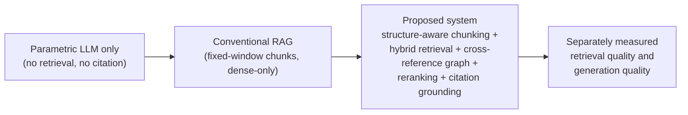

# Structure-Aware Retrieval for ISO Standard Documents: A Comparative Study of Chunking and Retrieval Strategies

---

**A Project Report submitted in partial fulfilment of the requirements for the award of the degree of**

**Master of Technology (M.Tech)**

**[DEPARTMENT NAME]**

**[UNIVERSITY NAME]**

---

**Submitted by:** [STUDENT NAME]

**Project Guide:** [GUIDE NAME]

**Submission Date:** [SUBMISSION DATE]

**M.Tech Phase 1 Report**

---

## Certificate

> **Note:** This page is a template. It must be completed and signed only by the authorized institutional signatories. No signature, seal, or approval has been generated or assumed by the author of this document.

This is to certify that the project report titled **"Structure-Aware Retrieval for ISO Standard Documents: A Comparative Study of Chunking and Retrieval Strategies"** submitted by **[STUDENT NAME]** ([DEPARTMENT NAME], [UNIVERSITY NAME]) is a bonafide record of the project work carried out under my supervision, in partial fulfilment of the requirements for the award of the degree of Master of Technology.

The work embodied in this report is original and has not been submitted elsewhere for the award of any other degree or diploma.

 

**[GUIDE NAME]**
Project Guide

Date: [DATE]

 

**[HOD NAME]**
Head of Department

Date: [DATE]

 

*(Institutional seal and authorized signatures to be affixed here.)*

---

## Abstract

Electric vehicle (EV) charging and vehicle-to-grid (V2G) communication are governed by the ISO 15118 standard family, a set of long, densely cross-referenced engineering documents containing exact message names, field identifiers, normative tables, and clause dependencies. Large language models (LLMs) can answer technical questions fluently, but when applied to such standards they frequently produce unsupported statements because the model's parametric knowledge does not reliably cover exact identifiers and clause-level detail. Retrieval-Augmented Generation (RAG) addresses this by grounding generation in retrieved passages, yet conventional RAG pipelines over engineering standards still suffer two distinct failure modes: retrieval failure (irrelevant or fragmented passages, tables split mid-row, clause relationships lost during chunking) and generation failure (answers not supported by the retrieved evidence).

This project develops a fully local RAG question-answering system over three ISO 15118 part documents (Parts 1, 2, and 3). The methodology is organized as a controlled comparison of three chunking × retrieval "pairings": Pairing 1 (recursive chunking with parent-child retrieval) as the baseline; Pairing 2 (section-aware chunking derived from structured PDF parsing labels, hybrid dense/BM25 retrieval fused with Reciprocal Rank Fusion); and Pairing 3 (table-first chunking with atomic tables, a cross-reference graph built with NetworkX for clause-dependency expansion, metadata-filtered SelfQuery retrieval, and cross-encoder reranking). Documents are parsed with Docling, which supplies the heading, annex, and table labels that drive structure-preserving chunking. Answers are generated by a local LLM served through Ollama (default `llama3.2:3b-instruct-q4_K_M`, with an optional OpenAI provider), and every answer must cite its source clauses.

Evaluation uses a 32-query gold set with deterministic retrieval metrics (Recall@5, Precision@5, nDCG@5, MRR, section recall), an LLM-as-judge for faithfulness, answer relevance, and answer correctness, and a deterministic citation-accuracy metric. Measured first-run results exist: Pairing 3 achieves the best retrieval quality (Recall@5 = 1.0, MRR = 0.9307), while Pairing 2 achieves the best generation quality and latency (citation accuracy 0.96, end-to-end 2660 ms). These are single-run measurements; multi-run variance analysis is identified as future work. The principal contribution is a reproducible, evidence-disciplined pipeline and evaluation harness demonstrating how structure-aware chunking, hybrid retrieval, and cross-reference reasoning improve grounded question answering over engineering standards.

---

## Acknowledgement

> **Note:** This page is a template. Personal and institutional details are supplied as placeholders and must be completed by the student.

I would like to express my sincere gratitude to my project guide, **[GUIDE NAME]**, for the continuous guidance, technical direction, and encouragement provided throughout the Phase 1 stage of this project. The advice on experimental design and evidence discipline materially shaped the methodology described in this report.

I am grateful to **[HOD NAME]**, Head of the Department of **[DEPARTMENT NAME]**, and to the faculty of **[UNIVERSITY NAME]** for providing the academic environment and resources necessary for this work.

I also thank my peers and colleagues for their constructive feedback during the first review, and my family for their support.

**[STUDENT NAME]**

---

## Table of Contents

> This table of contents spans the **entire** report. Later parts of the report must match this skeleton exactly.

**Preliminary Pages**

- Certificate
- Abstract
- Acknowledgement
- Table of Contents
- List of Figures
- List of Tables
- List of Abbreviations and Acronyms

**Chapter 1: Introduction**

- 1.1 Background
- 1.2 Retrieval-Augmented Generation
- 1.3 Technical Challenges in Engineering Standards
- 1.4 Motivation
- 1.5 Problem Statement
- 1.6 Objectives
- 1.7 Scope of the Project
- 1.8 Proposed Solution
- 1.9 Contributions of the Project
- 1.10 Organization of the Report

**Chapter 2: Literature Survey**

- 2.1 Introduction
- 2.2 Retrieval-Augmented Generation
- 2.3 Dense Semantic Retrieval
- 2.4 Sparse Keyword Retrieval and BM25
- 2.5 Hybrid Information Retrieval
- 2.6 Reciprocal Rank Fusion
- 2.7 Document Parsing and Structure-Aware Chunking
- 2.8 Reranking and Late-Interaction Retrieval
- 2.9 Graph-Based Retrieval over Structured Corpora
- 2.10 Evaluation of RAG Systems
- 2.11 Comparative Summary of Existing Approaches
- 2.12 Research Gap
- 2.13 Chapter Summary

**Chapter 3: System Requirements Specification**

- 3.1 System Overview
- 3.2 User Requirements
- 3.3 Functional Requirements
- 3.4 Non-Functional Requirements
- 3.5 Hardware Requirements
- 3.6 Software Requirements
- 3.7 System Constraints
- 3.8 Assumptions and Dependencies
- 3.9 Test Case Specification
- 3.10 Requirements Traceability Matrix

**Chapter 4: Proposed Methodology**

- 4.1 Overall System Architecture
- 4.2 System Workflow
- 4.3 Document Ingestion and Structured PDF Parsing with Docling
- 4.4 Structure Recovery: Headings, Annexes, Tables, and Page Boundaries
- 4.5 Chunking Strategy 1: Recursive Chunking with Parent-Child Retrieval (Baseline)
- 4.6 Chunking Strategy 2: Section-Aware Chunking
- 4.7 Chunking Strategy 3: Table-First Chunking with Table Atomicity
- 4.8 Metadata Enrichment
- 4.9 Dense Vector Indexing with Qwen3-Embedding-0.6B
- 4.10 BM25 Keyword Indexing
- 4.11 Hybrid Retrieval and Reciprocal Rank Fusion
- 4.12 Cross-Reference Graph Construction and Expansion
- 4.13 Metadata-Filtered Retrieval (SelfQuery)
- 4.14 Cross-Encoder Reranking
- 4.15 Answer Generation with Citation Grounding
- 4.16 Baseline and Proposed Pipelines
- 4.17 Evaluation Metrics and Methodology
- 4.18 Algorithms and Pseudocode
- 4.19 Methodology Summary

**Chapter 5: Implementation Details**

- 5.1 Development Environment
- 5.2 Software and Tools
- 5.3 Project Directory Structure
- 5.4 Document Parsing Module
- 5.5 Chunking and Metadata Modules
- 5.6 Indexing Module
- 5.7 Hybrid Retrieval Modules
- 5.8 Cross-Reference Graph Module
- 5.9 Reranking Module
- 5.10 Answer Generation Module
- 5.11 Evaluation Harness
- 5.12 Streamlit User Interface
- 5.13 Integration of Modules
- 5.14 Implementation Status

**Chapter 6: Intermediate Results and Discussion**

- 6.1 Experimental Objectives
- 6.2 Experimental Environment
- 6.3 Dataset and Evaluation Query Design
- 6.4 Golden Question-Answer Dataset
- 6.5 Baseline Configuration (Pairing 1)
- 6.6 Proposed Configurations (Pairings 2 and 3)
- 6.7 Evaluation Metrics
- 6.8 Retrieval Results
- 6.9 Generation Quality and Citation Accuracy Results
- 6.10 Context Size, Index Size, and Latency Analysis
- 6.11 Comparative Discussion
- 6.12 Limitations
- 6.13 Chapter Summary

**Chapter 7: Conclusion and Future Work**

- 7.1 Summary of the Project
- 7.2 Contributions
- 7.3 Limitations
- 7.4 Future Work
- 7.5 Concluding Remarks

**References**

---

## List of Figures

| Figure | Title | Page |
|---|---|---|
| Fig. 1.1 | Positioning of the project within the RAG landscape | [PAGE] |
| Fig. 4.1 | Overall system architecture (ingestion, indexing, retrieval, generation) | [PAGE] |
| Fig. 4.2 | Document ingestion and structure-aware chunking workflow | [PAGE] |
| Fig. 4.3 | Cross-reference graph construction and expansion workflow | [PAGE] |
| Fig. 4.4 | Baseline (Pairing 1) versus proposed (Pairings 2/3) pipeline paths | [PAGE] |
| Fig. 4.5 | Evaluation workflow (gold set, retrieval metrics, LLM-as-judge, citation accuracy) | [PAGE] |
| Fig. 5.1 | Project directory structure | [PAGE] |
| Fig. 6.1 | Retrieval metric comparison across pairings | [PAGE] |
| Fig. 6.2 | Generation quality and latency comparison across pairings | [PAGE] |

---

## List of Tables

| Table | Title | Page |
|---|---|---|
| Table 2.1 | Comparative summary of existing approaches | [PAGE] |
| Table 3.1 | Functional requirements (FR-01 … FR-26) | [PAGE] |
| Table 3.2 | Non-functional requirements (NFR-01 … NFR-08) | [PAGE] |
| Table 3.3 | Hardware and software requirements | [PAGE] |
| Table 3.4 | Test case specification | [PAGE] |
| Table 3.5 | Requirements traceability matrix | [PAGE] |
| Table 4.1 | Metadata fields per chunk type | [PAGE] |
| Table 4.2 | Chunking parameters per pairing | [PAGE] |
| Table 4.3 | Retrieval and generation configuration per pairing | [PAGE] |
| Table 5.1 | Implementation status of system components | [PAGE] |
| Table 6.1 | Summary of measured results across pairings (single run, 32 queries) | [PAGE] |
| Table 6.2 | Retrieval metric comparison | [PAGE] |
| Table 6.3 | Generation quality and citation accuracy comparison | [PAGE] |
| Table 6.4 | Efficiency comparison (index time, retrieval latency, end-to-end latency, index size, tokens per query) | [PAGE] |
| Table 7.1 | Deviations from the originally proposed design and their rationale | [PAGE] |

---

## List of Abbreviations and Acronyms

| Abbreviation | Expansion |
|---|---|
| BM25 | Best Matching 25 (probabilistic sparse keyword ranking function) |
| DPR | Dense Passage Retrieval |
| EV | Electric Vehicle |
| FR | Functional Requirement |
| IR | Information Retrieval |
| ISO | International Organization for Standardization |
| LLM | Large Language Model |
| MRR | Mean Reciprocal Rank |
| NFR | Non-Functional Requirement |
| NLI | Natural Language Inference |
| nDCG | normalized Discounted Cumulative Gain |
| OCR | Optical Character Recognition |
| PDF | Portable Document Format |
| QA | Question Answering |
| RAG | Retrieval-Augmented Generation |
| RRF | Reciprocal Rank Fusion |
| UI | User Interface |
| V2G | Vehicle-to-Grid |

---

## Chapter 1: Introduction

### 1.1 Background

Modern electric vehicles do not charge in isolation. In a vehicle-to-grid (V2G) deployment, the vehicle and the charging station negotiate charging parameters, exchange pricing information, and coordinate energy flow through a standardized communication interface. The ISO 15118 standard family [12] specifies this interface: Part 1 defines general information and use-case terminology, Part 2 defines the protocol and message layers for the vehicle-to-grid communication, and Part 3 defines the physical and data-link layer requirements. Together these documents form the normative reference for implementers of EV charging communication in vehicles, charging stations, and backend systems.

Documents of this kind have a characteristic structure. They are organized as numbered clauses nested in a hierarchy, they contain normative tables whose rows carry binding requirements, they use exact technical identifiers (message names, field names, acronyms, signal names) that must be reproduced without alteration, and they reference other clauses and annexes by number. An engineer consulting the standard typically asks questions of a precise form: which message carries a given field, what a specific acronym expands to, which clause governs a given procedure, or what a table row requires. Answering such questions correctly requires locating the governing clause, not paraphrasing it.

Large language models (LLMs) have demonstrated strong fluency and broad parametric knowledge, but their knowledge is fixed at training time and does not reliably cover the exact identifiers, clause numbers, and table-level detail of a specific, versioned engineering standard. When asked a precise technical question about such a document, an LLM may produce a fluent answer that is partially or wholly unsupported. Retrieval-Augmented Generation (RAG) [1] is the established paradigm for addressing this: instead of relying on parametric knowledge alone, the system first retrieves relevant passages from the source documents and then conditions generation on those passages, so that answers can be checked against, and cited to, the retrieved evidence.

This project applies the RAG paradigm to the ISO 15118 corpus and investigates a specific question: how should the pipeline between the PDF and the LLM be designed so that retrieval is clause-accurate and generation is grounded? The project answers this empirically, by implementing three complete chunking × retrieval pipelines ("pairings") and comparing them on a common gold query set with deterministic metrics.

### 1.2 Retrieval-Augmented Generation

Retrieval-Augmented Generation [1] combines a non-parametric memory (a searchable index over source documents) with a parametric memory (a pre-trained sequence-to-sequence or instruction-following LLM). At query time, the pipeline retrieves the passages most relevant to the question and passes them to the generator as context, together with an instruction to answer only from the provided evidence. The approach has three properties that matter for technical question answering. First, it decouples knowledge from the model: the corpus can be updated, versioned, and audited without retraining. Second, it makes answers inspectable: because the generator is conditioned on retrieved passages, each generated statement can in principle be traced to specific evidence, enabling citation-grounded answers. Third, it confines the model's role to reading and synthesizing evidence rather than recalling it, which reduces — although it does not eliminate — unsupported generation.

The quality of a RAG system is therefore bounded by two stages that can fail independently. **Retrieval failure** occurs when the retriever returns passages that are irrelevant, incomplete, or fragmented — for example, when a normative table is split mid-row during chunking, when a clause is divided so that its governing sentence is separated from its detail, or when the retriever matches surface similarity but misses the clause that actually governs the question. **Generation failure** occurs when the retrieved evidence is adequate but the generator produces statements that the evidence does not support, or omits the clause citations that make the answer verifiable. These failure modes require different remedies: retrieval failure is addressed by chunking strategy, index design, and ranking; generation failure is addressed by prompting, context construction, and evaluation of answer faithfulness. A central design principle of this project is that the two stages must be measured separately, so that a measured improvement can be attributed to the stage that caused it.

Figure 1.1 positions the project within the RAG landscape. A parametric-only language model answers from memory and cannot cite a source; a conventional RAG pipeline adds retrieval but may still fragment tables and lose clause identity; the proposed system adds structure-aware chunking, hybrid retrieval, cross-reference reasoning and citation-grounded generation, and measures retrieval quality and generation quality separately.

**Fig. 1.1: Positioning of the project within the RAG landscape**

### 1.3 Technical Challenges in Engineering Standards

Applying RAG to engineering standards such as ISO 15118 [12] is materially harder than applying it to general prose, for five reasons.

**Long documents and deep clause hierarchies.** Each part of the standard is a long PDF organized as a nested clause hierarchy with annexes. A conventional fixed-size text splitter has no knowledge of this hierarchy: it cuts text at arbitrary token boundaries, producing chunks that begin and end mid-sentence and that carry no clause identity. Downstream, the retriever then returns fragments whose provenance is unclear, and the generator cannot cite a clause it does not know.

**Exact technical identifiers.** Standards communicate requirements through exact names: message identifiers, field names, acronyms, and signal names. Dense semantic retrieval, which matches meaning rather than surface form [2], is well suited to paraphrased questions but can under-rank passages whose decisive content is an exact identifier, because an identifier contributes little to the semantic vector. Lexical sparse retrieval such as BM25 [3] handles exact identifiers well but fails on paraphrase. Neither alone is sufficient, which motivates hybrid retrieval.

**Structured tables.** Normative tables carry binding requirements row by row. A generic text splitter fragments tables across chunk boundaries, so that a retrieved fragment may contain a table row without its header or governing context — an unusable and potentially misleading unit of evidence. Table atomicity must be enforced deliberately during chunking.

**Clause dependencies.** Requirements in the standard frequently depend on other clauses: a clause may state a requirement "as specified in" another clause, or a table may reference definitions given elsewhere. A retriever that returns only the matching clause returns an incomplete unit of evidence; the dependent clauses must be pulled in as well. This motivates an explicit cross-reference structure rather than relying on co-occurrence within a chunk.

**Unsupported generation.** Even with adequate evidence, a small local LLM may produce statements that go beyond the evidence, or omit the clause citations that make an answer verifiable. The system must therefore both prompt for grounded, cited answers and measure citation accuracy deterministically, so that grounding is an evaluated property rather than an assumed one.

### 1.4 Motivation

The motivation for this project arises from three observations.

First, engineers, students, and implementers consulting ISO 15118 [12] need precise, clause-citable answers, and the current workflow — manual search across three long PDFs — is slow and error-prone. A grounded question-answering system that returns the governing clause with every answer directly addresses this need.

Second, the RAG literature provides strong general-purpose components — dense retrieval [2], sparse retrieval [3], rank fusion [4], structured document parsing [10] — but their combination for engineering standards is not well characterized. In particular, the interaction between chunking strategy and retrieval quality on clause-hierarchical, table-heavy corpora is an empirical question: the best chunking strategy for general prose may fragment tables and lose clause identity, while a structure-aware strategy may produce chunks that are better provenanced but differently ranked. The project treats this interaction as its core experimental subject by implementing and comparing three complete pipelines on a common evaluation harness.

Third, all processing can and should run locally. The corpus is licensed material, and the system is intended for use where the documents and the queries may be sensitive. A local-first design — local embeddings, a local vector store, a local LLM served through Ollama — keeps the entire pipeline within the user's machine, with an optional hosted LLM provider available only by explicit configuration.

### 1.5 Problem Statement

The problem addressed by this project is stated as follows:

> Given the three ISO 15118 part documents (Parts 1, 2, and 3) as PDF files, design, implement, and evaluate a fully local retrieval-augmented question-answering system that (a) parses the documents into structure-preserving units that retain clause identity and table atomicity, (b) retrieves the passages that govern a user's technical question, including passages reached through clause cross-references, (c) generates answers that are grounded in the retrieved evidence and cite their source clauses, and (d) measures retrieval quality and generation quality separately with a reproducible evaluation harness, so that the effect of each pipeline design decision is empirically attributable.

The central research question is: **which combination of chunking strategy and retrieval mechanism yields the best clause-accurate retrieval and the best grounded generation over the ISO 15118 corpus?** The project answers this by implementing three complete chunking × retrieval pairings and comparing them on a common 32-query gold set.

### 1.6 Objectives

The objectives of the project are measurable and map directly to the implemented system:

1. **O1 — Clause-accurate retrieval.** Implement and measure retrieval that returns the governing clause for technical questions, evaluated with Recall@5, Precision@5, nDCG@5, MRR, and section recall on a fixed gold query set.
2. **O2 — Structure-preserving chunking.** Derive chunk boundaries from structured PDF parsing labels (headings, annexes, tables) rather than fixed token windows, and enforce table atomicity so that no normative table is fragmented across chunks.
3. **O3 — Hybrid retrieval.** Implement dense semantic retrieval combined with BM25 sparse retrieval, fused with Reciprocal Rank Fusion, and measure its contribution relative to dense-only baseline retrieval.
4. **O4 — Cross-reference reasoning.** Build an explicit cross-reference graph over clause references extracted from the corpus, and implement retrieval expansion that pulls in clauses reached through the graph, so that dependent clauses accompany the matching clause.
5. **O5 — Citation-grounded generation.** Generate answers with a local LLM that are conditioned on retrieved evidence and cite their source clauses, and measure citation accuracy deterministically.
6. **O6 — Reproducible evaluation.** Provide a single-command evaluation harness that scores all pairings on the same gold set with the same judge configuration, records uncomputable metrics as flagged rather than omitted, and reports measured results with their run count.

### 1.7 Scope of the Project

The system does the following. It ingests three fixed PDF documents (ISO 15118 Parts 1, 2, and 3) [12] using structured PDF parsing [10]; it implements three complete chunking × retrieval pairings; it serves question answering through a local Streamlit interface with source-passage inspection; and it evaluates all pairings on a common gold query set with deterministic retrieval metrics, an LLM-as-judge for answer quality, and a deterministic citation-accuracy metric. All default processing is local: local embeddings, a local vector store, and a local LLM served through Ollama, with an optional OpenAI provider selectable by configuration.

The system does not attempt the following. It does not process arbitrary PDFs: the corpus is the three fixed part documents, and the parsing and chunking strategies are designed for their structure. It does not perform OCR by default: the source PDFs are digitally native, and scanned-document handling is out of scope. It does not support multi-language querying or multi-language corpora. It does not retrain or fine-tune any model. It does not implement Natural Language Inference (NLI)-based grounding evaluation or adaptive-k context selection; both are identified as future work. It does not claim to eliminate hallucination: grounding is enforced by retrieval, prompting, and measured citation accuracy, and unsupported generation remains possible and is measured rather than assumed away.

### 1.8 Proposed Solution

The proposed solution is a controlled three-pairing comparison over a shared ingestion and evaluation substrate.

**Shared ingestion.** All pairings consume the same parsed representation: each PDF is parsed with Docling [10], which supplies the structured labels (headings, annexes, tables, page boundaries) from which chunking strategies derive their boundaries. This ensures that measured differences between pairings are attributable to chunking and retrieval, not to parsing.

**Pairing 1 — Baseline: recursive chunking with parent-child retrieval.** Text is split with a recursive character splitter into small chunks for matching, with larger parent chunks retrieved for context. This represents the conventional RAG design and serves as the baseline against which the structure-aware pairings are measured.

**Pairing 2 — Section-aware chunking with hybrid retrieval.** Chunks are aligned to the parsed clause/section structure, so each chunk carries its section identity. Retrieval combines dense semantic search with BM25 sparse search [3], fused with Reciprocal Rank Fusion [4], so that paraphrased questions and exact-identifier questions are both served.

**Pairing 3 — Table-first chunking with cross-reference reasoning.** Tables are kept atomic and chunked with their governing context. Retrieval adds three mechanisms: a cross-reference graph (built with NetworkX) over clause references, whose expansion pulls in clauses reached through the graph; metadata-filtered retrieval (SelfQuery) that constrains search by chunk metadata; and cross-encoder reranking of the fused candidate set, so the final ranking is decided by a model that reads query and passage together.

**Generation and evaluation.** Answers are generated by a local LLM served through Ollama (default `llama3.2:3b-instruct-q4_K_M`), prompted to answer only from the retrieved evidence and to cite source clauses. Evaluation uses a 32-query gold set with deterministic retrieval metrics, an LLM-as-judge for faithfulness, answer relevance, and answer correctness, and a deterministic citation-accuracy metric. Measured first-run results exist and are presented in Chapter 6: Pairing 3 achieves the best retrieval quality, Pairing 2 the best generation quality and latency.

### 1.9 Contributions of the Project

The project makes the following contributions:

1. **Structure-aware chunking derived from parser labels.** A chunking approach in which section boundaries, annex handling, and table atomicity are derived from Docling's structured labels [10] rather than fixed token windows, with a documented strategy for oversized sections and atomic tables.
2. **A three-pairing empirical comparison.** Three complete chunking × retrieval pipelines — recursive/parent-child (baseline), section-aware/hybrid, and table-first/graph/reranked — implemented over a shared ingestion substrate and compared on a common gold set, providing measured evidence on the chunking–retrieval interaction for standards text.
3. **Cross-reference graph retrieval expansion.** A deterministic cross-reference graph over clause references, built with NetworkX, with a retrieval-expansion mechanism that pulls in clauses reached through the graph — an explicit, auditable alternative to relying on chunk co-occurrence for clause dependencies.
4. **A deterministic citation-accuracy metric.** An evaluation metric that checks, without a judge model, whether the clause citations in a generated answer correspond to the clauses of the retrieved evidence — complementing LLM-as-judge faithfulness with a fully reproducible check.
5. **A reproducible evaluation harness.** A single-command harness that scores all pairings on the same gold set with the same judge configuration, records uncomputable metrics as flagged rather than omitted, and reports measured results with their run count.

### 1.10 Organization of the Report

The remainder of this report is organized as follows.

**Chapter 2 (Literature Survey)** reviews the RAG paradigm, dense and sparse retrieval, hybrid retrieval and Reciprocal Rank Fusion, document parsing and structure-aware chunking, reranking, graph-based retrieval, and RAG evaluation, and identifies the research gap addressed by the combination of structure-aware parsing, hybrid retrieval, cross-reference reasoning, and reproducible evaluation on standards text.

**Chapter 3 (System Requirements Specification)** documents the user, functional, and non-functional requirements (FR-01 … FR-26, NFR-01 … NFR-08), the hardware and software requirements, the system constraints and assumptions, the test case specification, and the requirements traceability matrix.

**Chapter 4 (Proposed Methodology)** presents the overall architecture and workflow, the Docling-based ingestion and structure recovery, the three chunking strategies with table atomicity, metadata enrichment, dense indexing with Qwen3-Embedding-0.6B, BM25 indexing, hybrid retrieval with RRF, cross-reference graph construction and expansion, metadata-filtered retrieval, cross-encoder reranking, citation-grounded generation, the baseline versus proposed pipeline configurations, the evaluation metrics and methodology, and the algorithms and pseudocode.

**Chapter 5 (Implementation Details)** describes the development environment, the real project directory structure, the responsibilities of each implemented module (parsing, chunking, indexing, retrieval, graph, reranking, generation, evaluation, UI), their integration, and the implementation status of every component with file-level evidence.

**Chapter 6 (Intermediate Results and Discussion)** presents the measured results: the experimental environment, the gold query set, the baseline and proposed configurations, the retrieval metrics, the generation quality and citation accuracy results, the efficiency analysis (index time, latency, index size, tokens per query), the comparative discussion of why Pairing 3 wins retrieval and Pairing 2 wins generation quality and latency, and the limitations of the single-run measurement.

**Chapter 7 (Conclusion and Future Work)** summarizes the project, restates the contributions and limitations, and identifies future work: multi-run variance analysis, NLI-based grounding evaluation, adaptive-k context selection, corpus expansion, and incremental indexing.

The References section lists the sources cited throughout the report in IEEE numeric style.
