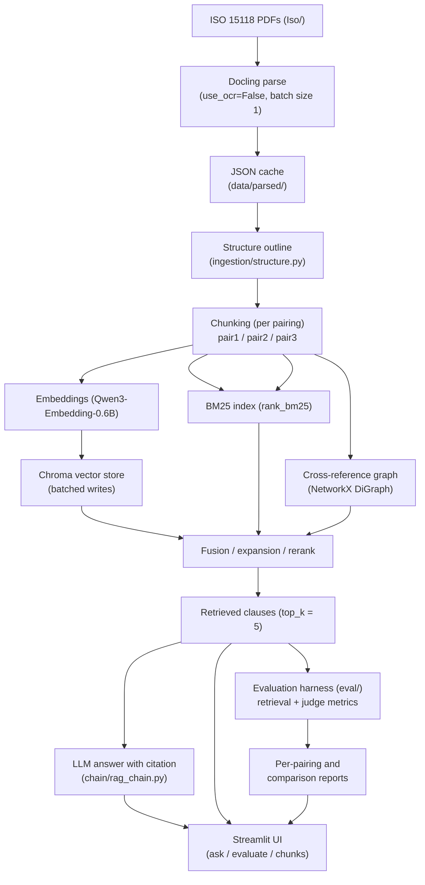
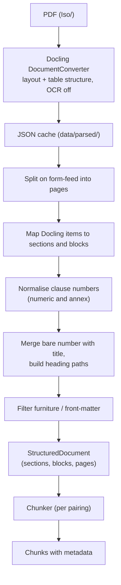
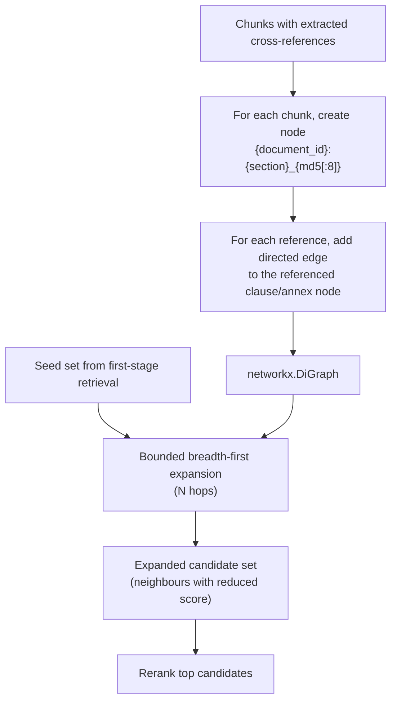
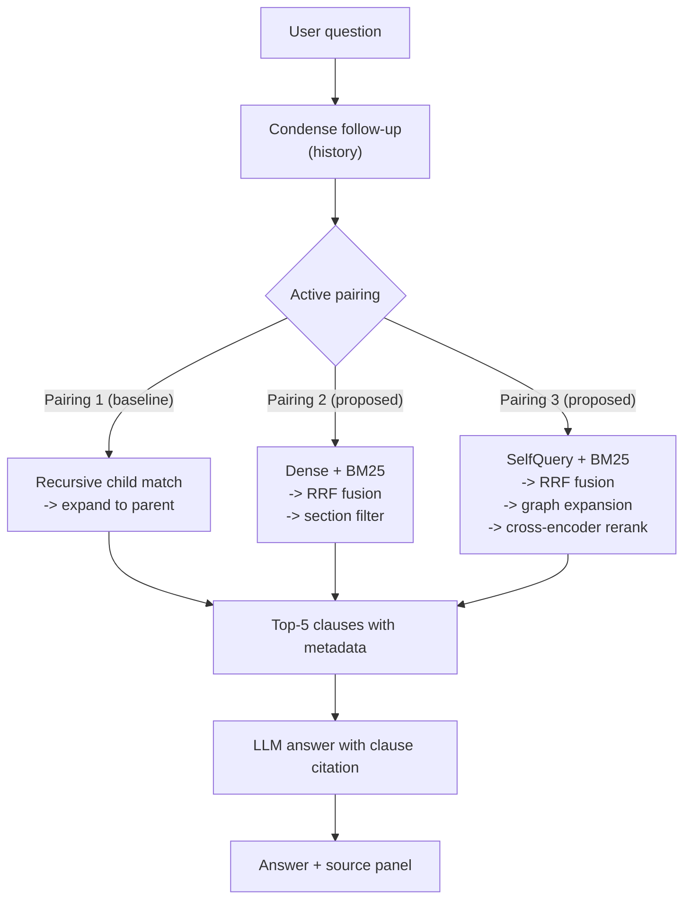
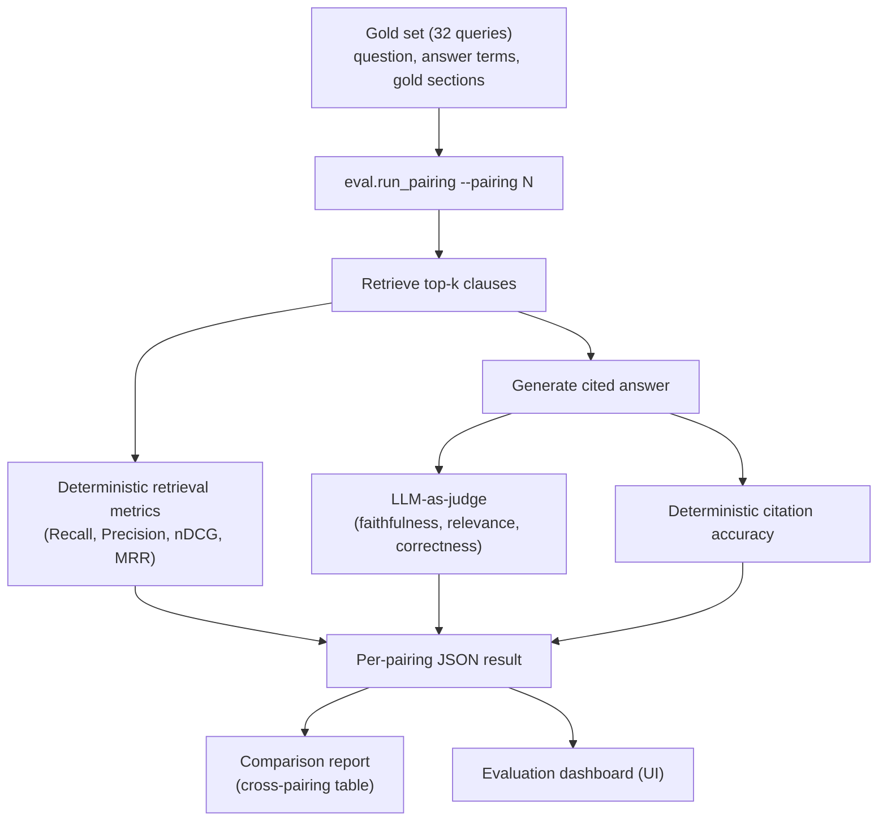

## Chapter 4: Proposed Methodology

### 4.1 Overall System Architecture

The system is organised as four cooperating stages — ingestion, indexing, retrieval and generation — wrapped by an evaluation harness and a presentation layer. The ingestion stage converts each PDF into a structure-preserving outline and then into retrievable chunks. The indexing stage embeds those chunks into a local vector store and, for the hybrid pairings, builds a sparse lexical index and a cross-reference graph. The retrieval stage turns a question into a ranked set of clauses, using a different mechanism for each pairing. The generation stage turns those clauses into a cited answer. The evaluation harness replays a fixed gold question set against a selected pairing and scores it, and the presentation layer exposes the same pipeline interactively.

The architecture is deliberately layered so that the parsing and chunking substrate is shared by all three pairings. This is what makes the comparison meaningful: because every pairing consumes the same parsed representation, a measured difference between pairings is attributable to chunking and retrieval rather than to parsing. Figure 4.1 shows the overall architecture.

**Fig. 4.1: Overall system architecture (ingestion, indexing, retrieval, generation)**



The design is constrained by the target environment. The development machine has 8 GB of memory, so Docling runs with batch size 1, only one pipeline is cached at a time, and the reranking step is guarded against resource failure. The corpus is licensed, so the system cites clauses rather than reproducing text, and the source panel shows the retrieved passages to the user. All retrieval components run locally; only the optional chat completion may use a network service.

### 4.2 System Workflow

The end-to-end workflow proceeds in eight steps.

1. **Corpus preparation.** The three PDFs in `Iso/` are selected by the loader. Conversion uses Docling with layout analysis, table-structure recovery, OCR disabled and batch size 1, because larger batches exhausted memory on an 8 GB machine. The parsed document is written to `data/parsed/` as JSON and reused on subsequent runs.

2. **Structure recovery.** Serialised text is split on the form-feed placeholder into pages, and Docling items are converted into sections and blocks. Clause numbers are normalised, heading paths are built, page numbers are attached to every block, and furniture or front-matter headings are filtered out.

3. **Chunking.** The user-selected pairing decides which chunker runs. Pairing 1 creates recursive child chunks of 256 tokens with 25 overlap and parent chunks of 1024 with 100 overlap. Pairing 2 creates section-bounded chunks of 512 with 50 overlap, keeping tables whole and splitting only above `TABLE_MAX_CHARS` on row boundaries. Pairing 3 creates standalone table chunks with captions, clause-level text chunks of the same size, and extracts cross-references.

4. **Indexing.** Chunks are embedded with the local embedding model and written to Chroma in batches through `add_documents_in_batches()`. For Pairings 2 and 3 a BM25 index is built over the same chunk texts. For Pairing 3 the cross-reference graph is constructed from the recorded references. Index freshness is checked so that a changed chunking fingerprint forces a rebuild.

5. **Retrieval.** The retriever for the active pairing is invoked with the (optionally condensed) question. Pairing 1 expands child hits to parents. Pairing 2 fuses dense and BM25 rankings by reciprocal rank fusion and can apply a `section_number` filter. Pairing 3 derives metadata constraints with the self-query retriever, ensembles the retrievers, expands along the graph, and reranks the top `RERANK_TOP_N` candidates with the cross-encoder, falling back to the unranked list if reranking fails.

6. **Generation.** The retrieved chunks, the conversation history and the system prompt are passed through the answer chain. The returned answer is displayed together with the exact passages used, so the user can check any citation against the source panel.

7. **Evaluation.** `python -m eval.run_pairing --pairing N --limit M` replays the gold set against a pairing and writes a JSON result; `python -m eval.comparison_report` renders the cross-pairing comparison. The same question set and the same judge configuration are used for every pairing.

8. **Presentation.** The UI builds pipelines through `build_pipeline()` in [`ui/pipeline_registry.py`](ui/pipeline_registry.py:39). `PIPELINE_NAMES` maps the three display names to the three branch cases, and each branch imports its own chunker and retriever, constructs the chain, and returns the retriever, chain, condensation chain, vector store and graph. Only the selected pipeline is cached in single-pipeline mode. In compare mode the registry builds each pipeline in turn, collects its answers, and releases it before building the next one, because holding all three pipelines simultaneously was out-of-memory on the development machine.

### 4.3 Document Ingestion and Structured PDF Parsing with Docling

The ingestion stage is implemented in [`ingestion/loader.py`](ingestion/loader.py:1), which drives Docling's `DocumentConverter` directly rather than using a Markdown export helper. This is a deliberate design decision. The convenience `ExportType.MARKDOWN` export returns one document per PDF with no page metadata, whereas section-based chunking and page attribution both depend on page boundaries. The loader therefore keeps a single document per PDF and derives page boundaries from a form-feed placeholder inserted during serialisation. Running headers and footers are stripped, and OCR is disabled because the source PDFs already contain a text layer. The converted structure is cached as JSON under `data/parsed/` so that repeated runs skip conversion entirely. The public entry point `load_iso_structures()` returns a list of `StructuredDocument` objects.

The choice of Docling [10] follows from the observation in Chapter 2 that layout-aware conversion is markedly more reliable than naive text extraction on complex, columned, table-bearing documents. ISO 15118 is exactly such a document: it contains multi-column layouts, normative tables whose rows carry binding requirements, and a nested clause hierarchy. A naive text extractor would interleave columns and flatten tables, destroying the structure that the downstream chunking depends on.

### 4.4 Structure Recovery: Headings, Annexes, Tables, and Page Boundaries

The structure-recovery pass is implemented in [`ingestion/structure.py`](ingestion/structure.py:1). It turns Docling's item labels into a clause-level outline: `section_header` items become sections, `TableItem`s become table blocks, clause numbers are normalised (numeric clauses such as `4.1.2`, annex labels such as `A` and `A.1`), and a heading emitted as two consecutive headers is merged into one clause number and title. Front-matter and furniture headings are dropped.

The decision to recover structure from Docling's structured labels rather than matching headings with a regular expression is central to the methodology. A Markdown-level heading regex misses annex headings and non-numeric headings and collapses large regions of the document into single oversized sections. Working from the parser's structured labels instead keeps annexes and lettered headings as first-class sections. The structure module also attaches a page number to every block, so that each chunk can carry its source page. Figure 4.2 shows the ingestion and structure-aware chunking workflow.

**Fig. 4.2: Document ingestion and structure-aware chunking workflow**



### 4.5 Chunking Strategy 1: Recursive Chunking with Parent-Child Retrieval (Baseline)

Pairing 1 is the baseline. It uses a generic recursive character splitter to produce small child chunks for matching and larger parent chunks for context. The child chunk size is 256 characters with 25 overlap, and the parent chunk size is 1024 with 100 overlap, as configured in [`config.py`](config.py:53). Retrieval matches against the small children and returns the enclosing parent, so that a matched fact is not answered out of its surrounding explanation. This represents the conventional RAG design and serves as the baseline against which the structure-aware pairings are measured.

The baseline deliberately carries no clause metadata: its chunks are not aligned to the document's section structure, so they have no `section_number`. This is why the section-based relevance signal is not applicable to Pairing 1, a fact that is recorded as a flag rather than dropped in the evaluation (see Chapter 6). The baseline is the reference point for every measured improvement attributed to structure-aware chunking, hybrid fusion, graph expansion or reranking.

### 4.6 Chunking Strategy 2: Section-Aware Chunking

Pairing 2 aligns chunk boundaries to the parsed clause/section structure. Chunks are created within section boundaries at a target size of 512 characters with 50 overlap, so that each chunk carries its section identity. Tables are kept whole, and only a table larger than `TABLE_MAX_CHARS = 4000` is split, on row boundaries, with the header row repeated. The chunker is implemented in [`ingestion/chunking_pair2.py`](ingestion/chunking_pair2.py:1) and consumes `list[StructuredDocument]`.

The rationale for section-aware chunking is that a clause is the natural unit of evidence in a standard. A chunk that begins and ends at clause boundaries carries a coherent meaning and a citable identity, whereas a fixed-window chunk may begin mid-sentence and carry no clause identity. The section-aware chunker therefore produces chunks that are better provenanced than the baseline, at the cost of a slightly less uniform chunk size.

### 4.7 Chunking Strategy 3: Table-First Chunking with Table Atomicity

Pairing 3 is the most structure-aware strategy. It produces standalone table chunks with their captions, clause-level text chunks of the same size as Pairing 2, and it records the cross-references found in each chunk. The chunker is implemented in [`ingestion/chunking_pair3.py`](ingestion/chunking_pair3.py:1).

Table atomicity is the defining constraint of this strategy. A normative table carries binding requirements row by row, so a table fragmented across chunk boundaries produces a retrieved fragment that may contain a row without its header or governing context — an unusable and potentially misleading unit of evidence. The shared helpers in [`ingestion/chunk_utils.py`](ingestion/chunk_utils.py:1) enforce atomicity: `pack_units()` fills a character budget with whole units, and `split_table_markdown()` breaks an oversized table on row boundaries while repeating the header row. A table is therefore never fragmented mid-row, and every table chunk remains interpretable on its own. The cross-references extracted during chunking become the edges of the graph described in §4.12.

### 4.8 Metadata Enrichment

Every chunk carries metadata that supports retrieval, filtering and citation. The metadata fields differ by chunk type, as shown in Table 4.1. The `document_id` identifies the source part, the `section_number` and `section_title` identify the clause, the `heading_path` records the full heading ancestry, and the page number records the source page. The `content_type` distinguishes text from table chunks, and the `cross_references` field records the clause and annex references extracted from the chunk.

**Table 4.1: Metadata fields per chunk type**

| Field | Text chunk (Pairing 2/3) | Table chunk (Pairing 3) | Baseline chunk (Pairing 1) |
|---|---|---|---|
| `document_id` | Yes | Yes | Yes |
| `section_number` | Yes | Yes | No |
| `section_title` | Yes | Yes | No |
| `heading_path` | Yes | Yes | No |
| `page_number` | Yes | Yes | Yes |
| `content_type` | `text` | `table` | `text` |
| `cross_references` | Yes (Pairing 3) | Yes (Pairing 3) | No |

The metadata is what makes clause-level citation possible: the generator can name the document and clause of each retrieved passage, and the deterministic citation-accuracy metric can check that the cited clause was actually retrieved.

### 4.9 Dense Vector Indexing with Qwen3-Embedding-0.6B

Chunks are embedded with a local sentence-transformer model, `Qwen/Qwen3-Embedding-0.6B`, and written to a persistent Chroma vector store. The embedding wrapper is implemented in [`models/embeddings.py`](models/embeddings.py:1). It normalises vectors, applies the model's built-in instruction prompt to queries only, and flattens Markdown tables before encoding so that the stored chunk text stays untouched. This last point is important: the source panel and any human inspection still show the original Markdown, while the encoder input is cleaned of separator rows that would waste vector space.

The choice of an instruction-aware embedder follows from the zero-shot dense retrieval work of Gao et al. [6]: the ISO corpus has no relevance labels, so a general, instruction-aware embedder is used rather than a task-fine-tuned QA encoder. The query-side instruction is applied to questions and the document side is left instruction-free, following the intended input formatting of the model. Because changing the embedding model, the prompt setting or the table-stripping setting changes the vectors, any such change invalidates the existing Chroma index and forces a rebuild.

### 4.10 BM25 Keyword Indexing

For Pairings 2 and 3, a BM25 index is built over the same chunk texts using `rank_bm25`. The lexical signal is complementary to the dense signal: BM25 [3] handles exact identifiers, clause numbers, message names and parameter symbols well, while dense retrieval handles paraphrase. The two are combined by reciprocal rank fusion, described next.

### 4.11 Hybrid Retrieval and Reciprocal Rank Fusion

Hybrid retrieval combines the dense and sparse rankings by reciprocal rank fusion [4]. The dense retriever returns a ranked list of chunks by vector similarity, and the BM25 retriever returns a ranked list by lexical score. Because the two score scales are not comparable, the fusion operates on rank positions rather than scores. For a document $d$ and a set of rankers $R$, the fused score is

$$
\text{RRF}(d) = \sum_{r \in R} \frac{1}{k + \text{rank}_r(d)}
$$

where $\text{rank}_r(d)$ is the 1-based rank of $d$ in ranker $r$'s list, and $k$ is a damping constant that controls the influence of low ranks. The fused list is then truncated to `TOP_K = 5`. The weighting of the vector and BM25 components (0.6 / 0.4 in [`config.py`](config.py:68)) controls how many candidates each side contributes. The choice of rank-based fusion over weighted score fusion follows the parameter-light default endorsed by [4] and avoids the score-calibration problem that makes weighted score fusion fragile.

### 4.12 Cross-Reference Graph Construction and Expansion

Pairing 3 builds a directed cross-reference graph over the clause references extracted during chunking. The graph is constructed in [`graph/builder.py`](graph/builder.py:1) as a `networkx.DiGraph` whose node identifiers are `{document_id}:{section}_{md5[:8]}` and whose edges come from the cross-references recorded during chunking. Node identifiers are qualified by document part so that identically numbered clauses in different parts do not collide. A breadth-first helper expands a seed set by a bounded number of hops and returns the neighbouring chunks with a reduced score.

The rationale for an explicit graph is that requirements in a standard frequently depend on other clauses: a clause may state a requirement "as specified in" another clause, or a table may reference definitions given elsewhere. A retriever that returns only the matching clause returns an incomplete unit of evidence; the dependent clauses must be pulled in as well. Unlike the entity-centred graph of Edge et al. [9], which is built by prompting a language model at ingestion time, this graph is deterministic and citation-derived: its edges are the standard's own "see 4.2" and "Annex A" references, which is cheaper and auditable. Figure 4.4 shows the graph construction and expansion workflow.

**Fig. 4.3: Cross-reference graph construction and expansion workflow**



### 4.13 Metadata-Filtered Retrieval (SelfQuery)

Pairing 3 also uses metadata-filtered retrieval, implemented with LangChain's `SelfQueryRetriever`. The self-query retriever derives metadata constraints from the question — for example, restricting the search to a particular `section_number` — and applies them as a filter on the vector store. This is useful for questions that name a clause explicitly, and it complements the hybrid fusion by narrowing the candidate set before ranking. Pairing 2 exposes a simpler metadata-filtered variant keyed on `section_number`.

### 4.14 Cross-Encoder Reranking

The final ranking of Pairing 3 is decided by a cross-encoder, `BAAI/bge-reranker-v2-m3` [7], implemented in [`models/reranker.py`](models/reranker.py:1). Unlike a bi-encoder, which encodes query and passage independently, the cross-encoder encodes the query–passage pair jointly, so query and passage tokens attend to one another. This yields a more accurate relevance score at a higher cost, which is why it is applied only as a second pass over the top `RERANK_TOP_N = 20` candidates, returning the top `TOP_K = 5`. The reranking step is wrapped in a guard so that a resource failure — for example, a GPU out-of-memory condition — returns the unranked list rather than failing the query. The sequence limit is raised to 1024 because table chunks exceed the default 512.

The design follows the principle established in Chapter 2 that the representation used for final ranking need not be the same as the one used for candidate generation [5]. The first stage is cheap and approximate; the second stage is more expensive and more accurate; and only the top candidates are reranked, which bounds the cost.

### 4.15 Answer Generation with Citation Grounding

Generation is implemented in [`chain/rag_chain.py`](chain/rag_chain.py:1) as two LangChain LCEL chains. The first is a condensation chain that rewrites a follow-up question into a standalone question using the conversation history. The second is the answer chain, whose system prompt confines the answer to the supplied context, requires a document and clause citation, and instructs the model to state that it lacks sufficient information otherwise. Retrieval is executed by the caller so that the identical context object feeds both the prompt and the UI source panel. The default chat model is a local `llama3.2:3b-instruct-q4_K_M` served through Ollama, with an optional OpenAI provider selectable by configuration.

The citation requirement is what makes grounding an evaluated property rather than an assumed one. Because the answer must name a clause, and because the deterministic citation-accuracy metric checks that the named clause was actually retrieved, a fluent but ungrounded answer fails the metric.

### 4.16 Baseline and Proposed Pipelines

The three pairings are the core abstraction of the project. Pairing 1 is the baseline; Pairings 2 and 3 are the proposed configurations. Table 4.2 lists the chunking parameters per pairing, and Table 4.3 lists the retrieval and generation configuration per pairing. Figure 4.4 shows the baseline and proposed pipeline paths.

**Table 4.2: Chunking parameters per pairing**

| Parameter | Pairing 1 (baseline) | Pairing 2 | Pairing 3 |
|---|---|---|---|
| Strategy | Recursive parent/child | Section-aware | Table-first |
| Child / chunk size | 256 (child), 1024 (parent) | 512 | 512 |
| Overlap | 25 (child), 100 (parent) | 50 | 50 |
| Section metadata | No | Yes | Yes |
| Table handling | Generic splitter | Atomic, split above 4000 on rows | Standalone table chunks, atomic |
| Cross-references | No | No | Yes |

**Table 4.3: Retrieval and generation configuration per pairing**

| Aspect | Pairing 1 (baseline) | Pairing 2 | Pairing 3 |
|---|---|---|---|
| Dense retrieval | Yes (parent-child) | Yes | Yes |
| BM25 | No | Yes | Yes |
| Fusion | None | RRF (0.6 / 0.4) | RRF (0.6 / 0.4) |
| Metadata filter | No | Yes (`section_number`) | Yes (SelfQuery) |
| Graph expansion | No | No | Yes (bounded BFS) |
| Reranking | No | No | Yes (cross-encoder, top 20) |
| Returned clauses | `TOP_K = 5` | `TOP_K = 5` | `TOP_K = 5` |
| Generation | Local LLM, cited | Local LLM, cited | Local LLM, cited |

**Fig. 4.4: Baseline (Pairing 1) versus proposed (Pairings 2/3) pipeline paths**



### 4.17 Evaluation Metrics and Methodology

The evaluation harness scores all pairings on the same gold question set with the same judge configuration. The metrics fall into four categories.

**Retrieval metrics.** Recall@k, Precision@k, nDCG@k and MRR at k = 1, 3, 5 and 10. These are deterministic and require no model calls, so they are the primary comparison signal. Relevance is answer-term based: a retrieved chunk is relevant to a query if its text contains any of the query's answer terms (case-insensitive). This works uniformly across all three pairings, because Pairing 1 chunks carry no section metadata. An additional section-based relevance signal is computed when both the query gold sections and the chunk section metadata are available. The metric definitions are implemented in [`eval/metrics.py`](eval/metrics.py:1): recall@k is 1.0 if any relevant document is in the top-k, precision@k is the fraction of the top-k that are relevant, reciprocal rank is $1/\text{rank}$ of the first relevant document, and nDCG@k uses binary relevance with the standard logarithmic discount.

**Chunk-quality metrics.** Chunk counts, mean and maximum chunk size, relevance density, boundary coherence, and counts of standalone table chunks and graph edges. These are produced by the judge and by [`scripts/inspect_chunks.py`](scripts/inspect_chunks.py:1).

**Generation metrics.** LLM-as-judge scores for faithfulness, answer relevance and answer correctness, at temperature 0 with one retry, plus deterministic citation accuracy. The judge is implemented in [`eval/judge.py`](eval/judge.py:1). Faithfulness asks whether every claim in the answer is supported by the retrieved context; answer relevance asks whether the answer addresses the question; answer correctness asks whether the answer agrees with the gold answer. Citation accuracy is computed deterministically, without a judge, by comparing the clause numbers cited in the answer with the sections actually retrieved.

**Efficiency metrics.** Indexing time, retrieval latency, end-to-end latency, index size, and tokens per query, recorded per run so that any quality gain can be weighed against its cost.

The judge runs at temperature 0 to reduce run-to-run variance and retries once on a malformed response. A score that cannot be computed is stored as `None` and flagged in the output rather than replaced with a default value, so that the report cannot overstate coverage. Figure 4.5 shows the evaluation workflow.

**Fig. 4.5: Evaluation workflow (gold set, retrieval metrics, LLM-as-judge, citation accuracy)**



### 4.18 Algorithms and Pseudocode

This section gives readable pseudocode for the four core algorithms: structure-aware chunking, reciprocal rank fusion, graph expansion, and cross-encoder reranking.

**Algorithm 4.1 — Structure-aware chunking with table atomicity**

```
INPUT: structures = list of StructuredDocument (sections, blocks, pages)
       max_chars = TABLE_MAX_CHARS
OUTPUT: chunks = list of Document with metadata

for each structure in structures:
    for each section in structure.sections:
        units = []
        for each block in section.blocks:
            if block.kind == "table":
                # tables are atomic; split only if oversized, on row boundaries
                parts = split_table_markdown(block.text, max_chars)
                for part in parts:
                    units.append((part, block.page, is_table=True))
            else:
                units.append((block.text, block.page, is_table=False))
        # pack whole units into chunks up to the target size
        packed = pack_units(units, target_size, splitter)
        for (text, page, is_table) in packed:
            metadata = {
                document_id, section_number, section_title,
                heading_path, page_number, content_type,
                cross_references: extract_references(text)
            }
            chunks.append(Document(text, metadata))
return chunks
```

**Algorithm 4.2 — Reciprocal rank fusion**

```
INPUT: ranked_lists = [dense_list, bm25_list], k = damping constant, top_k
OUTPUT: fused = top_k documents by fused score

scores = {}
for each list in ranked_lists:
    for rank, doc in enumerate(list, start=1):
        key = doc.id
        scores[key] = scores.get(key, 0) + 1 / (k + rank)
fused = sort(scores by score descending)
return fused[:top_k]
```

**Algorithm 4.3 — Cross-reference graph expansion**

```
INPUT: graph = DiGraph, seeds = list of nodes, hops = N, decay
OUTPUT: expanded = seeds plus neighbours with reduced score

expanded = {seed: 1.0 for seed in seeds}
frontier = list(seeds)
for hop in range(hops):
    next_frontier = []
    for node in frontier:
        for neighbour in graph.successors(node):
            if neighbour not in expanded:
                expanded[neighbour] = decay ** (hop + 1)
                next_frontier.append(neighbour)
    frontier = next_frontier
return expanded
```

**Algorithm 4.4 — Cross-encoder reranking with graceful degradation**

```
INPUT: query, candidates = list of documents, top_n, top_k
OUTPUT: reranked = top_k documents

try:
    head = candidates[:top_n]
    pairs = [(query, doc.text) for doc in head]
    scores = cross_encoder.predict(pairs)
    ranked = sort(head by score descending)
    return ranked[:top_k]
except Exception:            # e.g. GPU out-of-memory
    return candidates[:top_k]  # degrade to the unranked list
```

### 4.19 Methodology Summary

This chapter presented the methodology of the system. It described the four-stage architecture and the eight-step workflow; the Docling-based ingestion that keeps each PDF as one document with page boundaries; the structure-recovery pass that turns parser labels into a clause-level outline; the three chunking strategies, with table atomicity as a shared constraint; the metadata that makes clause-level citation possible; the dense indexing with an instruction-aware embedder; the BM25 lexical index; the hybrid retrieval fused by reciprocal rank fusion; the deterministic cross-reference graph and its bounded expansion; the metadata-filtered retrieval; the guarded cross-encoder reranking; and the citation-grounded generation. It then defined the baseline and proposed pipelines, the evaluation metrics and methodology, and the core algorithms. The next chapter describes how these methods are implemented in the repository.
