## Chapter 6: Intermediate Results and Discussion

### 6.1 Experimental Objectives

The experiment compares the three chunking × retrieval pairings on a common gold question set, with the objective of attributing measured differences to specific design decisions. The baseline is Pairing 1 (recursive chunking with parent-child retrieval, no clause metadata, no graph, no reranking). The proposed configurations are Pairing 2 (section-aware chunking with hybrid dense/BM25 retrieval fused by reciprocal rank fusion) and Pairing 3 (table-first chunking with a cross-reference graph, metadata-filtered retrieval and cross-encoder reranking). The experiment answers three questions: which pairing retrieves the governing clause most reliably, which pairing generates the best-grounded and best-cited answers, and what each quality gain costs in latency, index size and tokens per query.

### 6.2 Experimental Environment

The experiment was run on the development machine described in Chapter 5, an 8 GB workstation with device resolution `cuda > mps > cpu`. All components ran locally: the embedding model `Qwen/Qwen3-Embedding-0.6B`, the reranker `BAAI/bge-reranker-v2-m3`, the Chroma vector store, the BM25 index, the NetworkX graph, and the chat model `llama3.2:3b-instruct-q4_K_M` served through Ollama. The judge ran at temperature 0 with a single retry. Each pairing was evaluated with a single run (`--runs 1`), so the results are point measurements without variance; this limitation is discussed in §6.12.

### 6.3 Dataset and Evaluation Query Design

The evaluation dataset is a 32-query gold set built by [`eval/build_gold_set.py`](eval/build_gold_set.py:1) and stored in [`eval/gold_set.json`](eval/gold_set.json:1). Each entry records the question, a gold answer, the answer terms used for deterministic relevance matching, and the gold clause references of the form `document_id:section_number`. The questions cover the three parts of the standard and span six categories: definitional queries ("what is an actor"), procedural queries ("how is a communication session established"), parameter lookups ("what is the nominal AC charging voltage"), cross-reference queries ("which clauses reference Annex A"), annex lookups ("what does Annex C describe"), and comparison queries ("compare AC charging and DC charging"). The two relevance signals — answer-term matching and section matching — are used together: answer-term matching provides a uniform fallback for Pairing 1, whose chunks carry no clause metadata, while section matching provides a clause-level signal for Pairings 2 and 3.

### 6.4 Golden Question-Answer Dataset

The gold set contains 32 queries. The distribution by category is: definitional (14), procedural (6), parameter lookup (5), cross-reference (2), annex lookup (2), and comparison (2). Each query carries between one and several gold relevant sections, reflecting the fact that a single requirement in a standard is often spread across a definition clause, a normative clause and an annex. The gold answers are short extracts from the standard, and the answer terms are the exact identifiers or phrases that a correct answer must contain. The gold set is fixed, so every pairing is scored on exactly the same questions with exactly the same relevance criteria.

### 6.5 Baseline Configuration (Pairing 1)

The baseline is Pairing 1: recursive chunking with parent-child retrieval. Child chunks are 256 characters with 25 overlap, parent chunks are 1024 with 100 overlap, and retrieval matches against the children and returns the enclosing parent. The baseline carries no clause metadata, no BM25 index, no graph and no reranking. It produced 2084 chunks with a mean size of 709.5 characters.

### 6.6 Proposed Configurations (Pairings 2 and 3)

Pairing 2 uses section-aware chunking (512 characters, 50 overlap, atomic tables) with hybrid dense/BM25 retrieval fused by reciprocal rank fusion (vector weight 0.6, BM25 weight 0.4) and an optional `section_number` filter. It produced 2128 chunks with a mean size of 678.2 characters. Pairing 3 uses table-first chunking (standalone table chunks with captions, clause-level text chunks, extracted cross-references) with self-query metadata filtering, hybrid fusion, bounded graph expansion and cross-encoder reranking of the top 20 candidates. It produced 2007 chunks with a mean size of 709.6 characters.

### 6.7 Evaluation Metrics

The metrics are those defined in §4.17. Retrieval metrics (Recall@k, Precision@k, nDCG@k, MRR) are deterministic and answer-term based, with a section-based signal where clause metadata is available. Generation metrics (faithfulness, answer relevance, answer correctness) are LLM-as-judge scores at temperature 0, and citation accuracy is deterministic. Efficiency metrics (indexing time, retrieval latency, end-to-end latency, index size, tokens per query) are recorded per run. Uncomputable metrics are recorded as `None` and flagged rather than dropped.

Table 6.1 presents the complete set of measured results in one place, so that the retrieval, generation and efficiency figures can be read together. The detailed breakdowns follow in Tables 6.2, 6.3 and 6.4.

**Table 6.1: Summary of measured results across pairings (single run, 32 queries)**

| Metric | Pairing 1 (baseline) | Pairing 2 | Pairing 3 |
|---|---|---|---|
| Recall@5 | 0.9375 | 0.8750 | 1.0000 |
| Precision@5 | 0.5437 | 0.6062 | 0.7188 |
| nDCG@5 | 0.8920 | 0.8363 | 0.9401 |
| MRR | 0.9010 | 0.8529 | 0.9307 |
| Recall@5 (section) | N/A | 0.9062 | 1.0000 |
| Faithfulness | 0.4847 | 0.5690 | 0.4878 |
| Answer relevance | 0.5297 | 0.6910 | 0.6950 |
| Answer correctness | 0.4772 | 0.7010 | 0.5269 |
| Citation accuracy | 0.0000 | 0.9600 | 0.9481 |
| Index time (s) | 12.520 | 11.151 | 13.049 |
| Retrieval latency (ms) | 9487.53 | 102.97 | 13154.78 |
| End-to-end latency (ms) | 2910.44 | 2660.50 | 6531.60 |
| Index size (MiB) | 54.716 | 29.430 | 27.286 |
| Tokens per query | 2315.94 | 2698.37 | 1890.00 |

### 6.8 Retrieval Results

Table 6.2 presents the retrieval metrics for the three pairings at k = 5, and Figure 6.1 compares them. Pairing 3 achieves the best retrieval quality on every answer-term metric: Recall@5 = 1.0000, nDCG@5 = 0.9401 and MRR = 0.9307. Pairing 1 is second on nDCG@5 (0.8920) and MRR (0.9010), and Pairing 2 is third on those two metrics (0.8363 and 0.8529) but second on Precision@5 (0.6062). The section-based signal, available only for Pairings 2 and 3, shows Pairing 3 at Recall@5 = 1.0000 and Pairing 2 at 0.9062.

**Table 6.2: Retrieval metric comparison**

| Metric | Pairing 1 (baseline) | Pairing 2 | Pairing 3 |
|---|---|---|---|
| Recall@1 | 0.8750 | 0.8125 | 0.9063 |
| Recall@3 | 0.9375 | 0.8750 | 0.9375 |
| Recall@5 | 0.9375 | 0.8750 | 1.0000 |
| Recall@10 | 0.9375 | 0.9375 | 1.0000 |
| Precision@5 | 0.5437 | 0.6062 | 0.7188 |
| nDCG@5 | 0.8920 | 0.8363 | 0.9401 |
| MRR | 0.9010 | 0.8529 | 0.9307 |
| Recall@5 (section) | N/A | 0.9062 | 1.0000 |
| MRR (section) | N/A | 0.8607 | 0.9516 |

**Fig. 6.1: Retrieval metric comparison across pairings**

```mermaid
xychart-beta
    title "Retrieval metrics at k=5 across pairings"
    x-axis ["Recall@5", "Precision@5", "nDCG@5", "MRR"]
    y-axis "Score" 0 --> 1
    bar [0.9375, 0.5437, 0.8920, 0.9010]
    bar [0.8750, 0.6062, 0.8363, 0.8529]
    bar [1.0000, 0.7188, 0.9401, 0.9307]
```

The retrieval result is consistent with the design rationale. Pairing 3 combines the structure-aware chunking of Pairing 2 with graph expansion and cross-encoder reranking, and the reranker — which reads query and passage together — is able to promote the governing clause above superficially similar passages. The graph expansion pulls in clauses that a matched clause explicitly depends on, which raises recall to 1.0. Pairing 2's lower nDCG@5 and MRR relative to the baseline are notable: section-aware chunking produces better-provenanced chunks, but without reranking the fused ranking places the governing clause slightly lower on average. This is the clearest evidence in the experiment that chunking quality and ranking quality are separable, and that structure-aware chunking alone does not guarantee a better ranking.

### 6.9 Generation Quality and Citation Accuracy Results

Table 6.3 presents the generation metrics, and Figure 6.2 compares generation quality against latency. Pairing 2 achieves the best generation quality on all three judged dimensions: faithfulness 0.5690, answer relevance 0.6910 and answer correctness 0.7010. Pairing 3 is close on answer relevance (0.6950) but lower on faithfulness (0.4878) and answer correctness (0.5269). Pairing 1 is lowest on all three (0.4847, 0.5297, 0.4772). On citation accuracy, Pairing 2 achieves 0.9600 and Pairing 3 achieves 0.9481; Pairing 1 records 0.0000, because its chunks carry no section metadata, so the clause numbers cited in its answers cannot match the retrieved sections.

**Table 6.3: Generation quality and citation accuracy comparison**

| Metric | Pairing 1 (baseline) | Pairing 2 | Pairing 3 |
|---|---|---|---|
| Faithfulness | 0.4847 | 0.5690 | 0.4878 |
| Answer relevance | 0.5297 | 0.6910 | 0.6950 |
| Answer correctness | 0.4772 | 0.7010 | 0.5269 |
| Citation accuracy | 0.0000 | 0.9600 | 0.9481 |
| Relevance density | 0.1844 | 0.2170 | 0.2284 |
| Boundary coherence | 0.4141 | 0.2800 | 0.3438 |

**Fig. 6.2: Generation quality and latency comparison across pairings**

```mermaid
xychart-beta
    title "Generation quality and end-to-end latency"
    x-axis ["Faithfulness", "Ans. relevance", "Ans. correctness", "Citation acc."]
    y-axis "Score" 0 --> 1
    bar [0.4847, 0.5297, 0.4772, 0.0000]
    bar [0.5690, 0.6910, 0.7010, 0.9600]
    bar [0.4878, 0.6950, 0.5269, 0.9481]
```

The generation result is the most interesting finding of the experiment. Pairing 3 wins retrieval but does not win generation: its faithfulness and answer correctness are lower than Pairing 2's, even though its retrieved evidence is at least as good. This is a direct illustration of the principle established in Chapter 1 that retrieval failure and generation failure are independent. Better retrieval does not automatically produce a better-grounded answer, because the generator can still produce statements that the evidence does not support, or omit the clause citations that make the answer verifiable. Pairing 2's higher faithfulness and correctness suggest that its section-bounded chunks, which are more self-contained than Pairing 3's table-first chunks, give the generator a cleaner context to read from. The citation-accuracy result confirms that both structure-aware pairings make clause-level citation possible, while the baseline cannot, because it has no clause identity to cite.

### 6.10 Context Size, Index Size, and Latency Analysis

Table 6.4 presents the efficiency metrics. Pairing 2 is the fastest end-to-end (2660.5 ms) and has the smallest index among the two hybrid pairings (29.43 MiB), while Pairing 3 is the slowest (6531.6 ms) and has the smallest index overall (27.286 MiB). Pairing 1 has the largest index (54.716 MiB) because its parent-child structure stores both children and parents. Pairing 3 uses the fewest tokens per query (1890), followed by Pairing 1 (2315.94) and Pairing 2 (2698.37).

**Table 6.4: Efficiency comparison (index time, retrieval latency, end-to-end latency, index size, tokens per query)**

| Metric | Pairing 1 (baseline) | Pairing 2 | Pairing 3 |
|---|---|---|---|
| Indexing time (s) | 12.520 | 11.151 | 13.049 |
| Retrieval latency (ms) | 9487.53 | 102.97 | 13154.78 |
| End-to-end latency (ms) | 2910.44 | 2660.50 | 6531.60 |
| Index size (MiB) | 54.716 | 29.430 | 27.286 |
| Tokens per query | 2315.94 | 2698.37 | 1890.00 |
| Chunks | 2084 | 2128 | 2007 |
| Mean chunk size (chars) | 709.5 | 678.2 | 709.6 |

The retrieval-latency figures require care in interpretation. The mean retrieval latency for Pairing 1 (9487.53 ms) and Pairing 3 (13154.78 ms) is dominated by a small number of outliers: in the per-query data, Pairing 1 has a single query at 300360 ms and Pairing 3 has queries at 305949 ms, 17383 ms and 16661 ms, while the median retrieval latency for both is on the order of tens of milliseconds. Pairing 2's mean retrieval latency (102.97 ms) is not distorted by such outliers and reflects the typical cost of hybrid fusion without graph expansion and reranking. The end-to-end latency is the more stable comparison: Pairing 2 is the most responsive at 2660.5 ms, Pairing 3 is the slowest at 6531.6 ms because of the cross-encoder reranking pass, and Pairing 1 is intermediate at 2910.4 ms. The efficiency result therefore shows a genuine trade-off: Pairing 3 buys the best retrieval quality at the cost of the highest end-to-end latency, while Pairing 2 achieves the best generation quality and the lowest latency.

### 6.11 Comparative Discussion

The measured results support three conclusions.

First, **Pairing 3 wins retrieval**. Its Recall@5 of 1.0, nDCG@5 of 0.9401 and MRR of 0.9307 are the best of the three, and its section-based Recall@5 of 1.0 confirms that the improvement is at the clause level, not merely at the answer-term level. The mechanisms responsible are the cross-encoder reranker, which reads query and passage together and promotes the governing clause, and the graph expansion, which pulls in clauses that a matched clause depends on. This is the empirical answer to the research question posed in Chapter 1: for clause-accurate retrieval over a standards corpus, the combination of structure-aware chunking, hybrid fusion, graph expansion and reranking is the strongest configuration.

Second, **Pairing 2 wins generation quality and latency**. Its faithfulness (0.5690), answer correctness (0.7010) and citation accuracy (0.9600) are the best of the three, and its end-to-end latency (2660.5 ms) is the lowest. The likely reason is that its section-bounded chunks are more self-contained than Pairing 3's table-first chunks, giving the generator a cleaner context. This is a genuine and somewhat counter-intuitive result: the pairing with the best retrieval is not the pairing with the best generation, which demonstrates that the two stages must be measured separately.

Third, **the baseline is competitive on retrieval but fails on citation**. Pairing 1's Recall@5 (0.9375) and MRR (0.9010) are close to Pairing 3's, which shows that a well-tuned conventional pipeline is a strong retrieval baseline. But its citation accuracy is 0.0000, because its chunks carry no clause identity, so it cannot produce a verifiable clause citation. This is the clearest demonstration of the value of structure-aware chunking: the benefit is not only in retrieval ranking but in the ability to cite the governing clause at all.

The overall recommendation that follows is that Pairing 2 is the best default for accuracy-critical and latency-sensitive use, because it is both the generation-quality winner and the fastest, while Pairing 3 is the best choice when retrieval recall is the dominant requirement and the additional latency of reranking is acceptable.

### 6.12 Limitations

The results must be read with the following limitations in mind.

**Single run, no variance.** Each pairing was evaluated with a single run (`--runs 1`), so the reported values are point measurements without confidence intervals. The judge runs at temperature 0 to reduce variance, but run-to-run variation has not been quantified. Multi-run variance analysis is identified as future work.

**Judge coverage differs across pairings.** The judge coverage recorded in the result files is 32 queries for Pairing 1 and Pairing 3 but 10 queries for Pairing 2. The generation metrics for Pairing 2 are therefore computed over a smaller judged subset than those for the other pairings, which weakens the direct comparability of the faithfulness, answer-relevance and answer-correctness figures. Citation accuracy, being deterministic, is computed over all queries that cite a clause.

**Retrieval latency is outlier-dominated.** The mean retrieval latency for Pairings 1 and 3 is distorted by a few very slow queries, so the mean is not a reliable summary of typical retrieval cost. The end-to-end latency is the more stable comparison.

**Section recall is not applicable to the baseline.** Pairing 1's chunks carry no `section_number`, so the section-based relevance signal cannot be computed for it. This is recorded as a flagged `None` rather than dropped, and it is the reason the baseline's citation accuracy is 0.0000.

**Answer-term relevance is a proxy.** The deterministic retrieval metrics use answer-term matching, which is a proxy for true relevance. A chunk that contains an answer term is counted as relevant even if it does not govern the question, and a chunk that governs the question but phrases it differently may be missed. The section-based signal mitigates this for Pairings 2 and 3 but is not available for the baseline.

**Small, fixed corpus and gold set.** The corpus is three documents and the gold set is 32 queries, so the results characterise this corpus rather than standards text in general. The gold set is hand-built and its relevance judgements are not independently adjudicated.

**Parsing and table limitations.** The structure recovery depends on Docling's labels; a parsing failure would propagate into chunking and retrieval. Oversized tables are split on row boundaries with the header repeated, which preserves row integrity but may still separate a table from its governing clause.

### 6.13 Chapter Summary

This chapter presented the measured results of the three pairings on a common 32-query gold set. Pairing 3 achieved the best retrieval quality (Recall@5 = 1.0, nDCG@5 = 0.9401, MRR = 0.9307), while Pairing 2 achieved the best generation quality (faithfulness 0.5690, answer correctness 0.7010, citation accuracy 0.9600) and the lowest end-to-end latency (2660.5 ms). The baseline was competitive on retrieval but could not cite clauses, because its chunks carry no clause identity. The results demonstrate that retrieval quality and generation quality are separable, and that structure-aware chunking is what makes clause-level citation possible. The limitations of the single-run measurement, the differing judge coverage, the outlier-dominated retrieval latency and the small fixed corpus were stated explicitly. The next chapter concludes the report and identifies the future work that these limitations motivate.
